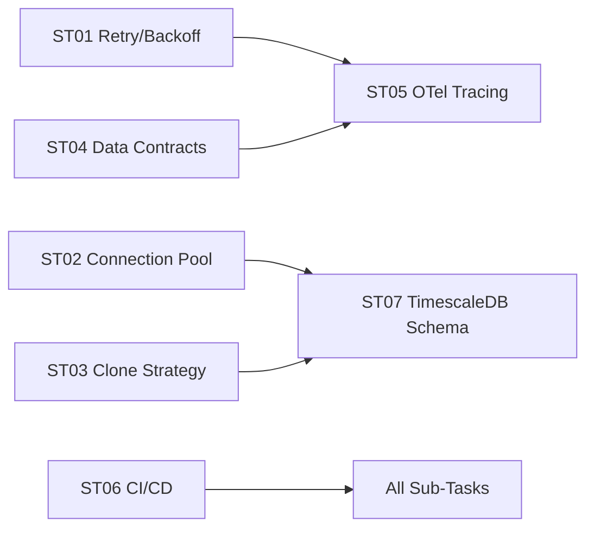
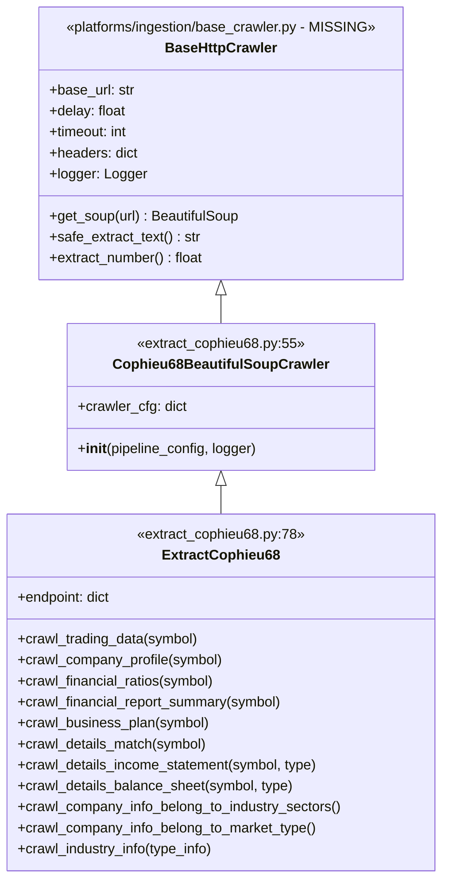
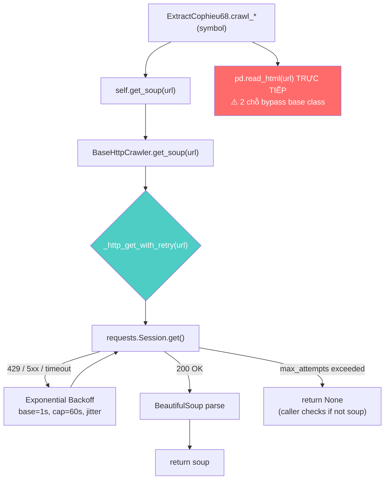

# @.github\skills\copilotinstructions\SKILL.md  Đọc để hiều context đi

---

**Status:** active  **Date:** 2026-10-22

---

### 👤 User

@.github\skills\copilotinstructions\SKILL.md  Đọc để hiều context đi

---

### 🤖 Assistant

> 🔧 called: read_file


> 🔧 **read_file** — .github\skills\copilotinstructions\SKILL.md

### 🤖 Assistant

Đọc xong. Đây là **skill manifest** định nghĩa luồng làm việc cho AI assistant trong môi trường đa dự án. Dưới đây là tóm tắt context:

---

## Hiểu về SKILL.md này

### Mục đích
File này là **routing guide** — không phải skill kỹ thuật thông thường, mà là **meta-instruction** quy định cách AI phải *tra cứu tri thức* trước khi xử lý bất kỳ yêu cầu nào.

### 2 nguồn tri thức (theo thứ tự ưu tiên)

| Ưu tiên | Vị trí | Vai trò |
|---|---|---|
| **1 – Động** | `./export_task/` (trong repo này) | Session logs, bài học, fix patterns của project này |
| **2 – Lõi** | `C:\Users\Admin\.ai_workspace\allskill` | Chuẩn mực code dùng chung toàn bộ dự án |

### Luật then chốt
1. **Override Rule**: `export_task/` luôn ghi đè `allskill/` nếu mâu thuẫn
2. **Bắt buộc quét `export_task/`** trước khi viết code hay phân tích
3. **Đóng gói session**: Sau task phức tạp → đề xuất tóm tắt lưu vào `export_task/`
4. **Phân loại → Khớp skill → Tư vấn kiểu senior** (nguyên nhân + trade-off + risk)

### Điều tôi cần làm ngay bây giờ

Theo đúng luồng thực thi, tôi cần quét `./export_task/` trong repo này để nắm context hiện tại của project. Bạn muốn tôi làm điều đó không, hay bạn có yêu cầu cụ thể cần xử lý?

---

### 👤 User

Đọc @e@export_task\  đi

---

### 🤖 Assistant

> 🔧 called: list_files


> 🔧 **list_files** — export_task

### 🤖 Assistant

> 🔧 called: read_file, read_file


> 🔧 **read_file** — export_task\bob-task-499c964b85873321a1f92a078cb27244-2026-10-21.md

> 🔧 **read_file** — export_task\bob-task-a18ea90b0ae5d05a1cf7ed388c5514d6-2026-10-21.md

### 🤖 Assistant

> 🔧 called: read_file, read_file

Now let me read the remaining session files to get the full picture:

> 🔧 **read_file** — export_task\session_2026_09_12_docker_and_dependencies.md

> 🔧 **read_file** — export_task\session_2026_09_12_pipeline_debugging_and_path_fix.md

### 🤖 Assistant

> 🔧 called: read_file, read_file


> 🔧 **read_file** — export_task\session_2026_09_13_agent_training_and_skill_sync.md

> 🔧 **read_file** — export_task\session_2026_09_14_debug_and_fix.md

### 🤖 Assistant

Context đã được nạp đầy đủ. Dưới đây là tổng hợp toàn bộ bức tranh dự án:

---

## 📋 Context Tổng Hợp — DataOps Pipeline WebCraw

### 🏗️ Kiến trúc & Stack thực tế

| Tầng | Tech | Ghi chú |
|---|---|---|
| **Ingestion** | `pandas.read_html` + `lxml` | Crawl cophieu68.vn |
| **Bronze** | MinIO (Parquet via `s3fs` + `pyarrow.dataset`) | Schema enforcement + DQ audit |
| **Silver** | Polars 1.12 | Transform + clean |
| **Gold/Serving** | PostgreSQL (staging → normalized) | Upsert qua pre-written SQL scripts |
| **Orchestration** | Prefect 2.14 | Flow management |
| **Infra** | Docker Compose | MinIO, Postgres, Prefect, Spark |

---

### ✅ Những gì đã hoàn thành (sessions 09-10 → 10-21)

**Session 09-10 → 09-14:**
- Fix logger không ghi file → thêm 13 entries `logger_config.yaml`
- Fix `symbol is null` 100% → inject trước DQ check
- Fix Polars S3 write → rewrite dùng `s3fs` + `pyarrow.dataset`
- Fix MinIO/PG credentials mismatch
- Tạo dbt skeleton + `profiles.yml`
- Auto-create bucket `lakehouse` khi write
- Fix `_DEFAULT_CONFIG_PATH` sai
- Thêm `lxml==5.3.0` vào `requirements.txt`
- Rewrite `.gitignore`

**Session 10-21 (gần nhất):**
- Xóa code gen SQL phức tạp khỏi schema — dùng scripts có sẵn trong `flows/sql/`
- Refactor `flows/common/base_config.py` — simplify `BaseExecutor` + `BasePipelineOrchestrator`
- Fix `flows/common/__init__.py` — import đúng từ `base_config.py`
- Move `_normalize_numeric_value` + `_normalize_date_value` từ `serving.py` → `ingestion/dto/extract_models.py`
- Rewrite `serving.py` — xóa schema-registry dependency, đơn giản hóa `ServingProcessor`
- Fix `bronze.py` — khôi phục helpers `_profile`, `_apply_dq`, `_flatten`, `_audit_cols`
- Fix `logger_setup.py` — đường dẫn config/log đúng

---

### ⏭️ Việc còn lại

1. **Verify MinIO + PostgreSQL** đang chạy
2. **Chạy pipeline** và kiểm tra `logs/etl/etl.log`
3. **Implement dbt models** thực sự cho Silver/Gold
4. **Kiểm tra imports** `flows.shared.*` → `flows.common.*`
5. **Thêm lại `.env.example`** (bị xóa trong rebase)
6. Branch hiện tại: `20261021_optimize_and_simplize`

---

Bạn muốn tiếp tục từ đâu?

---

### 👤 User

Tiến hành đọc file @PLAN_REPO01_WebCraw_production.md  trước đi và tham khảo kiến thức này: Tông hợp kiến thức kiến trúc

1. Byzantine Fault Tolerance (BFT) & Silent Data Corruption
 - Byzantine Node lỗi xảy ra khi có 3 nhóm này gây ra: Silent Data Conrruption (Lỗi vi mạch), Lỗi Firmware Ổ cứng (Ghi dữ liệu sai vao đĩa bị rác), mạng méo mó( bit TCP/IP bị lệch)
=> Thuật toán Raft đọc sai dẫn đến sai lệch leader - follower.

Tradeoffs: Crash-Tolerance vs Byzantine-Tolerance
+ Crash Fault Tolerance - Paxos: Node bị sập nguồn, cháy ổ cứng; công thức bầu là N= 2f+1, Để chịu dc 1 node sập (f=1) thì ít nhất 1 cụm phải có 3 node
+ Byzantine-Tolerance: Node báo dữ liệu sai, hợp tác với nhau đánh lừa mạng: công thức N=3f+1, giống như CFT nhưng thêm 1 case là có trễ mạng hay không

3 pha để giải quyết: Pre-prepare, prepare và commit
=> Thông lượng Throughput sụp đổ: Các node check lẫn nhau dẫn đến tăng mức độ phức tạp / Độ trễ

=> Ko dùng cho Kafka, Spark, Cassandra, Spanner/ Nên dùng cho Storage và Validation

Tính thực chiến: 
+ File-level Checksums(HDFS, S3, ZFS)
	Chống silent Data Corruption
	Khi dữ liệu được ghi vào S3 hoặc HDFS, một giá trị Checksum (như CRC32C hoặc MD5) được tính toán và lưu siêu dữ liệu (Metadata) riêng rẽ.
	Khi Data Node chạy tiến trình Background Scanner (hoặc khi đọc file), nếu phát hiện Checksum của block hiện tại không khớp với Checksum đã lưu, nó lập 	tức tự đánh dấu bản thân là “Byzantine/Corrupted”.
	NameNode/Control Plane sẽ tự động cô lập block rác đó và copy một bản trung thực từ Replica khác đè lên.
+ Merkle Trees
	- Ứng dụng: Để 2 node phân tán có dung lượng lớn có thể check lẫn nhau là chúng có dữ liệu giống nhau mà ko cần gửi dữ liệu (VD: 10TB) qua mạng.
		Dữ liệu được chia nhỏ, mỗi mảnh được băm (Hash) tạo thành các nốt lá (Leaf nodes).
		Các nốt lá được băm gộp lên dần cho đến khi ra được một Root Hash duy nhất đại diện cho cả 10TB.
		Khi 2 Node muốn đối soát (Anti-entropy), chúng chỉ trao đổi Root Hash (dài vài byte). Nếu khớp, 10TB dữ liệu giống nhau 100%.
		Nếu sai, chúng duyệt cây từ trên xuống để tìm ra chính xác Data Block nào bị sai lệch (Corrupted) và chỉ tải lại đúng Block đó qua mạng.


Trong kiến trúc Data Mesh đa miền (Multi-domain), một Data Product (như sales_events) có thể bị nhiễm rác do logic nghiệp vụ lỗi từ team Upstream. Đây là một dạng Organizational Byzantine Fault (Lỗi Byzantine cấp tổ chức).
Giải pháp: Xây dựng kiến trúc Zero-Trust. Đội Data Platform không “tin tưởng mù quáng” vào dữ liệu Upstream. Họ triển khai các Data Contracts và dùng công cụ như dbt-expectations hoặc Great Expectations để chạy Cross-validation (kiểm tra phân phối, tính duy nhất) như một chiếc “Circuit Breaker” trước khi cho phép dữ liệu vào Data Warehouse.
//////////////////////////////////////////

2. Thiết kế theo định hướng CAP & PACELC
Consistency (C - Tính Nhất quán): Mọi thao tác Đọc (Read) đều nhận được bản ghi mới nhất vừa được Ghi (Write) thành công, hoặc nhận được báo lỗi. Không bao giờ có chuyện user này đọc thấy dữ liệu cũ, user kia thấy dữ liệu mới (No Stale Data).
Availability (A - Tính Sẵn sàng): Mọi request không báo lỗi (non-failing node) đều nhận được phản hồi, dù đó có thể là dữ liệu cũ (Stale data). Hệ thống không bao giờ được phép chặn user.
Partition Tolerance (P - Chịu đứt gãy mạng): Hệ thống vẫn tiếp tục vận hành bình thường dù các bản tin bị rớt, hoặc mất kết nối mạng toàn phần giữa một số node với nhau (Ví dụ: Đứt cáp quang giữa Datacenter A và B).

Trong hệ thống distribution thì yếu tố P phải bắt buộc, do đó có 2 mô hình duy nhất là PA và PC
Hoặc là ưu tiên tính sẵn sàng, hoặc là ưu tiên tính nhất quán

Case consistency:
Để đảm bảo Consistency (C) khi bị chia cắt, hệ thống bắt buộc phải cấu hình nguyên tắc Quorum (Đa số). Phương trình Quorum kinh điển: W + R > N

N: Tổng số node (Replication factor). Phải luôn là số lẻ (3, 5, 7) để tránh hòa phiếu.
W: Số node tối thiểu phải xác nhận Ghi (Write) thành công.
R: Số node phải truy vấn để Đọc (Read) thành công.
Thực chiến: Cấu hình Kafka (Hệ thống CP / Strong Consistency) Giả sử bạn triển khai một topic Kafka lưu trữ giao dịch tài chính với N=3. Để hệ thống hoàn toàn chống mất dữ liệu và tránh Split-Brain, bạn bắt buộc phải cấu hình:

# 1. Server config (Kafka broker)
# Yêu cầu ít nhất 2 replicas phải đồng bộ mới cho phép Ghi
min.insync.replicas=2

# 2. Producer config (Client)
# Producer phải chờ tất cả in-sync replicas (ISR) phản hồi
acks=all


Nhưng trong điều kiện mạng bình thường thì sẽ phải ưu tiên theo mô hình EL hoặc EC
hoặc là ưu tiên tính latency, giảm độ trễ, hoặc là tính consistency


Case Availability
Đối với các hệ thống Tracking Hành vi người dùng (Clickstream, Giỏ hàng) hoặc hệ thống IoT Ingestion, việc “không bao giờ bỏ sót sự kiện” quan trọng hơn việc “dữ liệu phải chính xác tới từng mili-giây”. Đó là đất diễn của các hệ thống ưu tiên Availability (AP) như Apache Cassandra, Amazon DynamoDB.

Thực chiến: Cấu hình Cassandra bằng CQL (Cassandra Query Language) Cassandra cho phép bạn chỉnh độ nhất quán (Tunable Consistency) trên từng câu Query.
-- Cấu hình Keyspace với Replication Factor = 3 (N=3)
CREATE KEYSPACE user_tracking
WITH replication = {'class': 'NetworkTopologyStrategy', 'us-east': 3};

-- Khi insert sự kiện click của user, ta chỉ cần 1 node xác nhận (W=1)
-- Việc này tăng tối đa tốc độ ghi (Low Latency) và Sẵn sàng (Availability),
-- nhưng đánh đổi lại, dữ liệu có thể bị cũ nếu đọc ngay lập tức.
CONSISTENCY ONE;
INSERT INTO user_tracking.events (user_id, event_type, ts)
VALUES (123, 'click', toTimestamp(now()));

-- Để đọc chính xác, ta ép hệ thống phải đọc từ Quorum (R=2)
-- Phương trình W(1) + R(2) = 3 (Không lớn hơn N). Dữ liệu có thể bị Stale!
CONSISTENCY QUORUM;
SELECT * FROM user_tracking.events WHERE user_id = 123;

Công thức PACELC:

P (Partition): Nếu có đứt mạng, bạn chọn A (Availability) hay C (Consistency)?
E (Else): Nếu bình thường (Không có sự cố), bạn chọn L (Latency - Độ trễ thấp) hay C (Consistency - Đồng bộ mạnh)?

Azure CosmosDB cho phép Tunable Consistency với 5 mức độ: Strong, Bounded Staleness (chỉ cho phép cũ tối đa 5 giây hoặc 100 phiên bản), Session, Consistent Prefix, Eventual. Tùy vào Use-case mà bạn vặn nút điều chỉnh.

Deep case:

EC (Else + Consistency): Synchronous Replication
Mọi thay đổi dữ liệu phải được xác nhận (Acknowledge - Ack) bởi đa số (Quorum) hoặc toàn bộ các Node trong Cluster trước khi trả kết quả HTTP 200 về cho client.

Kiến trúc áp dụng: Google Spanner, CockroachDB, YugabyteDB.
Trade-off (Đánh đổi): Hệ thống bị phụ thuộc vào Tail Latency (Độ trễ đuôi) của Node chậm nhất. Nếu Node ở Mỹ (US-East-1) cần đồng bộ sang Châu Âu (EU-West-1) mất 90ms, thì End-user phải đợi >90ms cho một cú click chuột đơn giản.
Troubleshooting (Xử lý sự cố): Dễ gặp hiện tượng Micro-outages. Một Node ở Châu Âu bị chậm I/O ổ cứng sẽ làm tắc nghẽn toàn bộ Cluster. Các Thread Pool trên Node Mỹ cạn kiệt vì bị Blocked (Treo) để chờ Ack từ Châu Âu. Kỹ sư phải liên tục theo dõi metric P99 Latency.


EL (Else + Latency): Asynchronous Replication
Hệ thống lưu thay đổi ở Node tiếp nhận đầu tiên và trả kết quả thành công cho User ngay lập tức. Việc lan truyền dữ liệu (Gossip protocol, Replication log) sang các Node khác diễn ra âm thầm ở background.

Kiến trúc áp dụng: Amazon DynamoDB, Apache Cassandra, ScyllaDB.
Trade-off (Đánh đổi): Mở ra Cửa sổ bất nhất quán (Inconsistency Window). Xảy ra hiện tượng Stale Read (đọc dữ liệu cũ) hoặc Dirty Read. Người dùng vừa đổi Avatar xong, F5 lại web thì thấy Avatar cũ.
Troubleshooting (Xử lý sự cố): Cần thiết lập Monitor chặt chẽ trên metric Replication Lag. Nếu lag tăng vọt (ví dụ do CPU bị Throttled ở Follower node), nguy cơ mất dữ liệu vĩnh viễn (Data Loss) rất cao nếu Leader node bị crash và bốc cháy (Phá hủy ổ cứng) trước khi kịp gửi dữ liệu ngầm.

///////////////////////////////

Đồng Thuận Phân Tán: Paxos, Raft và FLP Impossibility

Bài toán Đồng thuận Phân tán (Distributed Consensus).
Safety (Tính An toàn): Hệ thống không bao giờ đồng thuận ra 2 kết quả trái ngược nhau. Nếu Node A ghi là 
X=5, thì Node B tuyệt đối không được ghi là X=10. (Tránh Split-Brain).
Liveness (Tính Sống sót): Hệ thống chắc chắn sẽ hoàn tất việc đưa ra quyết định (Không bị treo vĩnh viễn) sau một khoảng thời gian hữu hạn.

Bài toán đồng thuận
Raft: Tạo ra một thuật toán đồng thuận dễ hiểu, dễ lập trình, dễ Debug, nhưng an toàn tương đương Paxos.
Raft chia bài toán thành 3 thành phần cốt lõi: Leader Election, Log Replication, và Safety.

Mọi Node trong Raft tại mọi thời điểm chỉ có thể nằm ở 1 trong 3 trạng thái: Follower (Lính lác), Candidate (Ứng cử viên), hoặc Leader (Lãnh đạo).
Để tránh việc 5 Node cùng nổi dậy tranh cử cùng một phần nghìn giây (Gây ra Split Vote - Hòa phiếu và kẹt hệ thống), Raft gán cho mỗi Node một bộ đếm lùi ngẫu nhiên (Ví dụ: Từ 150ms đến 300ms). Node nào đếm về 0 trước sẽ “cướp cờ” trở thành Candidate và xin phiếu. Sự ngẫu nhiên này giải quyết hoàn hảo bài toán Liveness.
Node nào có số Term cao hơn luôn luôn có tiếng nói quyết định (Node cũ phải nhường ngôi).

Sao chép Log
Chỉ duy nhất Leader mới có quyền giao tiếp với Client.
Leader nhận lệnh (Ví dụ: SET X=5) từ Client, ghi vào Local Log của nó (Nhưng chưa Commit).
Leader phát bản tin AppendEntries kèm dữ liệu tới toàn bộ Follower.
Khi nhận được xác nhận ACK từ đa số (Quorum, ví dụ 3/5 Node).
Leader chính thức Commit dữ liệu đó, áp dụng (Apply) vào State Machine, và trả kết quả HTTP 200 cho Client. Đồng thời báo cho Follower biết để Commit theo.


Pre-Vote Phase
Tình huống: Cụm 5 Node, Node 5 bị đứt cáp mạng, rớt khỏi cụm. Cụm 4 Node còn lại vẫn hoạt động bình thường ở Term = 10. Node 5 bị cô lập, không nhận được Heartbeat từ Leader, nên nó tự động tăng Term lên 11 và kêu gọi bầu cử. Vài ngày sau, nó đạt đến Term = 9999 vì cứ bầu cử thất bại liên tục. Thảm họa: Khi cáp mạng sửa xong, Node 5 kết nối lại. Theo luật của Raft: Node thấy Term to hơn phải hạ cấp (Step down). Leader hiện tại (Term 10) nhìn thấy Term 9999 của Node 5, lập tức từ chức! Toàn bộ hệ thống bị treo để bầu cử lại, dù Node 5 mang dữ liệu cũ rích và cuối cùng cũng không được bầu.

=>Trước khi Node 5 tăng Term thật, nó phải gửi một bản tin “thăm dò” (Pre-Vote). Vì mạng bị đứt, nó không bao giờ nhận đủ số phiếu ảo, nên nó không bao giờ được phép tăng Term. Cụm chính vẫn an toàn tuyệt đối.

Kỷ nguyên KRaft (Kafka Raft Metadata): 
húng thuật toán Raft trực tiếp vào thẳng lõi của các Broker. Metadata không lưu trên Zookeeper nữa, mà được lưu thành một Event-log ngay trong nội bộ Kafka. Kết quả: Hệ thống giảm một nửa chi phí hạ tầng [Không cần Server nuôi Zookeeper], phục hồi lỗi siêu tốc (Vài Mili-giây thay vì vài Phút), và Scale khả năng lưu trữ lên hàng triệu Partitions.


Những Bài Toán “Khoai” Nhất Trong Nghề DE:
+ Network Shuffle & OOMKilled

Dữ liệu bị lệch (Data Skewness - ví dụ 90% giao dịch của cả nước dồn vào mã customer_id của tập đoàn mẹ). Gần như toàn bộ 9 tỷ bản ghi sẽ bị dồn (Shuffle) về một Executor Node duy nhất. Node này sẽ nhanh chóng cạn kiệt bộ nhớ Heap, kích hoạt Garbage Collector liên tục, và cuối cùng văng lỗi OOMKilled
=> Sử dụng Salting (Thêm random suffix vào khóa) để băm nhỏ khối dữ liệu lệch, hoặc dùng Broadcast Hash Join nếu một trong hai bảng đủ nhỏ để nhét vừa RAM của mọi Node
Cộng thêm : Adaptive Query Execution (AQE): Bật tính năng AQE của Spark 3.x. Optimizer sẽ tự động phát hiện Skew Partition trong lúc chạy (Runtime) và tự động chia nhỏ nó ra.
Code:
# spark-defaults.conf (Cấu hình Staff Engineer)
spark.sql.adaptive.enabled                 true
spark.sql.adaptive.skewJoin.enabled        true
spark.sql.adaptive.advisoryPartitionSizeInBytes 134217728 # 128MB per partition
spark.sql.shuffle.partitions               2000 # Cần Tuning dựa trên volume thực tế
spark.executor.memoryOverhead              2048 # Tránh YARN/Kubernetes kill container do thiếu RAM non-JVM


+Backfilling và Idempotency
 logic kinh doanh thay đổi => tính toán lại toàn bộ doanh thu của 5 năm qua => không thể cho hệ thống dừng hoạt động

Giải quyết:
Phải thiết kế pipeline tuân thủ nguyên tắc Idempotency: Chạy đi chạy lại 100 lần kết quả vẫn giữ nguyên, không bao giờ bị Duplicate dữ liệu. Giải pháp là luôn dùng cơ chế MERGE/UPSERT của Delta Lake/Iceberg, kết hợp pattern Write-Audit-Publish (WAP) (Ghi ra bảng nháp -> Kiểm tra -> Tráo đổi con trỏ sang bảng thật).
Sinh ra một mã Idempotency_Key duy nhất cho mỗi Event. Tại Database của Consumer, tạo một bảng processed_events. Đánh Index UNIQUE cho khóa này.
BEGIN;
-- Nếu message bị xử lý trùng, câu lệnh INSERT này sẽ ném lỗi "Unique Constraint Violation".
-- Ta Catch lỗi này trong Code, coi như Message đã chạy rồi, và bỏ qua một cách an toàn.
INSERT INTO processed_events [event_id, processed_at] VALUES ('event-uuid-123', NOW());

-- Nếu Insert thành công, tiếp tục Business Logic
UPDATE account SET balance = balance - 50 WHERE id = 'user_1';
COMMIT;


+State Management trong Streaming
Khi xử lý luồng sự kiện Real-time (ví dụ Kafka + Flink để tính doanh thu theo giờ), mạng 4G của user ở vùng sâu có thể rớt, khiến sự kiện mua hàng lúc 2:00 chiều tới tận 4:00 chiều mới bay lên Server (Late data).

Làm sao hệ thống tính đúng doanh thu của khung giờ 2:00-3:00?
=> Tận dụng Watermarking trong Apache Flink.
// Flink Java: Khai báo Watermark chấp nhận độ trễ (Late data) tối đa 2 giờDataStream<Transaction> stream = env.addSource(kafkaSource)    .assignTimestampsAndWatermarks(        WatermarkStrategy            .<Transaction>forBoundedOutOfOrderness(Duration.ofHours(2)) // Allowed Lateness            .withTimestampAssigner((event, timestamp) -> event.getEventTime())    );

Đánh đổi (Trade-off): Chấp nhận chờ thêm 2 tiếng để có con số chính xác tuyệt đối (Consistency), hay chốt sổ ngay lập tức để có báo cáo nhanh (Low Latency) nhưng sai số? Đó là quyết định của Staff Engineer.


Vòng Đời Dữ Liệu
Ingestion (Thu thập): Xu hướng hiện nay là loại bỏ việc truy vấn định kỳ (Batch query) vào DB nguồn gây quá tải. Thay vào đó, ta sử dụng CDC (Change Data Capture) qua Debezium. Debezium đọc trực tiếp file log giao dịch (WAL/Binlog) của DB và đẩy từng lệnh Insert/Update/Delete vào Kafka với độ trễ tính bằng mili-giây mà không làm chậm DB gốc.

Storage & Table Formats: Thay vì dump file CSV hay JSON rác vào S3 (tạo ra Data Swamp - đầm lầy dữ liệu), chuẩn mực mới là sử dụng các Open Table Formats như Apache Iceberg, Delta Lake, Hudi. Chúng mang tính chất CP (Consistency/Partition Tolerance) của cơ sở dữ liệu (ACID, Time-Travel) xuống tầng lưu trữ file Parquet rẻ tiền.

Compute (Tách rời Lưu trữ): Đọc dữ liệu từ Iceberg qua các công cụ truy vấn phân tán (Distributed SQL Engine) như Trino/Presto hay Spark, giúp chia tách hoàn toàn chi phí lưu trữ (S3 rẻ) và sức mạnh tính toán (Compute Node đắt).

Distributed Processing
Hadoop MapReduce: xử lý song song bằng cách chia nhỏ dữ liệu (Map), lưu xuống đĩa cứng (Disk I/O), rồi gom lại (Reduce). Đánh đổi: MapReduce quá an toàn và chịu lỗi cực tốt (vì ghi mọi thứ xuống đĩa cứng HDFS), nhưng tốc độ thảm họa.
Apache Spark: RDD (Resilient Distributed Datasets) và xử lý trên RAM (In-Memory Processing), ghi nhớ “Gia phả” (Lineage) của dữ liệu. Nếu một Node RAM bị sập, Spark sẽ nhìn vào Lineage DAG và tính toán lại phần bị mất từ đầu.

Terraform:
Dựng S3 Data Lake đi kèm chính sách Data Lifecycle để tự động xóa/lưu trữ lạnh dữ liệu rác, cắt giảm hóa đơn AWS hàng tháng.

# Terraform: Định nghĩa S3 bucket làm Data Lake (Raw zone)
resource "aws_s3_bucket" "data_lake_raw" {
  bucket = "company-data-lake-raw-zone-prod"
}

Data Contracts
# Data contract chặn đứng bảng users nếu có Null hoặc ID trùng
name: core_users_table_contract
dataset: warehouse.core.users
rules:
  - column: user_id
    checks:
      - is_not_null
      - is_unique
  - column: age
    checks:
      - is_greater_than_or_equal: 18
      - is_less_than: 120
  - column: email
    checks:
      - is_valid_email_pattern # Đảm bảo chuẩn hóa Format trước khi phân tích

# Bật versioning để bảo vệ dữ liệu chống xóa nhầm (Disaster Recovery)
resource "aws_s3_bucket_versioning" "raw_versioning" {
  bucket = aws_s3_bucket.data_lake_raw.id
  versioning_configuration {
    status = "Enabled"
  }
}

# FinOps: Dữ liệu thô sau 90 ngày tự động chuyển sang lưu trữ lạnh (Glacier)
resource "aws_s3_bucket_lifecycle_configuration" "raw_lifecycle" {
  bucket = aws_s3_bucket.data_lake_raw.id
  rule {
    id     = "archive_old_raw_data_to_glacier"
    status = "Enabled"
    transition {
      days          = 90
      storage_class = "GLACIER" # Tiết kiệm 80% chi phí lưu trữ
    }
  }
}

//////
Data Fabric

Data Fabric bản chất là một Unified Control Plane (Lớp điều khiển hợp nhất) được xây dựng dựa trên Active Metadata, Knowledge Graphs, và Data Virtualization. Kiến trúc ra đời để giải quyết bài toán Data Gravity (Lực hấp dẫn dữ liệu) trong môi trường Multi-Cloud / Hybrid. Thay vì cố gắng gom vật lý mọi thứ về một Centralized Data Lake/Warehouse (điều ngày càng bất khả thi do chi phí mạng, luật compliance, và độ trễ), Data Fabric tạo ra một lớp trừu tượng (Logical Layer) cho phép truy cập, bảo mật, và quản trị dữ liệu In-place (Ngay tại nơi nó sinh ra).

Kiến Trúc Hệ Thống: Control Plane vs. Data Plane
Một hệ thống Data Fabric thực sự phải tách biệt hoàn toàn giữa Control Plane (Bộ não: nơi quản lý Metadata, Security, Policy) và Data Plane (Cơ bắp: nơi thực thi tính toán thực tế).

Control Plane - Trái tim của Data Fabric là một Knowledge Graph (ví dụ: Neo4j, TigerGraph) kết nối Technical Metadata (Schema, Data Types), Business Metadata (Glossary, Ownership), và Operational Metadata (Query logs, Data Lineage).
Ví du: Nếu hệ thống phát hiện bảng users trên PostgreSQL có Access Pattern liên tục bị JOIN với bảng orders trên S3 nhưng Latency rất cao, Active Metadata Engine sẽ tự động kích hoạt một pipeline Spark chạy ngầm, tạo ra một Materialized View kết hợp sẵn (Pre-computed) lưu vào Redis, và tự động điều hướng các câu query tiếp theo vào Redis để giảm tải.

Data Plane: Data Virtualization & Query Federation
Dựa dẫm vào các Distributed SQL Engine mạnh mẽ như Trino (Presto) hoặc Starburst để làm lớp Data Virtualization. Người dùng viết 1 câu SQL duy nhất, Engine sẽ tự chia nhỏ câu query, đẩy xuống các DB bên dưới, kéo kết quả về bộ nhớ RAM của Worker và JOIN chúng lại
Example:
connector.name=postgresql
connection-url=jdbc:postgresql://db.us-east-1.internal:5432/core
connection-user=fabric_svc
connection-password=${ENV:DB_PASSWORD}
# Quan trọng: Predicate Pushdown để giảm Network I/O
allow-drop-table=false
join-pushdown.strategy=EQUALITY_AND_NONEQUALITY


Khó khăn kỹ thuật và FinOps

- Network I/O:Trong Data Fabric, bạn tiết kiệm Storage, nhưng phải trả giá bằng Cross-Region / Cross-AZ Network Data Transfer.

Sự cố thực tế (FinOps Incident): Một Data Analyst chạy câu query JOIN giữa bảng customers (nằm ở RDS us-east-1) và clickstream_logs (S3 ở us-west-2) thông qua Trino (nằm ở us-east-1). Thay vì đẩy màng lọc (Filter) xuống S3, Trino đã kéo toàn bộ 500GB log thô từ bờ Tây sang bờ Đông nước Mỹ qua NAT Gateway / VPC Peering để lọc trong RAM. Hậu quả: Hóa đơn AWS tăng vọt 5,000 USD trong một ngày chỉ cho Egress Network, đồng thời gây nghẽn băng thông rớt mạng cục bộ.

Giải pháp (Mitigation):

Bắt buộc cấu hình Dynamic Filtering và Predicate Pushdown sâu nhất có thể ở Connector level.
Áp dụng Rule Engine trong Control Plane: Tự động từ chối (Reject/Kill) các truy vấn Federation có dấu hiệu quét vượt quá 50GB qua biên giới Region.

- OOM (Out Of Memory)

Khi Federation Engine phải JOIN hai tập dữ liệu khổng lồ từ hai nguồn khác biệt (Heterogeneous), dữ liệu phải được kéo về Memory của các Worker Nodes để thực hiện Hash Join. Nếu xảy ra Data Skew (Dữ liệu bị lệch phân phối), một Worker sẽ phải gánh quá nhiều dữ liệu và chết vì OOM. 
Spark xử lý việc này tốt vì nó có thể Spill-to-Disk (Ghi tạm ra đĩa). Trino ưu tiên tốc độ (In-memory streaming) nên rất dễ Crash toàn bộ Query.

Cấu hình của Trino
spill-enabled=true
spill-order-by=true
spill-window-operator=true
max-spill-per-node=1TB
query.max-memory-per-node=16GB

Data Mesh: Giải quyết bài toán Tổ chức (Organizational). Chia nhỏ quyền sở hữu dữ liệu về các Domain (Domain-Driven Design). Coi dữ liệu là một Sản phẩm (Data as a Product).
Data Fabric: Giải quyết bài toán Kỹ thuật (Technical). Tự động hóa quá trình khám phá, kết nối, và bảo mật dữ liệu.

Tổ hợp hoàn hảo: Sử dụng Data Fabric làm nền tảng hạ tầng (Self-serve Data Platform) để hiện thực hóa mô hình Data Mesh. Các Domain không cần tự xây dựng các công cụ ETL, Catalog, hay Access Control từ số 0. Họ chỉ cần viết một file YAML khai báo Data Product, Data Fabric sẽ lo phần còn lại.

Ví dụ:
# Ví dụ khai báo Data Product trên hệ thống Fabric
apiVersion: fabric.data.com/v1
kind: DataProduct
metadata:
  name: user_recommendations
  domain: personalization
spec:
  sources:
    - type: kafka
      topic: raw.clickstream
    - type: postgres
      table: public.users
  virtualization:
    engine: trino
    query: >
      SELECT u.user_id, u.segment, c.event_type
      FROM postgres.public.users u
      JOIN kafka.raw.clickstream c ON u.user_id = c.user_id
  policies:
    - role: "data_scientist"
      action: "read"
      row_level_filter: "region = 'US'" # Tự động nhúng Row-level security


Vá Lỗi Schema Drift - Team Upstream đổi cấu trúc Database khiến Pipeline vỡ nát

Giải quyết:
- Team Backend đổi cột age (INT) trong MySQL thành dob (DATE).
- Hệ thống Debezium / CDC stream ném ra Schema Change Event.
- Schema Registry của Control Plane bắt được Event này.
Active Metadata Engine (với AI) phân tích và nhận diện đây là sự thay đổi ngữ nghĩa tương đồng.
- Hệ thống kích hoạt Auto-healing, tự động sửa lại Logical View ẩn bên dưới lớp Virtualization: CREATE OR REPLACE VIEW fabric.users AS SELECT YEAR(CURRENT_DATE) - YEAR(dob) AS age ...
- Báo cáo BI Downstream của sếp vẫn chạy bình thường, không ai nhận ra hệ thống nguồn vừa thay đổi.

//////////
Data Lifecycle Management (DLM).
Latency vs. Throughput: Làm sao đẩy hàng tỷ bản ghi mỗi ngày mà không làm sập Database nguồn?
Cost vs. Performance (FinOps): Lưu trữ Petabytes dữ liệu thế nào để truy vấn nhanh mà không đốt cháy ngân sách đám mây?
Consistency vs. Availability: Làm sao đảm bảo Data Quality khi hệ thống mạng gặp sự cố?
Compliance vs. Utility: Xóa dữ liệu thế nào cho đúng luật (GDPR) mà không làm vỡ các mô hình Machine Learning?

Data Contracs:
Giải quyết vấn để Schema drifts => Avro và Protobuf
syntax = "proto3";
package events;

message UserCheckout {
  // UUIDv7 cho phép sort theo timestamp, giảm thiểu B-Tree page splits trong OLTP DB
  string event_id = 1;
  string user_id = 2;
  double total_amount = 3;
  int64 timestamp_ms = 4;

  // Không được phép xóa hoặc đổi type của các field hiện tại
  // Chỉ được phép append field mới (Backward Compatibility)
}

Change Data Capture (CDC) & Backpressure
Chạy SELECT * FROM table định kỳ (Batch) sẽ tạo ra các table locks và I/O spikes, giết chết OLTP DB. CDC đọc trực tiếp từ Write-Ahead Log (WAL ở Postgres, Binlog ở MySQL) để thu thập dữ liệu với độ trễ thấp và an toàn.

# Cấu hình Debezium Connector cho Postgres
name: inventory-connector
config:
  connector.class: io.debezium.connector.postgresql.PostgresConnector
  database.hostname: db.production.internal
  database.user: cdc_user
  database.dbname: inventory
  plugin.name: pgoutput
  snapshot.mode: initial


Sự cố thực tế (Head-of-Line Blocking): Khi đẩy dữ liệu vào Kafka, nếu một Consumer bị kẹt do xử lý một message lỗi (Poison Pill), nó sẽ block toàn bộ Kafka partition. Phải sử dụng Dead Letter Queue (DLQ) để đẩy các bad messages ra ngoài, cho phép consumer tiếp tục chạy.

Lưu trữ (Storage): Layout & Table Formats

Columnnar Storage
Columnar format (như Parquet) cho phép Column Pruning (chỉ đọc những segment chứa cột đó từ đĩa) và Predicate Pushdown (lọc dữ liệu ở tầng Storage trước khi đưa lên RAM).


Open Table Formats:
Copy-On-Write (COW): Khi update 1 dòng, ghi lại toàn bộ file mới. Phù hợp cho Read-heavy workloads. Gây ra Write Amplification lớn.
Merge-On-Read (MOR): Update được ghi vào các delta logs nhỏ. Khi đọc, engine sẽ merge base file và log file. Tối ưu cho Write-heavy (streaming ingestion), đòi hỏi chạy Compaction định kỳ.

Tuân thủ GDPR: Crypto-shredding (Xóa Dữ Liệu An Toàn)

Kỹ thuật Crypto-shredding: Khi Ingestion, mọi dữ liệu nhạy cảm (PII) của user được mã hóa bằng một Encryption Key duy nhất của chính user đó. Các Key này lưu tập trung trong hệ thống Key Management Service (KMS). Khi có yêu cầu xóa, hệ thống KHÔNG CẦN chạm vào Data Lake. Bạn chỉ cần xóa Key của user đó trong KMS. Dữ liệu PII còn sót lại trên Data Lake vĩnh viễn trở thành một chuỗi mã hóa vô nghĩa không thể giải mã, thỏa mãn hoàn toàn yêu cầu hủy dữ liệu của GDPR.

////////////////
Data Mesh -mô hình kiến trúc phân tán tổ chức-xã hội và công nghệ (socio-technical architecture)

Thiết kế hệ thống data mesh:
2.1. Phân tán dữ liệu theo hướng Miền - Domain
2.2 Dữ liệu như 1 Data as a Product * Data Contracts
2.3. Hạ tầng dữ liệu tự phục vụ: ột Data Platform as a Service (DPaaS), chia làm 2 phần rõ rệt:

Control Plane: Quản lý metadata, phân quyền, đăng ký Data Product (thường là một UI Portal nội bộ như Backstage).
Data Plane: Nơi thực thi thực tế (Storage engine, Compute engine).

# Terraform module cho một Data Product
module "domain_data_product" {
  source = "./modules/data_product_mesh"

  domain_name       = "checkout"
  data_product_name = "orders_fact"

  # Cấp phát storage riêng rẽ (S3 Bucket độc lập)
  s3_bucket_name    = "company-mesh-checkout-orders-prod"

  # Cấp phát compute riêng (ví dụ: một namespace trên k8s cho Spark job)
  compute_namespace = "checkout-spark-jobs"

  # IAM roles cho việc write và read [Zero Trust Architecture]
  producer_role_arn = aws_iam_role.checkout_team_role.arn
  consumer_roles    = [
    aws_iam_role.marketing_team_role.arn,
    aws_iam_role.ml_ops_team_role.arn
  ]
}


Thách thức:
Compute / Network Shuffle across Domains (Tắc nghẽn mạng)
- OOM/ Network Shuffle Bottleneck
Sự cố thực tế: Khi chạy Distributed Query (bằng Trino/Presto) cross-domain, hàng Terabyte dữ liệu bị đẩy qua lại giữa các mạng VPC. Lượng Network In/Out tăng đột biến gây ra Network Shuffle Bottleneck làm sập (OOM - Out of Memory) các node Trino Worker và tăng hóa đơn AWS Data Transfer.
Khắc phục: Áp dụng mô hình Data Mesh Query Federation. Bắt buộc đẩy các phép tính filter/aggregation xuống (Predicate Pushdown) tận Storage Layer của từng domain thay vì kéo dữ liệu thô về. Với các bảng Dimension nhỏ, sử dụng cơ chế Data Replication cục bộ (Cache).

Tradeoffs: Consistency vs Availbility

Giả sử domain Order cập nhật trạng thái đơn hàng (đảm bảo High Availability), nhưng hệ thống CDC (Change Data Capture) đẩy về Data Product của nhánh Order bị trễ (Lagging do tải cao). Nếu domain Marketing truy vấn vào thời điểm đó sẽ thấy dữ liệu không nhất quán (Inconsistency - đơn báo thành công nhưng trong kho data chưa có). Trade-off: Trong Data Mesh, chúng ta bắt buộc phải chấp nhận Eventual Consistency (Nhất quán cuối cùng) trên toàn cục (Global Scope). Mọi Data Contract phải định nghĩa rõ độ trễ của SLA (như freshness: 15m) để Consumer tự có chiến lược xử lý dữ liệu trễ (Late Arriving Data).


FinOps: Sự lãng phí tài nguyên cục bộ (Resource Underutilization). Domain A duy trì một cụm Spark chạy 20% công suất, Domain B duy trì cụm Spark khác chạy 30%.

Giải pháp: Sử dụng Serverless Compute cho Data Plane (ví dụ Databricks Serverless, Snowflake, AWS Athena) nơi tài nguyên vật lý được Cloud Provider dùng chung dưới nền, nhưng chi phí logical vẫn được tính (chargeback) về đúng query tag của domain đó.

Khi nào không nên dùng Data Mesh:

- Dữ liệu <100 TB
- Định luật Conway (Conway’s Law Mismatch): Nếu cấu trúc tổ chức của bạn vẫn là “Command and Control” [Mệnh lệnh từ trên xuống, đùn đẩy trách nhiệm], không có văn hóa DevOps tự chủ (You build it, you run it), thì việc cố ép Data Mesh vào sẽ chỉ tạo ra các hòn đảo dữ liệu (Data Silos) tồi tệ và không thể giao tiếp.

/////////////

3 nút thắt khi tiến hành chạy hệ thống phân tán:

+ Network I/O & Shuffle Stage:JOIN hoặc GROUP BY cho các dữ liệu nằm ở nhiểu node khác nhau, mà dữ liệu đều rất lớn

+ Memory (Heap) & OOM (Out Of Memory): Phân bổ RAM không hợp lý cho các Core/Memmory Ratio dẫn đến Garbage Collection, văng lỗi OOMKiiled

+ Storage I/O (Tối ưu định dạng): Ghi 1 tỷ dòng raw JSON xuống S3 sẽ mất hàng tiếng và đốt sạch tiền I/O. Nhưng ghi bằng định dạng Columnar (Parquet/ORC) kết hợp nén thuật toán Snappy/ZSTD, và chia thư mục logic (Partitioning) theo year/month/day, tốc độ ghi và đọc sau này (Predicate Pushdown) sẽ tăng gấp hàng trăm lần.

Nguyên lý Checkpointing (Điểm neo trạng thái):

Trong Streaming (hoặc Long-running Batch), Checkpointing lưu lại trạng thái (State) và Offset (Vị trí đang đọc) xuống một nơi bền vững (HDFS/S3) theo định kỳ.

Nếu Cluster Flink/Spark bị sập, hệ thống khởi động lại và đọc từ Checkpoint gần nhất thay vì chạy lại từ đầu năm.

# Cấu hình Checkpointing cực kỳ quan trọng trong Spark Structured Streaming
spark.conf.set("spark.sql.streaming.checkpointLocation", "s3://company-datalake/checkpoints/billing_stream/")

query = streaming_df \
    .writeStream \
    .format("delta") \
    .outputMode("append") \
    .option("checkpointLocation", "s3://company-datalake/checkpoints/billing_stream/") \
    .trigger(processingTime="1 minute") \
    .start("s3://company-datalake/silver/billing/")


Quản trị Sự cố Thực tế (Real-world Triage & Debugging) - Late-Arriving Events (Sự kiện đến trễ)

Triệu chứng: Điện thoại người dùng mất mạng 4G lúc 10h sáng. Họ đi vào vùng phủ sóng lúc 4h chiều và App bắn toàn bộ log offline lên Server. Nếu Pipeline 10h sáng đã đóng sổ, dữ liệu này sẽ bị rớt (Data Loss).

Giải pháp (Watermarking): Định nghĩa một khoảng thời gian trễ cho phép. Hệ thống Streaming sẽ giữ State trong RAM cho các Event, chờ đến khi Watermark vượt qua ngưỡng đó thì mới đóng kết quả. Nếu dữ liệu đến quá trễ (sau Watermark), lưu vào bảng Dead Letter Queue (DLQ).


from airflow import DAG
from airflow.providers.cncf.kubernetes.operators.kubernetes_pod import KubernetesPodOperator
from airflow.utils.dates import days_ago
from datetime import timedelta

# Cấu hình chuẩn Production với cơ chế Retry & SLA
default_args = {
    'owner': 'data_platform',
    'depends_on_past': False, # KHÔNG khóa pipeline nếu ngày hôm qua lỗi
    'email_on_failure': True,
    'retries': 3,
    'retry_delay': timedelta(minutes=5),
    'execution_timeout': timedelta(hours=2), # Tránh Zombie tasks giữ tài nguyên
}

with DAG(
    'core_billing_pipeline',
    default_args=default_args,
    description='Pipeline thanh toán lõi (Idempotent & K8s Isolated)',
    schedule_interval='0 1 * * *',
    start_date=days_ago(2),
    catchup=True, # Cho phép Backfill tự động (Idempotency in action)
    max_active_runs=2, # Giới hạn concurrency để không sập DB nguồn
) as dag:

    # Khởi chạy Spark Job trong một Pod độc lập trên Kubernetes
    process_billing = KubernetesPodOperator(
        namespace='data-processing',
        image="company.registry.io/spark-billing:v2.4.1",
        cmds=["spark-submit"],
        arguments=[
            "/app/jobs/billing_aggregation.py",
            "--date", "{{ ds }}", # Logic Date từ Airflow
            "--env", "production"
        ],
        name="billing-aggregation-task",
        task_id="run_spark_billing",
        get_logs=True,
        is_delete_operator_pod=True, # Dọn dẹp Pod sau khi chạy xong để tiết kiệm tiền
        resources={
            'request_memory': '16Gi',
            'request_cpu': '4',
            'limit_memory': '32Gi', # Phòng hờ OOM nhẹ
        }
    )

/////////////////////
Kiến trúc dữ liệu

Lambda Architecture: 2 luồng batch và stream riêng biệt + serving layer dùng để merg 2 luồng
Trade Offs: Chi phí bảo trì cực cao. Kỹ sư phải viết và duy trì hai tập Codebase hoàn toàn khác nhau (một cho Batch Spark, một cho Flink/Storm streaming) nhưng phải đảm bảo sinh ra cùng một kết quả.

Kappa Architecture: Cả Batch và Stream chung 1 luồng
Trade-off: Giảm một nửa nỗ lực code (Chỉ duy trì 1 Codebase). Nhưng yêu cầu hạ tầng Streaming cực kỳ đắt đỏ và mạnh mẽ. Việc Replay 5 năm dữ liệu lịch sử qua Kafka tốn kém và chậm hơn rất nhiều so với việc Map-Reduce bằng Spark trên S3.


Vấn để Small File:
Hệ thống Streaming (VD: Debezium -> Kafka -> S3) liên tục ghi hàng nghìn file Parquet dung lượng 10KB mỗi phút. Sau vài tháng, vùng Bronze chứa hàng trăm triệu file nhỏ.

Hậu quả: Lệnh SELECT count(*) FROM table tốn 30 phút vì Query Engine (Trino/Spark) phải tốn nhiều thời gian, I/O mạng và CPU để thực hiện các lời gọi API LIST và GET Metadata tới AWS S3 hơn là thời gian thực sự đọc nội dung dữ liệu (Metadata Overhead Threshold).

Giải pháp: Thiết kế các Data Pipeline chạy Compaction (Nén file) định kỳ (thường vào giờ thấp điểm ban đêm). Bảng dưới đây minh họa cấu hình tối ưu Apache Iceberg:

-- Chuyển đổi hàng vạn file nhỏ thành các file 512MB chuẩn hóa
ALTER TABLE silver.user_events SET TBLPROPERTIES (
    'write.target-file-size-bytes'='536870912', -- 512 MB per file
    'write.distribution-mode'='hash',
    'format-version'='2' -- Hỗ trợ Row-level delete
);

-- Gọi thủ tục tối ưu hóa định kỳ (ví dụ qua Apache Airflow DAG)
CALL catalog.system.rewrite_data_files(
    table => 'silver.user_events',
    strategy => 'sort',
    sort_order => 'event_time DESC, user_id ASC'
);

Các phương thức tiết kiệm finops

Sử dụng Spot Instances (Preemptible VMs): Sử dụng AWS Spot Instances cho các Spark Worker Nodes. Do kiến trúc của Spark hỗ trợ Lineage và Fault Tolerance mạnh mẽ, nếu một Spot Node bị Cloud Provider thu hồi đột ngột, Spark Master sẽ tự động giao lại (Re-schedule) task cho node khác mà không làm hỏng toàn bộ pipeline. Tiết kiệm 70-80% chi phí Compute.
Chuyển đổi kiến trúc sang ARM (Graviton): Chuyển các workload (như Trino, Spark) từ kiến trúc x86 (Intel/AMD) sang chip ARM (AWS Graviton, GCP Axion). Điều này tăng mật độ tính toán trên mỗi watt điện, giảm chi phí trực tiếp thêm 20-30%.
Autoscaling & Scale-to-Zero: Định cấu hình HPA (Horizontal Pod Autoscaling) trong Kubernetes để tắt toàn bộ cluster ngoài giờ hành chính cho các môi trường Dev/Staging.

////////////

2 loại kién trúc phân tán:
- Shared-Nothing (MPP):Mỗi node (máy chủ) trong cụm (Cluster) sở hữu CPU, RAM và Disk riêng biệt. Dữ liệu được băm (hash) và chia đều xuống ổ cứng cục bộ (Local Disk) của từng node.

- Kiến trúc Cloud -native:  cuộc cách mạng bằng cách tách rời hoàn toàn Tầng tính toán (Compute) và Tầng lưu trữ (Storage). Đây là mô hình Hybrid: Dữ liệu chia sẻ chung (Shared-Disk) nhưng tính toán độc lập (Shared-Nothing Compute).
+ Storage Layer: Sử dụng Object Storage siêu rẻ và bền bỉ (Amazon S3, Google Colossus). Dữ liệu nằm ở dạng Immutable Files (Bất biến).
+ Compute Layer: Các cluster phi trạng thái (Stateless Virtual Warehouses trong Snowflake, hay Dremel execution engine trong BigQuery). Chúng fetch dữ liệu từ Storage qua mạng tốc độ cao để tính toán.
+The Catch (Điểm yếu chí mạng): Tốc độ đọc từ S3 qua mạng chậm hơn rất nhiều so với Local NVMe. Để bù đắp, Snowflake sử dụng Local SSD Caching trên Compute node và cơ chế Micro-partitioning. BigQuery dùng Jupiter Network băng thông Petabit.

Thực thi truy với với các loại join:

Collocated Join (Trạng thái lý tưởng)
Nếu cả 2 bảng được phân phối (Distributed) trên cùng một khóa (ví dụ user_id), dữ liệu của user_id = 123 ở cả bảng sales và users đều nằm chung trên Node A. Phép JOIN diễn ra hoàn toàn trong RAM của Node A (Local Join). Không có Network Shuffle.

Broadcast Join (Dành cho bảng nhỏ - Dimension Tables)
Nếu bảng users nhỏ (vài chục MB đến vài GB), Master Node sẽ copy toàn bộ bảng users và gửi (broadcast) đến tất cả các Compute nodes. Các node sẽ build một Hash Table từ bảng users trên RAM, sau đó stream bảng sales qua (Hash Join).
Rủi ro OOM: Nếu bảng users vượt quá dung lượng RAM khả dụng của từng node, node sẽ bị Out of Memory và query bị hủy.

Shuffle Hash Join (Nặng nề nhất)
Nếu cả 2 bảng đều khổng lồ, toàn bộ cụm phải thực hiện Hash Partitioning qua mạng: Mỗi node đọc một phần của bảng A và B, băm khóa JOIN, rồi gửi data chứa khóa đó tới một Node đích được chỉ định.

Data Skew Incident: Nếu dữ liệu bị lệch (Ví dụ: Một user_id ẩn danh thực hiện tới 30% tổng số giao dịch), Node chịu trách nhiệm xử lý hash của user_id đó sẽ phải gánh 30% khối lượng công việc, trong khi các Node khác ngồi chơi (CPU idle). Kết quả: Node đó OOM hoặc Disk Spill (tràn RAM phải ghi tạm xuống đĩa), query chạy chậm đi 100 lần.

Storage Level
Columnar Storage & Compression
Thay vì lưu từng hàng (Row-based) như MySQL/PostgreSQL, DWH lưu dữ liệu theo cột (Columnar). Điều này cho phép:
Giảm I/O: Chỉ đọc đúng những cột cần dùng trong lệnh SELECT.
Nén Đỉnh Cao (Compression): Dữ liệu trong một cột thường có cùng kiểu và độ lặp lại cao. DWH dùng các thuật toán nén chuyên biệt cho phép “Thao tác trực tiếp trên dữ liệu đã nén”.
Run-Length Encoding (RLE): Nếu cột “Trạng thái” có giá trị: ['Thành công', 'Thành công'...] 1 triệu lần liên tiếp, DWH lưu: [Thành công, 1000000].
Dictionary Encoding: Ánh xạ các chuỗi string dài thành các số nguyên (Integer).


Các DWH hiện đại (ClickHouse, Snowflake) sử dụng Vectorized Execution. Dữ liệu được nạp vào CPU Cache theo từng khối (Batch) dạng cột, ví dụ 1024 giá trị nguyên liên tiếp. CPU sử dụng tập lệnh kiến trúc SIMD (Single Instruction, Multiple Data) để cộng/nhân toàn bộ mảng đó trong một chu kỳ xung nhịp duy nhất.

Kiểm soát chi phí
Dấu chân Zombie (Orphaned Compute): Compute cluster chạy liên tục không tự động suspend khi hết việc. Trên Snowflake, luôn cấu hình AUTO_SUSPEND = 60 (giây).
Result Cache (Tối ưu hóa bảng Dashboard): Các query cho BI Dashboards thường giống hệt nhau mỗi khi user F5. DWH hiện đại cache kết quả trực tiếp. Lần gọi thứ 2 tốn 0$ compute. Hãy đảm bảo công cụ BI không tự sinh ra các parameter ngẫu nhiên phá hỏng Cache Hit Ratio.
Spill to Disk: Monitoring liên tục metric Bytes spilled to remote storage. Nếu chỉ số này cao, tức là RAM của Warehouse không đủ lớn, bạn CẦN nâng cấp cấu hình Warehouse Size (Scale Up - từ L lên XL), chứ không phải tăng số lượng node (Scale Out).


Cassandra, DynamoDB - PA/EL - ” Token Ring architecture, Consistent Hashing. Sẵn sàng cho user Đọc/Ghi 24/7 mọi lúc mọi nơi (PA). Khi mạng bình thường, ghi cực nhanh (EL) nhưng chấp nhận Eventual Consistency. “
MongoDB (Default) - PA/EC - Replica Set với cấu hình w: majority. Cố gắng EC khi bình thường, nhưng khi có lỗi mạng, Node rớt mạng có thể đọc ra Stale Data (nếu cho phép readPreference=secondary). 


iệc ép buộc hệ thống chạy EC (Else Consistency) trong mô hình Active-Active Multi-Region là tự sát về tài chính.

Cross-Region Data Transfer Cost: Phí truyền tải dữ liệu giữa các AWS Regions (VD: us-east-1 sang eu-central-1) khoảng $0.02/GB. Nếu hệ thống write-heavy (100,000 TPS) và bắt buộc đồng bộ Synchronous, hóa đơn mạng sẽ lên tới hàng triệu Đô-la.
Compute Idle Time: Các CPU threads bị Block (Treo) chỉ để chờ I/O qua mạng WAN. Hiệu suất tính toán (CPU Utilization) thực tế chưa tới 10%, nhưng bạn vẫn phải Scale-out (Mua thêm Server) để xử lý lượng Request ồ ạt đổ vào.
💡 Khuyến nghị Kiến trúc (Best Practice): Hãy sử dụng mô hình CQRS (Command Query Responsibility Segregation) kết hợp Event-driven.

Phía Ghi (Command) sử dụng EC tại một Region duy nhất (Single-Leader) để tránh Conflict và Split-brain.
Phía Đọc (Query) phân bổ các Read-Replicas ở nhiều Region toàn cầu thông qua cơ chế EL (Asynchronous Replication). Chấp nhận Replication Lag khoảng 1-2 giây để đổi lấy việc tiết kiệm 80% ngân sách hạ tầng và mang lại trải nghiệm (Latency) siêu mượt cho người dùng cuối.

/////////////////////////
Event-Driven Architecture
The Dual-Write Problem

Một Microservice thực hiện một nghiệp vụ (ví dụ: Tạo đơn hàng thành công), nó thường phải làm 2 việc đồng thời:

Ghi dữ liệu vào Database của chính nó (ví dụ: PostgreSQL).
Phát ra một sự kiện (Publish Event) vào Message Broker (ví dụ: Kafka) để báo cho Service khác (Ví dụ: Service Gửi Email, Service Trừ Tồn Kho).

Thách thức:
Nếu bạn gọi INSERT DB thành công, nhưng lệnh producer.send() tới Kafka bị thất bại (do Network chập chờn, Timeout) 
→ Các Service khác không nhận được Event. Đơn hàng đã tạo nhưng kho không trừ, email không gửi. Dữ liệu bất đồng bộ vĩnh viễn.
Ngược lại, nếu bạn Publish Kafka trước, rồi ghi DB thất bại 
→
→ Email đã báo “Khách hàng mua thành công”, nhưng Đơn hàng lại không hề tồn tại trong Database gốc!

Giải pháp: Transactional Outbox Pattern kết hợp CDC
Để giải quyết bài toán này, tuyệt đối không bao giờ gọi producer.send() ngay giữa Business Logic. Hãy dùng Outbox Pattern.

Luồng: Order API sẽ gửi dữ liệu đến Local ACID Transaction (PostgreSQL), tại đây data được ghi vào 2 bảng: Bảng Orders và bảng Outbox_Events
CDC sẽ không ngừng check trong bảng Outbox (Tailling Wal/Polling)
Sau đó tiến hành đầy vào trong Kafka Topic, cấu hính At _least-once
BEGIN;

-- 1. Lưu Business Data
INSERT INTO orders (id, status, total) VALUES ('123', 'CREATED', 500);

-- 2. Lưu Event vào Outbox table
INSERT INTO outbox_events (aggregate_id, event_type, payload)
VALUES ('123', 'OrderCreated', '{"id": "123", "total": 500, "status": "CREATED"}');

COMMIT;

SagaPattern

Trong Microservices, dữ liệu bị phân mảnh ở 5 Database khác nhau. Làm sao để giữ tính nhất quán? 
Saga chia một giao dịch (Transaction) lớn thành một chuỗi các Local Transactions nhỏ. Mỗi Service hoàn thành công việc của nó, sẽ bắn ra một Event (Dùng Outbox Pattern) để kích hoạt Service tiếp theo.

Xử lý Lỗi (Failure Handling) với Compensating Transactions:
Nếu ở bước thứ 3, Service Thanh toán báo lỗi (Thẻ từ chối). Nó sẽ bắn ra một Event PaymentFailed. Hệ thống KHÔNG THỂ “Rollback” theo kiểu Database truyền thống. Thay vào đó, nó phải kích hoạt các Compensating Transactions (Giao dịch bù trừ) để đảo ngược các tác vụ trước đó.
Bước 1: Order Service 
→
→ Tạo Đơn Hàng (Status = PENDING). Bắn event OrderCreated.
Bước 2: Inventory Service 
→ Nhận OrderCreated, Trừ tồn kho. Bắn event InventoryReserved.
Bước 3: Payment Service 
→ Nhận InventoryReserved, Cà thẻ. THẤT BẠI. Bắn event PaymentFailed.
Compensating 2: Inventory Service 
→ Nhận PaymentFailed, Cộng lại tồn kho đã trừ.
Compensating 1: Order Service 
→ Nhận PaymentFailed, Update Order (Status = CANCELLED).


Consumer Group Rebalance Storm
Khi bạn có một Topic với 30 Partitions và 30 Consumers đang chạy. Đột nhiên 1 Consumer bị treo (Do OOM hoặc Stop-The-World Garbage Collection (GC) Pause của Java).

Kafka Group Coordinator nhận thấy Consumer này ngừng gửi tín hiệu “Heartbeat”. Nó đánh dấu Consumer đã chết.
Nó kích hoạt quá trình Rebalance: Tạm dừng TOÀN BỘ 29 Consumers còn lại, tính toán lại việc chia Partitions cho 29 người, rồi mới gán lại (Assign). Trong lúc này, toàn bộ hệ thống bị “Đứng hình” (Stop-The-World).
Sau 30 giây, Consumer kia GC xong, “Tỉnh dậy” và gửi Heartbeat. Coordinator lại kích hoạt Rebalance thêm lần nữa! 
→
→ Kết quả: Hệ thống bị kẹt trong vòng lặp Rebalance vô tận. Không một Message nào được xử lý. Độ trễ (Lag) tăng vọt lên hàng triệu.

Giải quyết
Tuning tham số:
# Consumer Configs
session.timeout.ms=45000       # Chịu đựng GC pause dài hơn (Mặc định thường quá ngắn)
heartbeat.interval.ms=15000    # Heartbeat không quá dày
max.poll.interval.ms=300000    # Đảm bảo logic xử lý message hoàn thành dưới 5 phút

Tuning các tham số timeout một cách cẩn thận, không dùng mặc định
# Consumer Configs
session.timeout.ms=45000       # Chịu đựng GC pause dài hơn (Mặc định thường quá ngắn)
heartbeat.interval.ms=15000    # Heartbeat không quá dày
max.poll.interval.ms=300000    # Đảm bảo logic xử lý message hoàn thành dưới 5 phút

Sử dụng tính năng Static Membership (group.instance.id) trong Kafka 2.3+. Khi Consumer chết tạm thời, Coordinator giữ nguyên Partition cho nó thay vì Rebalance ngay lập tức. Khi Consumer khởi động lại, nó được cấp lại ngay Partition cũ.


Xử lý Dữ liệu Độc hại: Poison Pills & Dead Letter Queue (DLQ)
Trong Event-Driven, “Poison Pill” (Viên thuốc độc) là một Message có Format bị hỏng (Ví dụ: JSON bị thiếu dấu ngoặc đóng }) hoặc chứa dữ liệu gây Crash logic (Null Pointer Exception).
Vì Kafka xử lý Message theo thứ tự (Sequential), nếu một Message gây crash, Consumer bị văng lỗi, tự động khởi động lại (Restart), nó sẽ lại đọc trúng Message độc hại đó 
→ Lặp vô hạn (Infinite Crash Loop). Toàn bộ Partition bị nghẽn tắc (Blocked) vĩnh viễn, các Message khỏe mạnh phía sau xếp hàng không bao giờ được chạy.

Giải pháp Chuẩn (Enterprise Grade DLQ Pattern): Quy tắc sống còn: Consumer không bao giờ được phép Throw Unhandled Exception ra ngoài vòng lặp poll().
// Mã giả Java cho Kafka Consumer an toàn (Sống chung với Poison Pills)
while (true) {
    ConsumerRecords records = consumer.poll(Duration.ofMillis(100));
    for (Record r : records) {
        try {
            // Xử lý logic nghiệp vụ
            processBusinessLogic(r);
        } catch (Exception e) {
            // BẮT LỖI TẠI CHỖ! Không được Crash!
            // Bắn message độc hại sang một Topic "Thùng rác" (DLQ - Dead Letter Queue)
            ProducerRecord dlqRecord = new ProducerRecord(
                "my_topic.DLQ", r.key(), r.value(), e.getMessage() // Lưu lại Stacktrace
            );
            producer.send(dlqRecord);
            logger.error("Poison pill detected! Đã tống cổ vào DLQ.");
        }
    }
    // Vẫn commit offset để đánh dấu là "đã lướt qua" message này, để đi tiếp message sau!
    consumer.commitSync();
}

/////////////////
MLOPS


Online-Offline Skew và Data Leakage
Online-Offline Skew (Lệch pha môi trường - Training-Serving Skew)
Nhà khoa học dữ liệu viết code Python/Pandas trên Jupyter: df['click_rate'] = df['clicks'] / df['impressions'].fillna(0). Kỹ sư Backend sau đó viết lại code đó trên Go/Java cho production API: clickRate := float64(clicks) / math.Max(float64(impressions), 0.001).

Chỉ một khác biệt siêu nhỏ trong cách xử lý phép chia cho số 0 (Divide by zero) cũng khiến đặc trưng (Feature) đầu vào ở Production khác hoàn toàn so với lúc huấn luyện. Lỗi ngầm (Silent failure) này khiến mô hình suy luận sai lệch dần theo thời gian mà hệ thống monitoring truyền thống (đo latency/throughput) không thể bắt được.

1. Time-Travel Joins & Data Leakage
Khi huấn luyện mô hình dự đoán khả năng khách hàng hủy gói (Churn Prediction) vào ngày 01-07-2023, bạn cần ghép (Join) nhãn (label) Churned=True với các đặc trưng của khách hàng TẠI THỜI ĐIỂM CHÍNH XÁC đó.

Nếu bạn truy vấn Data Warehouse trực tiếp: Lấy user_balance (số dư) hiện tại của khách hàng ở thời điểm chạy query (ví dụ năm 2024), mô hình đã được “nhìn thấy tương lai”. Nó sẽ học rất giỏi lúc train, nhưng dự đoán cực tệ lúc test. Hiện tượng này gọi là Data Leakage.

Feature Store giải quyết bằng “Point-in-Time Correctness” (AS OF Joins): Feature Store duy trì một nhật ký sự kiện của mọi giá trị. Khi bạn yêu cầu Training Data, nó thực hiện một phép JOIN lịch sử phức tạp (Time-travel): Với mỗi sự kiện trong bảng Entity (User id, Timestamp T), tìm giá trị Feature F của User đó có Timestamp mới nhất nhưng phải nhỏ hơn hoặc bằng T.

Kiến trúc Physical: Dual-Storage (Lưu trữ kép)
Để đáp ứng 2 tải công việc đối nghịch (Quét hàng tỷ dòng Offline vs. Phục vụ với độ trễ <10ms Online), Feature Store bắt buộc phải áp dụng kiến trúc Dual-Storage.
- Offline Store (Phục vụ Huấn luyện - Training): HDFS, S3 (định dạng Parquet) hoặc Data Warehouse (BigQuery, Snowflake). Gần đây, Apache Iceberg hoặc Delta Lake được ưa chuộng nhờ khả năng Time-travel native. Đặc điểm: Tối ưu thông lượng đọc (High Throughput). Lưu trữ toàn bộ lịch sử giá trị của Feature theo thời gian (Append-only). Chịu trách nhiệm tạo dataset khổng lồ cho việc Training.
- Online Store (Phục vụ Suy luận thời gian thực - Inference): Storage Backend: Các cơ sở dữ liệu In-memory hoặc NoSQL độ trễ thấp như Redis, DynamoDB, hoặc Cassandra. Đặc điểm: Tối ưu độ trễ (Ultra-low Latency). Chỉ lưu trữ trạng thái mới nhất (Latest state) của mỗi Entity. Truy vấn theo dạng Key-Value (VD: Nhập User_ID, trả về Feature Vector). Bỏ qua hoàn toàn dữ liệu cũ.

Configuration as Code

Feast (Standalone Feature Store) và Hopsworks (End-to-end MLOps Platform) là hai cái tên tiêu biểu. Feast đóng vai trò như một thư viện nhẹ nhàng kết nối các hạ tầng có sẵn, trong khi Hopsworks cung cấp giải pháp toàn diện bao gồm cả Spark/Flink.

# Feast Configuration (feature_repo.py)
from feast import Entity, FeatureView, Field
from feast.types import Float32, Int64
from datetime import timedelta

# 1. Định nghĩa thực thể User (Khóa chính)
user = Entity(name="user", join_keys=["user_id"])

# 2. Định nghĩa FeatureView kết nối cả Offline và Online
user_stats_fv = FeatureView(
    name="user_transaction_stats",
    entities=[user],
    ttl=timedelta(days=30), # Quan trọng: Dữ liệu quá 30 ngày sẽ bị xóa khỏi Online Store
    schema=[
        Field(name="daily_transactions", dtype=Int64),
        Field(name="total_spend", dtype=Float32),
    ],
    online=True,  # Bật đồng bộ lên Redis
    source=bigquery_source # Trỏ tới bảng BQ (Offline Store)
)

Rủi ro vận hành:

+Bùng nổ RAM: Các Data Scientists thường tạo ra hàng ngàn Features (để thử nghiệm), bật flag online=True vô tội vạ cho toàn bộ tập khách hàng (kể cả khách hàng đã ngừng hoạt động 10 năm). Redis là In-Memory DB, lưu vài tỷ keys sẽ lập tức hết RAM, kích hoạt tiến trình OOM-Killer của hệ điều hành, làm sập toàn bộ Online Store.

Khắc phục:
- Cấu hình TTL (Time-To-Live): Bắt buộc mọi FeatureView phải cấu hình TTL. Nếu một thực thể không có tương tác trong 30 ngày, Redis phải tự động xóa nó.
- Eviction Policies: Sử dụng cấu trúc lưu trữ Hash trong Redis thay vì chuỗi String riêng lẻ, giúp tiết kiệm tới 40% memory overhead.
Xây dựng quy trình CI/CD tự động quét và hạ cấp (Archive) các Features không được Inference API gọi trong 30 ngày.

+ Độ trễ Kép (Materialization Lag)
Dữ liệu batch từ Offline Store được đồng bộ sang Online Store định kỳ qua Job Materialization (Ví dụ: Airflow chạy Job mỗi đêm 1 lần). Do đó, Online Store luôn hiển thị dữ liệu “cũ” (trễ vài tiếng). Nếu mô hình phát hiện gian lận (Fraud Detection) cần tính năng “số giao dịch trong 5 phút qua”, Materialization sẽ hoàn toàn vô dụng.

Khắc phục bằng Streaming Feature Store: Dùng Kafka + Flink để tính toán Sliding Windows [Tổng chi tiêu trong 1 giờ qua, tính từng giây] và ghi trực tiếp vào Online Store với độ trễ mili-giây, đồng thời xả log về Offline Store cho mục đích huấn luyện sau này. Kiến trúc này giải quyết triệt để độ trễ, nhưng phức tạp gấp 3 lần và đòi hỏi cụm Stream-Processing luôn chạy (Always-on).


Row-based Storage
Dữ liệu của một bản ghi được ghi tuần tự và liền kề nhau trên đĩa cứng.
Đại diện: CSV, JSON, Apache Avro.
Tối ưu cho Write-heavy (Streaming): Thao tác ghi là Append-only (Ghi nối tiếp thẳng vào cuối file). Không tốn chi phí CPU để gom nhóm và nén.
Thảm họa cho OLAP (Analytical): Nếu bảng có 100 cột và bạn chạy SELECT SUM(salary) FROM table, ổ cứng vật lý bắt buộc phải đọc qua toàn bộ 100 cột đẩy lên RAM, vứt bỏ 99 cột không dùng, sau đó mới tính tổng. Gây ra hiện tượng I/O Bottleneck.

Columnar Storage
Dữ liệu của các cột giống nhau được nhóm lại và lưu liền kề.
Đại diện: Apache Parquet, Apache ORC.
Tối ưu cho Read-heavy (OLAP): Cung cấp Projection Pushdown (Chỉ đọc đúng mảng byte của cột cần thiết) và CPU SIMD (Vectorized Execution). CPU hiện đại có thể tải nguyên một khối dữ liệu cột (ví dụ 256 integers) vào thanh ghi (SIMD registers) và tính tổng trong 1 lệnh duy nhất.
Write Penalty (Chi phí ghi khổng lồ): Để ghi một file Parquet, Engine (Spark) không thể ghi trực tiếp. Nó phải đệm (Buffer) dữ liệu vào RAM cho đến khi đủ lớn (ví dụ 128MB), sau đó dùng CPU để chuyển vị (Transpose) ma trận từ dòng sang cột, chạy thuật toán mã hóa, rồi mới xả (Flush) xuống đĩa.
Apache Avro: Tiêu Chuẩn Streaming (Kafka)
Mỗi file Avro gồm 2 phần:

Header: Lưu trữ Schema định dạng JSON (Bắt buộc phải có để giải mã khối nhị phân bên dưới) và Codec nén (Snappy, Zstandard).
Data Blocks: Chứa hàng ngàn bản ghi nhị phân.
Schema Resolution. Trong kiến trúc Microservices, Backend Dev liên tục thêm/xóa cột. Avro xử lý việc này hoàn hảo nhờ việc duy trì 2 schema: Writer’s Schema (lúc đẩy vào Kafka) và Reader’s Schema (lúc Data Engineer đọc). Khi đọc, Avro đối chiếu hai bản:

Cột mới thêm 
→ Điền giá trị Default.
Cột bị xóa 
→ Bỏ qua không báo lỗi. Hệ thống Pipeline không bao giờ bị “gãy” [Break].

Apache Parquet:
Kiến Trúc Phân Cấp (Hierarchical Layout)
Row Group: Chia bảng thành các khối (Mặc định 128MB).
Column Chunk: Trong một Row Group, dữ liệu tách thành các cột.
Data Page: Mức độ vật lý nhỏ nhất để nén (Thường 1MB).

Mã Hóa (Encoding Magic): Trình tự nén của Parquet là sự kết hợp chết người của:
Dictionary Encoding: Lập từ điển (Ví dụ: Hanoi=0, HCM=1). Thay vì lưu chuỗi text dài, nó lưu mã integer.
RLE (Run-Length Encoding): Nếu có 1 triệu dòng Hanoi liên tiếp, thay vì lưu 1 triệu số 0, nó lưu thành cặp (0, 1000000).
Delta Encoding: Tối ưu cho chuỗi số tăng dần (Timestamps, ID). Nó chỉ lưu sự chênh lệch (Delta) giữa số sau và số trước.
Predicate Pushdown: Footer của file lưu trữ giá trị Min/Max của từng Column Chunk. Nếu bạn truy vấn WHERE Age > 50 mà Max(Age) trong Row Group là 40, Engine sẽ bỏ qua hoàn toàn (Skip) Row Group đó, không tải lên RAM, tiết kiệm hàng vạn I/O.


Rủi to vận hành:
Sự Cố 1: JVM OOMKilled Khi Ghi Bảng Rộng (Wide Tables)
Khắc phục: Giảm parquet.block.size xuống (Ví dụ: 32MB) cho các bảng siêu rộng, hoặc tăng cấp phát RAM cho Executor.


Sự Cố 2: Phân Mảnh S3 (The Small Files Problem)

Streaming đẩy mỗi phút hàng chục file Parquet dung lượng 10KB lên S3. Khi đọc, Engine phải thiết lập hàng vạn HTTP Connection để đọc Footer (Metadata) của từng file. Thời gian độ trễ mạng (Network Latency) lớn hơn cả thời gian tải dữ liệu.
Khắc phục: Viết kịch bản Compaction định kỳ (Gom tệp 10KB thành tệp 1GB).


/////////////////
Mô hình Kappa yêu cầu giữ lại tất cả dữ liệu lịch sử trên Kafka để có thể “Reprocess” (chạy lại) bất cứ khi nào cần. 
Nhược điểm: Tốn chi phí lưu trữ
Giải pháp thực tế: Kafka nay đã hỗ trợ Tiered Storage. Dữ liệu mới/nóng lưu trên Local SSD/EBS để phục vụ real-time với độ trễ mili-giây. Dữ liệu cũ (ví dụ: > 7 ngày) tự động offload xuống Object Storage (Amazon S3 / GCS) với chi phí rẻ hơn hàng chục lần

2 stack : Kafka + Flink
Kafka: Triển khai như các Microservices thông thường trên Kubernetes. Ứng dụng tích hợp sâu với Kafka, Event-driven microservices.
Flink: Đòi hỏi Flink Cluster (JobManager / TaskManager).Cần xử lý khối lượng khổng lồ (High-throughput), thuật toán Window cực phức tạp, hợp nhất Batch/Stream.


Quy trình Reprocessing (Replay) trong Kappa:

Khởi tạo một job Flink mới (Version B) chứa code đã fix bug.
Trỏ Flink job này đọc dữ liệu từ Kafka tại vị trí offset = earliest (đọc từ đầu dòng thời gian).
Ghi kết quả tính toán vào một bảng mới (Table B) trên Serving Layer.
Job này sẽ chạy bứt tốc (burst) để “bắt kịp” (catch-up) với luồng sự kiện hiện tại.
Khi đã đồng bộ (Lag = 0), đổi routing ứng dụng sang Table B và khai tử Table A (Version A).

-- Ví dụ: Flink SQL config để đọc từ đầu cho Reprocessing
CREATE TABLE raw_events (
  user_id STRING,
  event_time TIMESTAMP(3),
  WATERMARK FOR event_time AS event_time - INTERVAL '5' SECOND
) WITH (
  'connector' = 'kafka',
  'topic' = 'clickstream',
  'properties.bootstrap.servers' = 'broker:9092',
  'scan.startup.mode' = 'earliest-offset' -- Bắt buộc cho quá trình Reprocessing
);

TradeOff: Khi chạy lại luồng dữ liệu của 3 năm (vài Petabytes), Job sẽ cố kéo dữ liệu nhanh nhất có thể. Điều này dẫn đến Network Spikes và CPU throttling cho toàn bộ Kafka cluster, ảnh hưởng trực tiếp đến các real-time consumers khác.

Tuning: Cần cấu hình Rate Limiting hoặc cô lập tài nguyên cho các Catch-up Jobs để tránh DDoS chính hệ thống Kafka của mình.

Nhược điểm Kappa:
Bạn cần tính tổng doanh thu của User trong 30 ngày. Hệ thống phải giữ lại thông tin (State) của User đó trong suốt 30 ngày.

Khi Replay lịch sử với tốc độ cao, State này phình to cực nhanh. Nếu dùng RAM thuần túy (HashMapStateBackend), Job Manager / Task Manager sẽ ngay lập tức dính Out Of Memory (OOM) và sập.
Fix: Phải cấu hình Flink sử dụng RocksDB State Backend (hoặc State Stores trong Kafka Streams). RocksDB ghi state xuống ổ đĩa cục bộ (Local Disk) dưới dạng SSTables và chỉ cache một phần lên RAM, sau đó checkpoint định kỳ ra S3.


//// Logic Bầu Leader
 Công thức tính Quorum luôn là: 
N/2 +1

Với cụm 3 nodes, Quorum = 2. Cụm chịu được tối đa 1 node chết.
Với cụm 5 nodes, Quorum = 3. Cụm chịu được tối đa 2 node chết.
Systemic Trade-off: Không bao giờ triển khai cụm với số lượng node chẵn [VD: 4 nodes]. Tại sao? Để đạt Quorum của 4 nodes, bạn cần 3 phiếu. Điều này có nghĩa là cụm 4 nodes cũng chỉ chịu được 1 node chết (giống hệt cụm 3 nodes) nhưng bạn lại tốn chi phí server cao hơn. Hơn nữa, số chẵn cực kỳ dễ dẫn đến Split Vote (Ví dụ: 2 node cùng nhận được 2 phiếu), gây bế tắc trong việc bầu chọn.


Kẻ thù số 1: Network Partitions gây ra Split-Brain
Hãy tưởng tượng một cụm 5 nodes bị đứt cáp hoặc lỗi Switch, chia cụm thành 2 phe (Phe A có 2 nodes, Phe B có 3 nodes).

Phe A (Giả sử Leader cũ nằm ở đây): Bị cắt mạng, không liên lạc được Phe B. Nó không còn nắm giữ Quorum -> Leader cũ bắt buộc phải tự động từ chức (Stepping down) trở thành Follower.
Phe B (Chứa 3 nodes): Thấy Leader cũ mất tích, lập tức bầu ra Leader mới (Vì 3 nodes đủ đạt Quorum). Hệ thống vẫn sống sót an toàn.

Kẻ thù số 2: Stop-The-World GC Pauses (Tạm dừng gom rác)
Node A đang làm Leader hợp pháp. Đột nhiên, một đợt dọn rác bộ nhớ (Stop-the-world GC Pause) của Java/Go xảy ra, đóng băng toàn bộ tiến trình của Node A (kể cả các thread mạng) trong 15 giây.

Node B và C không nhận được Heartbeat từ A -> Tưởng A đã chết -> Bầu B lên làm Leader mới. Node B bắt đầu xử lý ghi dữ liệu.
GC Pause kết thúc, Node A “tỉnh lại”. Đối với Node A, hệ điều hành không cho nó biết 15 giây đã trôi qua. Nó vẫn đinh ninh mình là Leader và cố gắng đẩy nốt tệp dữ liệu cũ xuống Storage (Database/S3).
Hậu quả: Dữ liệu của Node A ghi đè lên dữ liệu mới của Node B, hệ thống bị hỏng hóc nghiêm trọng một cách thầm lặng (Silent Corruption).


Fix: 
Cơ chế hoạt động của Fencing Tokens:

Mỗi khi bầu Leader mới, hệ thống điều phối (ZooKeeper) cấp một mã Token (ví dụ: zxid - một số nguyên đơn điệu tăng).
Node A làm Leader: Token = 33
Node B được bầu làm Leader mới: Token = 34
Bất kỳ lệnh Ghi (Write) nào của Leader gửi xuống Storage đều bắt buộc đính kèm Token này.
Tầng Storage (DB) ghi nhớ Token cao nhất mà nó từng phục vụ. Khi Node A tỉnh dậy từ GC Pause, nó cố ghi dữ liệu với Token=33. Storage phát hiện ra nó đã phục vụ Token=34 trước đó, lập tức Từ chối (Reject) giao dịch của Node A với lỗi StaleTokenException.

-- Cấu trúc bảng có cột current_token để lưu High Watermark
CREATE TABLE cluster_config (
    id INT PRIMARY KEY,
    config_data JSONB,
    current_token BIGINT
);

-- Khi Leader muốn update dữ liệu, nó bắt buộc phải thỏa mãn điều kiện Fencing
UPDATE cluster_config
SET
    config_data = '{"state": "running"}',
    current_token = 34
WHERE
    id = 1
    -- FENCING CONDITION:
    -- Chỉ cho phép ghi nếu Token cung cấp (34) >= Token hiện tại trong DB
    AND current_token <= 34;

-- Nếu Token của Zombie Leader là 33, điều kiện (current_token <= 33) sẽ False
-- Do current_token trong DB đã bị Leader mới set thành 34.
-- Kết quả: 0 rows affected. Code của application check số row affected = 0 sẽ throw Exception.


Tinh chỉnh các thông số Election Timeout là bài toán đánh đổi giữa Độ trễ phục hồi (Failover Time) và Tính ổn định của Cụm (Cluster Stability):

Timeout quá thấp: Hệ thống phản ứng lẹ (Fast Failover). Tuy nhiên, mạng chỉ cần chập chờn (Network Blip) vài chục mili-giây, hoặc Server chạy CPU spike nhẹ làm rớt Heartbeat, hệ thống sẽ đòi bầu lại Leader. Việc này lặp đi lặp lại gây ra hiện tượng Flapping làm sập toàn bộ Cụm.
Timeout quá cao: Hạn chế Flapping, nhưng khi Leader sập (Cúp điện thật), hệ thống bị đóng băng (Downtime) quá lâu để chờ thời gian Timeout kết thúc trước khi bầu chọn Leader mới.
# etcd.conf - Cấu hình mẫu cho mạng cloud nội bộ có độ trễ ping < 1ms
# Thời gian gửi Heartbeat: 100ms
ETCD_HEARTBEAT_INTERVAL=100

# Election timeout thường được cấu hình bằng 10 lần Heartbeat interval
# 1000ms = 1 giây là một con số an toàn để tránh Flapping do Network Blip
ETCD_ELECTION_TIMEOUT=10


////////////////////
Modern Data Stack (MDS) - Ngăn xếp Dữ liệu Hiện đại - không chỉ là việc mua một loạt các công cụ phần mềm dạng dịch vụ (SaaS) như Fivetran, Snowflake, dbt rồi ghép nối lại với nhau. Dưới lăng kính Kỹ thuật Hệ thống (Systems Engineering), MDS đại diện cho một sự chuyển dịch mô hình vật lý khổng lồ: Sự Phân Tách Giữa Lưu Trữ (Storage) và Tính Toán (Compute), đi kèm với sự đổi ngôi từ mô hình ETL sang ELT.

Sức mạnh thực sự của MDS nằm ở việc tách rời hoàn toàn Tầng Lưu trữ (Storage) và Tầng Tính toán (Compute):

Storage Layer: Dữ liệu thô được nén (Compression) và lưu dưới định dạng cột (Columnar format như Parquet hoặc Micro-partitions của Snowflake) trên Object Storage siêu rẻ (Amazon S3 / GCS). Bạn có thể lưu trữ hàng Petabytes với chi phí cực thấp.
Compute Layer: Các cụm máy chủ (Virtual Warehouses) phi trạng thái (stateless) chỉ được bật lên (Spin up) khi bạn thực thi truy vấn SQL (Ví dụ: chạy luồng dbt). Khi truy vấn xong, Compute tự động tắt (Auto-suspend). Bạn chỉ trả tiền cho thời gian CPU thực sự hoạt động.

Rủi ro:
Phân Mảnh Ngữ Nghĩa
Khi Team A tính “Doanh Thu” trên công cụ BI này, và Team B tính “Doanh Thu” trong một job Python khác, kết quả ra hai con số khác nhau. Không có một tầng ngữ nghĩa tập trung (Universal Semantic Layer), tính toàn vẹn của dữ liệu sụp đổ.

Tool Sprawl & Overhead
Việc sử dụng 5-7 nhà cung cấp khác nhau nghĩa là bạn có 5-7 hóa đơn (billing), 5-7 hệ thống quản lý phân quyền (IAM), và 5-7 giao diện giám sát. Các kỹ sư dữ liệu (Data Engineers) giờ đây dành nhiều thời gian để viết “mã kết dính” (Glue code) giữa các hệ thống hơn là xây dựng các luồng dữ liệu mang lại giá trị kinh doanh. 

Bãi Lầy Dữ Liệu và Ma Trận DAGs (Spaghetti DAGs)
Garbage In, Garbage Out: Việc tải dữ liệu qua Fivetran quá dễ. Nếu API nguồn đổi schema âm thầm (Schema Drift), dữ liệu rác sẽ tràn vào Warehouse. Giải pháp là áp dụng dbt tests và Data Observability ngay lập tức.
Spaghetti DAGs: Viết SQL trong dbt quá dễ (chỉ cần {{ ref('model') }}), dẫn đến các biểu đồ phụ thuộc (Lineage DAGs) chằng chịt hàng nghìn nodes. Khi một table gốc gặp lỗi, luồng tác động (blast radius) làm hỏng hàng trăm báo cáo.

Khắc phục Finops:
Tuning 1: Incremental dbt Models Thay vì chạy Full-Refresh (Xóa bảng đi và tạo lại bằng cách select toàn bộ dữ liệu 5 năm), bạn PHẢI cấu hình các luồng tính toán nặng (Fact tables) chạy ở chế độ Incremental.

-- Cấu hình dbt incremental để tối ưu chi phí Compute khổng lồ
{{ config(
    materialized='incremental',
    unique_key='order_id',
    incremental_strategy='merge',
    cluster_by=['order_date']
) }}

SELECT * FROM {{ ref('stg_orders') }}


  -- CHỈ QUÉT và tính toán trên những dữ liệu mới sinh ra từ lần chạy cuối
  WHERE updated_at > (SELECT max(updated_at) FROM {{ this }})


Tuning 2: Clustering & Partitioning (Tối ưu Storage) Dữ liệu trên BigQuery/Snowflake phải được Partition/Cluster theo cột thời gian (thường là created_at). Khi Looker truy vấn WHERE date = 'today', engine chỉ quét phân vùng (micro-partition) của ngày hôm nay thay vì Scan toàn bộ Petabyte dữ liệu, giảm chi phí từ $100 xuống còn $0.01.


Xu hướng:
Hợp Nhất [Consolidation]: Các Vendor bắt đầu sáp nhập (Ví dụ: Fivetran và dbt Labs) hoặc tạo ra các nền tảng Data Platform All-in-one để giảm bớt chi phí quản lý (TCO).
Lakehouse (Iceberg/Delta): Thoát khỏi sự giam cầm (Vendor Lock-in) của các Data Warehouse. Các hệ thống hiện đại lưu file Parquet mở với chuẩn Apache Iceberg trên Amazon S3, cho phép nhiều engine phân tán (Spark, Trino, Flink) cùng truy xuất đồng thời mà vẫn đảm bảo tính chất ACID.

//////////////////////////////
Push vs Pull Architecture: System Design Trade-offs

Push Architecture:
Trong mô hình Push, Producer (Hoặc Broker) giữ vai trò chủ động. Ngay khi State thay đổi hoặc Event được sinh ra, Producer sẽ mở một TCP connection hoặc tái sử dụng connection pool (HTTP Keep-Alive, gRPC, Server-Sent Events - SSE) để đẩy payload thẳng tới Consumer.

Hệ thống điển hình: RabbitMQ, Webhooks, Server-Sent Events (SSE).

Trade-off lớn nhất của Push là sự thiếu vắng Backpressure tự nhiên. Producer hoạt động độc lập và hoàn toàn “mù” (ignorant) về Capacity (CPU, Memory, Disk I/O) của Consumer. Khi có một đợt Traffic Spike (ví dụ: Marketing Push Notification), Producer xả dữ liệu với Rate Rp, trong khi Consumer chỉ có thể xử lý với Rate Rc. Nếu Rp > Rc trong thời gian đủ dài, các buffer ở tầng Network (TCP Receive Window) và Application (Thread Pool, Queue) của Consumer sẽ đầy. Kết quả là hiện tượng Cascading Failure:

Consumer chậm lại, Response Time tăng vọt (Latency Degradation).
Producer gặp Timeout, kích hoạt cơ chế Retry.
Retry làm tăng thêm lưu lượng ảo (Amplification), đánh sập hoàn toàn Consumer (OOM - Out of Memory, hoặc CPU Starvation).
Cách khắc phục (Mitigations):

Rate Limiting & Load Shedding: Consumer buộc phải cấu hình Load Shedding (ví dụ dùng thuật toán Token Bucket). Nếu Request Rate vượt ngưỡng, lập tức trả về HTTP 429 Too Many Requests hoặc đóng connection, hy sinh Availability để bảo vệ System Core.
Circuit Breaker: Đặt tại Producer. Nếu thấy tỷ lệ lỗi/timeout từ Consumer cao, ngắt mạch tạm thời để Consumer có thời gian “thở”.
Real-world Incident: Các hệ thống Webhook quy mô lớn (như Stripe, GitHub) thường gặp bài toán này. Họ phải xây dựng hệ thống Forwarder khổng lồ với Exponential Backoff và Jitter để push dữ liệu mà không làm sập server của khách hàng.


Pull Architecture:
Trong mô hình Pull, quyền kiểm soát tốc độ (Pacing) thuộc về Consumer. Producer ghi dữ liệu vào một thành phần lưu trữ trung gian (Write-Ahead Log, Message Queue), và Consumer sẽ thực hiện polling định kỳ để lấy dữ liệu.

Hệ thống điển hình: Apache Kafka, Amazon SQS, REST API Polling.

///////////////
Quản lý trạng thái trong kiến trúc dữ liệu
Khi Flink thực hiện các phép toán Stateful như Window Aggregation (Tính tổng doanh thu trong 5 phút) hoặc Stream-to-Stream Join, nó phải nhớ các sự kiện (State). Khi scale lên hàng chục triệu người dùng, RAM (Heap Memory) là không bao giờ đủ. Giải pháp tiêu chuẩn là sử dụng RocksDB State Backend để xả State xuống ổ cứng SSD cục bộ của từng Node.
Sự Cố Hệ Thống: Write Amplification (Khuếch đại Ghi) RocksDB sử dụng cấu trúc dữ liệu LSM-Tree. Việc cập nhật State liên tục (ví dụ: đếm view video) sẽ kích hoạt quá trình dọn dẹp và gộp file (Compaction) chạy ngầm cực kỳ khốc liệt. Hiện tượng Write Amplification có thể nhân lượng I/O Disk lên 10-30 lần. Ổ đĩa bị IOPS Bottleneck (100% Load), khiến Node Flink bị treo cứng, Backpressure dội ngược lên Kafka, và Checkpoint bị timeout.


 Data Skew (Hot Keys) & OOM
 Dữ liệu bị lệch (Data Skew). Ví dụ: Bạn Group By theo shop_id. Một shop lớn (Shopee Mall) có lượng đơn hàng bằng 10,000 shop nhỏ cộng lại. Do cơ chế Hash Partitioning, toàn bộ 10,000 sự kiện của shop đó bị nhồi vào chung một TaskManager duy nhất. Node đó bị quá tải CPU hoặc vỡ RAM (OOM - Out Of Memory), kéo theo cả Cụm Flink sụp đổ.

Giải pháp: Two-Phase Aggregation (Local-Global) Trong Flink SQL, Staff Engineer phải chủ động bật tính năng chia nhỏ Hot Key (Salted Key). Flink sẽ tự động thêm một số ngẫu nhiên vào Key để phân tán tính toán sơ bộ (Local Aggregation) ra toàn cụm, trước khi gộp kết quả cuối cùng (Global).

-- Flink SQL: Xử lý Data Skew bằng Local-Global Aggregation
-- Bật chiến lược 2 pha để chia tải cho Hot Keys
SET 'table.optimizer.agg-phase-strategy' = 'TWO_PHASE';
-- Cho phép chia nhỏ dữ liệu Distinct Aggregation
SET 'table.optimizer.distinct-agg.split.enabled' = 'true';

-- Query thực tế tính lượng unique users
SELECT shop_id, COUNT(DISTINCT user_id) as unique_buyers
FROM orders
GROUP BY TUMBLE(order_time, INTERVAL '5' MINUTE), shop_id;


Exactly-Once Semantics (EOS) vs. End-to-End Latency
Nhiệm vụ tối thượng: Tiền của user không được mất, và không được tính đúp. Flink đảm bảo EOS (Exactly-Once Semantics) bằng thuật toán Chandy-Lamport Checkpointing kết hợp với Two-Phase Commit (2PC) khi ghi ra hệ thống bên ngoài.

Đánh đổi (The Ultimate Trade-off): Khi kích hoạt 2PC để ghi vào Kafka Sink hoặc Database, Transaction chỉ được Commit khi toàn bộ cụm Flink hoàn thành Checkpoint. Nếu Checkpoint Interval cấu hình là 3 phút, thì End-to-End Latency thấp nhất mà User thấy được là… 3 phút! (Vì dữ liệu trong 3 phút đó bị treo ở trạng thái UNCOMMITTED, downstream không được phép đọc).

Nếu bài toán yêu cầu độ trễ < 1 giây (Ví dụ: Fraud Detection), bạn bắt buộc phải lùi bước: Chuyển Semantics về At-Least-Once (Chấp nhận xử lý trùng), nhưng thiết kế Idempotent Sink ở tầng Database đích. Bằng cách dùng lệnh UPSERT thay vì INSERT, bạn đẩy trách nhiệm lọc trùng (Deduplication) xuống Database, giữ cho luồng Streaming nhẹ nhàng và siêu tốc.

//////////////////////////////////////////////

Relational Database (RDBMS)

Kiến Trúc Vật Lý & Thực Thi
B+Tree, Data Pages và Buffer Pool

Đơn vị đọc/ghi nhỏ nhất trên đĩa không phải là 1 byte hay 1 row, mà là một Page (Trang dữ liệu - thường là 8KB trong PostgreSQL hoặc 16KB trong MySQL InnoDB).

Cấu trúc B+Tree được sinh ra để giảm thiểu số lần tìm kiếm trên đĩa (Disk Seek). Một B+Tree với độ sâu (Depth) bằng 3 có thể lưu trữ hàng tỷ bản ghi. Nghĩa là hệ thống chỉ tốn tối đa 3 thao tác I/O để tìm ra dòng dữ liệu.

Tuy nhiên, đọc từ đĩa cứng luôn chậm (millisecond). Do đó, RDBMS duy trì một vùng RAM gọi là Buffer Pool (hay Shared Buffers) để cache các Data Pages.

*****Buffer Pool sử dụng thuật toán LRU (Least Recently Used) để quyết định Page nào bị đẩy ra khỏi RAM (Evict). Nếu một Data Analyst viết câu truy vấn SELECT * FROM massive_table mà không có index, RDBMS phải quét toàn bảng (Full Table Scan). Nó sẽ kéo hàng GB data từ đĩa lên RAM, vô tình “xóa sạch” những dữ liệu nóng (Hot data) đang nằm trong Buffer Pool của hệ thống Production. Hệ quả: Hiệu năng toàn bộ database sụp đổ đột ngột.


Write-Ahead Logging (WAL) & Syscall fsync()
Khi một Transaction báo COMMIT, RDBMS không ghi trực tiếp dữ liệu thay đổi vào các Data Pages trên đĩa (vì đó là Random I/O rất chậm chạp). Thay vào đó, nó ghi sự kiện thay đổi (Append-only) vào một tệp nhật ký tuần tự gọi là WAL (Write-Ahead Log).

Chỉ khi WAL được đẩy xuống đĩa vật lý thành công (thông qua lệnh system call fsync()), Transaction mới được báo thành công cho Client (Đảm bảo tính Durability - Bền vững).

Sự cố Đánh đổi (Trade-offs) thực tế: Cấu hình fsync sai lệch. Trong MySQL InnoDB, tham số innodb_flush_log_at_trx_commit quyết định mạng sống của hệ thống:

1: Gọi fsync ở mỗi commit. An toàn nhất, không bao giờ mất data, nhưng chậm nhất (High Latency).
2: Chỉ flush vào OS Cache (Hệ điều hành), OS sẽ tự flush xuống đĩa mỗi 1 giây. Nhanh hơn rất nhiều, nhưng mất tối đa 1 giây dữ liệu nếu Server bị cúp điện.
0: Buffer trên RAM của MySQL và xả xuống đĩa mỗi giây. Nhanh nhất (Max Throughput), nhưng rủi ro mất dữ liệu nếu tiến trình MySQL crash.

Kiểm Soát Đồng Thời: MVCC vs. Khóa 2PL

Làm sao để 10,000 kết nối có thể đọc/ghi cùng một lúc mà không bị chặn (Block)?
Giải pháp của cơ sở dữ liệu hiện đại là MVCC (Multi-Version Concurrency Control).

Nguyên lý: Khi Update một dòng dữ liệu, DB không ghi đè lên dòng cũ, mà tạo ra một phiên bản mới (Version).
Đọc: Mỗi Transaction được cấp một Snapshot ID. Nó chỉ được phép nhìn thấy những phiên bản đã commit trước thời điểm nó bắt đầu.
Kết quả: Người đọc không bao giờ chặn người ghi, vì người đọc cứ việc đọc phiên bản cũ, còn người ghi cứ việc tạo phiên bản mới.

MYSQL vs PostgreSQL
Kiến trúc: PostgreSQL lưu dữ liệu ở vùng Heap. Tất cả Index (kể cả Primary Key) đều là Secondary Index, lưu con trỏ (TID - Tuple ID) trỏ trực tiếp đến vị trí vật lý của dòng dữ liệu trong Heap.
MVCC: Khi Update, Postgres giữ nguyên phiên bản cũ, và tạo một row phiên bản mới ngay trong Heap. Vì row mới nằm ở vị trí vật lý mới (TID mới), toàn bộ Index của bảng đó đều phải được cập nhật lại để trỏ tới TID mới, dù bạn chỉ update một cột không liên quan đến index.
Hậu quả (Write Amplification): Một Update nhỏ xíu có thể phình to thành hàng chục thao tác I/O. Hơn nữa, Postgres phải chạy một tiến trình ngầm gọi là VACUUM để dọn dẹp các phiên bản cũ (Dead tuples). Ở quy mô của Uber, VACUUM bị nghẽn (Lock bloat) khiến ổ cứng bị bào mòn và hiệu năng giảm thê thảm. (Lưu ý: Tính năng HOT - Heap Only Tuples của Postgres giúp giảm thiểu vấn đề này, nhưng chỉ khi row mới vẫn nằm vừa vặn trong cùng một Data Page).
--------------
3.2. MySQL InnoDB: Clustered Index & Undo Logs
Kiến trúc: InnoDB dùng Clustered Index. Dữ liệu vật lý được lưu trữ ngay bên trong các nốt lá (Leaf nodes) của cây Primary Key. Secondary Index không trỏ tới vị trí vật lý, mà trỏ tới Primary Key.
MVCC: Khi Update, InnoDB ghi đè (In-place update) dòng dữ liệu mới nhất vào Clustered Index, và đẩy dòng dữ liệu cũ vào một vùng riêng gọi là Undo Logs.
Kết quả: Update rất nhanh. Secondary Index không cần phải cập nhật lại (vì Primary Key đâu có đổi). Giải quyết triệt để bài toán Write Amplification của Postgres. Tuy nhiên, nếu có một Long-running Query kéo dài nhiều tiếng đồng hồ, hệ thống không dám xóa Undo Logs, dẫn tới tràn đĩa cứng.


Rủi ro RDBMS:
Sự Cố Read-After-Write
Mô hình Leader-Follower hay gặp lỗi kinh điển: User vừa cập nhật ảnh đại diện, trang web tải lại và hiển thị ảnh cũ. Tại sao? Vì web đọc dữ liệu từ Replica (Follower) đang bị trễ 2 giây so với Leader (Replication Lag).

Giải pháp System Design: Sử dụng Client Pinning hoặc đối chiếu LSN (Log Sequence Number). API sẽ ghi LSN của lần Update vào Cache/Cookie. Khi User load lại trang, API kiểm tra xem Follower đã đồng bộ đến mức LSN đó chưa. Nếu chưa, API bắt buộc phải điều hướng (Route) câu lệnh SELECT thẳng vào Leader để đảm bảo Consistency.


Cạn Kiệt Kết Nối 
Mỗi connection vào PostgreSQL/MySQL không chỉ là một socket TCP, nó khởi tạo một Process/Thread riêng biệt, ngốn 10MB RAM. Nếu bạn có 200 microservices pods, mỗi pod mở pool 50 connections, DB sẽ phải gánh 10,000 connections. Hệ thống sẽ chết vì OOM (Out of Memory).

Giải pháp: Phải đặt một Connection Pooler trung gian (như PgBouncer hoặc ProxySQL). 10,000 Apps sẽ trỏ tới PgBouncer. PgBouncer chỉ duy trì 200 connection vật lý tới Database và liên tục “nhồi” [multiplexing] các câu lệnh SQL qua 200 đường ống này.


-------
Để triển khai CDC với Postgres, Debezium cần Postgres tạo một Logical Replication Slot. Replication Slot đảm bảo rằng Postgres không được xóa các WAL segment cho đến khi Debezium báo đã đọc (ACK) xong.

Sự cố thực tế (Real-world Incident): Nếu hệ thống Kafka / Debezium bị sập trong cuối tuần (chẳng hạn do OOM) và không có ai trực On-call phát hiện, Replication Slot trên Postgres vẫn tiếp tục giữ các WAL logs lại. Do WAL logs liên tục sinh ra (vài chục GB mỗi giờ), phân vùng ổ cứng của Postgres sẽ bị đầy 100%. Khi Disk full, Postgres sẽ PANIC và sập toàn bộ hệ thống production.

Fix/Config: Luôn phải monitor metric pg_replication_slots và cấu hình cảnh báo, kết hợp giới hạn max_slot_wal_keep_size (từ Postgres 13) để Postgres tự động drop slot nếu WAL giữ quá nhiều. Đứng ở góc độ Business, chúng ta chấp nhận hy sinh pipeline dữ liệu để bảo vệ hệ thống Core OLTP.


///////////////////////////////////////
Vấn đề của Direct Query (Truy vấn trực tiếp)
Khóa tài nguyên (Resource Locking): Nếu Data Pipeline của bạn chạy một câu lệnh SELECT kéo 50 triệu dòng để làm Full Extract hàng đêm, cơ sở dữ liệu sẽ phải giữ các Snapshot/Locks. Trong PostgreSQL, điều này ngăn cản tiến trình VACUUM dọn dẹp các Dead Tuples (các bản ghi cũ bị xóa/cập nhật), dẫn đến Table Bloat (phình to ổ cứng) và giảm hiệu năng nghiêm trọng cho toàn bộ hệ thống.
CPU & I/O Contention (Tranh chấp tài nguyên): Truy vấn lớn sẽ đẩy cache của OLTP (như InnoDB Buffer Pool trong MySQL) ra ngoài ổ đĩa (Cache Eviction), làm tăng I/O latency cho các thao tác của Backend API.
Giải pháp vật lý: Thay vì query thẳng vào Primary Node (Master), ta thiết lập Read Replica (bản sao đọc).

Trade-off: Read Replica đồng bộ thông qua Replication Log (Asynchronous). Nếu Network chậm, Replication Lag có thể lên tới vài giây (thậm chí vài phút), khiến dữ liệu bạn trích xuất bị “stale” (cũ). Việc cấu hình Synchronous Replication (Đồng bộ) thì lại làm chậm thao tác Write trên Primary Node, vi phạm nguyên tắc Latency của OLTP.


Xử lý Rate Limits & Throttling
Các API SaaS luôn áp dụng thuật toán Token Bucket hoặc Leaky Bucket. Nếu pipeline của bạn bắn 1000 requests/giây để kéo dữ liệu, bạn sẽ lập tức bị khóa bằng mã lỗi HTTP 429 Too Many Requests.

Data Pipeline chạy Production không được phép crash vì 429. Chúng phải triển khai Exponential Backoff with Jitter (lùi lịch thử lại theo hàm mũ kèm độ trễ ngẫu nhiên). Độ trễ ngẫu nhiên (Jitter) giúp tránh hiện tượng “Thundering Herd” [Đàn trâu sấm sét] khi hàng ngàn threads cùng retry lại tại đúng một mili-giây, vô tình tự tạo ra một cuộc tấn công DDoS vào hệ thống.
import time
import random
import requests

def api_request_with_backoff(url, max_retries=5):
    base_delay = 1.0  # seconds
    for attempt in range(max_retries):
        response = requests.get(url)
        if response.status_code == 200:
            return response.json()
        elif response.status_code in [429, 502, 503, 504]:
            # Calculate exponential backoff with full jitter
            temp = min(60, base_delay * (2 ** attempt))
            sleep_time = temp / 2 + random.uniform(0, temp / 2)
            time.sleep(sleep_time)
        else:
            response.raise_for_status()
    raise Exception("Max retries exceeded")


Pagination & Idempotency
SaaS API thường trả về dữ liệu qua nhiều trang (Cursor-based hoặc Offset-based).

Nếu pipeline sụp ở trang 99/100, bạn phải tải lại từ trang 1 nếu không thiết kế Idempotency (tính lũy đẳng) và Checkpointing.
Hệ thống trích xuất (Ingestion system) phải lưu lại Cursor (ID bản ghi cuối cùng đã xử lý thành công) vào một metadata store (như Redis hoặc DynamoDB) để khi Airflow chạy lại (resume) task bị lỗi, nó tiếp tục kéo từ ID đó thay vì chạy lại từ đầu, tiết kiệm API Quota quý giá.

///////////////////////
Cơ Chế Copy-on-Write (CoW)
Trạng thái “Zero-Copy” chỉ đúng ở khoảnh khắc nó vừa sinh ra. Kể từ T1, khi bản Clone hoặc bản Gốc có phát sinh các thao tác DML (INSERT/UPDATE/DELETE), nguyên lý Copy-on-Write (CoW) sẽ được kích hoạt để đảm bảo tính cô lập (Write Isolation).

Do các file dữ liệu (Parquet) trên S3 là Bất biến (Immutable), một thao tác UPDATE không thể ghi đè lên file cũ. Thay vào đó:

Hệ thống đọc file cũ vào Memory của Compute Node.
Áp dụng thay đổi.
Ghi ra một (hoặc nhiều) file Parquet mới xuống Object Storage.
Cập nhật Metadata của đối tượng bị thay đổi (bản Clone) để trỏ sang file mới. Metadata của bản Gốc vẫn trỏ vào file cũ.
Lúc này, dung lượng lưu trữ bắt đầu phân kỳ (Diverge) và bạn bắt đầu phải trả thêm tiền Storage cho Cloud Provider.

Ví dụ Vận Hành:
SQL (Delta Lake Shallow Clone):

Copy to BlackBox
-- Tạo Shallow Clone trong Databricks để cô lập môi trường test
-- Chỉ copy metadata, chia sẻ chung Parquet files với prod_db
CREATE TABLE sandbox_db.user_data_clone
SHALLOW CLONE prod_db.user_data
VERSION AS OF 150;

Terraform (Snowflake Clone):

Copy to BlackBox
resource "snowflake_database" "dev_db" {
  name          = "PROD_CLONE_DEV"
  from_database = "PROD_DB"
  # Tận dụng Zero-copy clone ở cấp độ toàn bộ Database
  # Môi trường DEV có dữ liệu hệt như PROD trong tích tắc
}

Bài toán Garbage Collection
Với Snowflake, hệ thống lưu trữ là một hộp đen. Storage Engine của họ tự động đếm tham chiếu (Reference Counting) để biết khi nào một Micro-partition thực sự không còn ai trỏ tới (cả Gốc, Clone, và Time-Travel đều đã hết hạn) để tiến hành xóa vật lý một cách an toàn.

Tuy nhiên, với các Open Table Formats (Iceberg, Delta Lake), Storage nằm trên S3 mà Data Team tự quản lý. Hãy tưởng tượng kịch bản sau:

T0: Tạo một Shallow Clone từ bảng Production sang môi trường Research.
T7: Một tuần sau, Data Pipeline trên Production chạy lệnh VACUUM (hoặc Expire Snapshots) để dọn dẹp các data files cũ nhằm tối ưu chi phí S3.
Do bảng Production không “biết” rằng bảng Clone ở môi trường Research vẫn đang cần dùng các file cũ đó, lệnh VACUUM sẽ xóa sạch các tệp vật lý trên S3.
Hậu quả (Impact): Bảng Clone trở thành trẻ mồ côi (Orphaned pointers). Mọi câu Query từ Data Scientist sẽ văng lỗi FileNotFoundException và job ML sụp đổ hoàn toàn.
Giải pháp: Nếu cần một môi trường độc lập dài hạn, hãy dùng Deep Clone (copy vật lý). Shallow Clone chỉ nên dùng cho các luồng CI/CD sống ngắn hạn (Ephemeral).


Hiệu Ứng Phân Mảnh (Write Amplification)
Một nhược điểm tàn khốc của CoW kết hợp với Columnar format là Write Amplification (Khuếch đại ghi). Giả sử bạn cần update 1 row (chỉ nặng 10 bytes), nhưng row đó lại nằm trong 1 file Parquet nặng 250MB. Khi update ở bản Clone, hệ thống bắt buộc phải tải 250MB lên RAM, sửa 10 bytes, và ghi ra đĩa 1 cục Parquet 250MB mới toanh. Nếu bạn chạy các script UPDATE rải rác liên tục trên bản Clone, Storage Cost sẽ bùng nổ theo cấp số nhân, phá nát ảo mộng “Zero-Cost Storage”.


FinOps&TradeOffs

Clone Sprawl
Vì tạo Clone quá dễ (gần như tức thì và “miễn phí”), các Engineer thường tạo ra hàng chục bản Clone để test rồi… quên luôn.
Mặc dù Storage không tốn thêm lúc đầu, nhưng khi dữ liệu phân kỳ, chi phí lưu trữ sẽ tăng ngầm.
Quan trọng hơn, người dùng sẽ chạy các Heavy Queries trên các bản Clone này, đốt sạch hạn mức Compute (Snowflake Credits / Databricks DBUs).


Metadata Latency
Nếu bạn tạo “Clone của một Clone của một Clone”, bạn vô tình tạo ra một chuỗi phụ thuộc [Dependency Chain] khổng lồ trong hệ thống Metadata. Quá trình Query Planning (đọc metadata để xác định file nào hợp lệ cần quét trước khi thực thi) sẽ tốn rất nhiều thời gian, làm tăng độ trễ (Latency) của truy vấn.


 Lỗ hổng Governance (Bảo mật)

---

### 🤖 Assistant

> 🔧 called: read_file


> 🔧 **read_file** — PLAN_REPO01_WebCraw_production.md

### 🤖 Assistant

Đọc xong toàn bộ. Dưới đây là phân tích sâu kết hợp `PLAN_REPO01` với khối kiến trúc lý thuyết bạn cung cấp:

---

## 📋 Phân tích PLAN_REPO01 × Kiến trúc Lý thuyết

### 🗺️ Bức tranh tổng thể

`PLAN_REPO01_WebCraw_production.md` là kế hoạch nâng cấp repo này từ PoC → **production-grade stock data platform** với 7 Sub-Task. Nhìn qua lăng kính kiến trúc phân tán, mỗi sub-task giải quyết đúng 1 trong những **failure mode thực chiến** đã đề cập:

---

### 🔗 Mapping Theory → Sub-Task

| Sub-Task | Vấn đề thực chiến đang giải | Theory khớp |
|---|---|---|
| **ST01** — Retry/Backoff | Crawler không có retry → pipeline fail khi HTTP 429 | **Rate Limiting + Token Bucket**: `Exponential Backoff with Full Jitter` tránh Thundering Herd khi toàn bộ workers retry cùng lúc |
| **ST02** — Connection Pool | 10+ Prefect tasks × 10MB/conn → OOM | **RDBMS Connection Exhaustion**: `PgBouncer multiplexing` — 10,000 apps → 200 conn thực vào DB |
| **ST03** — Deep Clone | Shallow Clone + VACUUM → Orphan Pointer → Data Loss | **Copy-on-Write + Garbage Collection**: file Parquet là immutable, VACUUM không biết Clone đang tham chiếu → `FileNotFoundException` crash |
| **ST04** — Data Contracts | Schema drift từ upstream phá pipeline | **Organizational Byzantine Fault**: upstream team đổi schema → "Zero-Trust" + Circuit Breaker pattern tại boundary |
| **ST05** — OpenTelemetry | Không có distributed tracing → không root cause được | **Observability**: `trace_id/span_id` trong log để trace từ CLI → Prefect → MinIO write |
| **ST06** — CI/CD | Không có automated test → deploy bằng tay | **DORA Metrics**: Deployment Frequency, Lead Time |
| **ST07** — TimescaleDB Schema | `fact_stock_price` không có time-series optimization → Full Table Scan | **B+Tree + Buffer Pool**: Covering Index `(symbol_id, trade_date DESC)` → Index Only Scan, không kéo toàn bộ page vào RAM |

---

### 🔴 3 Sub-Task có rủi ro cao nhất cần làm trước

**1. ST01 — Exponential Backoff** *(P0 cho Production)*

Lý thuyết: Hệ thống Thundering Herd — nếu 5 worker Prefect cùng retry lúc 00:00:00.000 → tự DDoS target server. Full Jitter formula:
```
sleep = random(0, min(cap, base * 2^attempt))
```
Repo này crawl cophieu68.vn — không có retry → 1 lần timeout = pipeline fail hoàn toàn. Đây là **lowest hanging fruit** có impact cao nhất.

**2. ST04 — Data Contracts** *(P0 cho Data Quality)*

Từ session 10-21, bạn đã move `norm_numeric`/`norm_date` vào `ingestion/dto/extract_models.py`. Đây là bước đầu của **Zero-Trust Architecture tại source boundary**. ST04 hoàn thiện nó bằng cách thêm Pandera schema enforcement — validate trước khi write vào Bronze, không để "rác" propagate xuống Silver/Gold.

**3. ST02 — Connection Pool** *(P1 liên quan tới ST07)*

Prefect tasks hiện chạy concurrent. Không có pool = connection exhaustion khi scale. `pool_pre_ping=True` phát hiện stale connection (sau docker restart MinIO/PG).

---

### ⚠️ Điểm cần lưu ý theo kiến trúc

**ST03 — Delta Lake Clone**: Repo này dùng **Polars + MinIO Parquet**, không phải Delta Lake. Sub-task này cần được điều chỉnh:
- Không có `DeltaTable.clone()` — thay vào đó là vấn đề `VACUUM` / file retention trong MinIO
- Tương đương trong stack hiện tại: đảm bảo Bronze Parquet files không bị xóa khi Silver job đang đọc (race condition)
- Config thực tế: `s3://lakehouse/bronze/_dq_violations/` cần retention policy

**ST07 — TimescaleDB**: Đây là quyết định architectural lớn — **CAP Trade-off**:
- PostgreSQL native partitioning: đơn giản, không thêm dependency
- TimescaleDB: chunk-based compression có thể tiết kiệm 90% storage cho time-series, nhưng thêm extension dependency
- Theo kiến trúc hiện tại dùng staging → normalized, covering index `(symbol_id, trade_date DESC) INCLUDE (close_price, volume)` là bước **cần làm trước** TimescaleDB.

---

### 📐 Dependency Order (đã có trong plan)



---

### 🚀 Đề xuất thứ tự thực hiện

```
Sprint 1 (P0 — Core Reliability):
  ST01 → ST04 → ST06 (CI/CD gate trước khi merge)

Sprint 2 (P1 — Infrastructure):
  ST02 → ST05 → ST07

Sprint 3 (P2 — Polish):
  ST03 (refine theo stack thực tế: Polars/MinIO)
```

---

Bạn muốn bắt đầu từ Sub-Task nào? Tôi có thể phân tích chi tiết từng todo list hoặc trả lời câu hỏi kỹ thuật cụ thể về bất kỳ sub-task nào.

---

### 👤 User

hãy review lại repo hiện tại để capture lại nhưng subtask trên xem xem có chỉnh sửa lại gì không

---

### 🤖 Assistant

> 🔧 called: list_files, list_files

Để review chính xác, tôi cần đọc các file liên quan đến từng sub-task. Làm song song:

> 🔧 **list_files** — .

> 🔧 **list_files** — platforms

### 🤖 Assistant

> 🔧 called: list_files, list_files


> 🔧 **list_files** — shared

> 🔧 **list_files** — flows

### 🤖 Assistant

> 🔧 called: list_files, list_files


> 🔧 **list_files** — infra_webcraw

> 🔧 **list_files** — .github

### 🤖 Assistant

> 🔧 called: read_file, read_file


> 🔧 **read_file** — platforms\processing\polars\polars_engine.py

> 🔧 **read_file** — platforms\storage\postgre\base_postgre.py

### 🤖 Assistant

> 🔧 called: read_file, read_file


> 🔧 **read_file** — flows\sql\migrations\V3__create_normalized_tables.sql

> 🔧 **read_file** — platforms\orchestration\prefect\prefect_main.py

### 🤖 Assistant

> 🔧 called: read_file, read_file


> 🔧 **read_file** — flows\cophieu68_deploy_full_pipeline\ingestion\source\extract_cophieu68.py

> 🔧 **read_file** — flows\cophieu68_deploy_full_pipeline\ingestion\dto\extract_models.py

### 🤖 Assistant

> 🔧 called: grep, glob


> 🔧 **glob** — platforms/ingestion/**/*.py

> 🔧 **grep** — import|from platforms\.ingestion

### 🤖 Assistant

> 🔧 called: grep, read_file


> 🔧 **read_file** — requirements.txt

> 🔧 **grep** — base_crawler|BaseHttpCrawler|BaseHttpCrawler

### 🤖 Assistant

> 🔧 called: glob, read_file


> 🔧 **read_file** — infra_webcraw\docker-compose.yml

> 🔧 **glob** — **/*.py

### 🤖 Assistant

> 🔧 called: read_file, read_file


> 🔧 **read_file** — flows\cophieu68_deploy_full_pipeline\run.py

> 🔧 **read_file** — flows\common\base_config.py

### 🤖 Assistant

> 🔧 called: grep, glob

Đủ thông tin rồi. Để xem nốt `base_crawler` thực sự tồn tại ở đâu:

> 🔧 **glob** — **/*.yml

> 🔧 **grep** — class BaseHttpCrawler

### 🤖 Assistant

Đủ data. Dưới đây là kết quả review từng sub-task dựa trên **code thực tế** trong repo:

---

## 🔍 Review PLAN_REPO01 × Repo thực tế

---

### ST01 — Exponential Backoff + Jitter

**Phát hiện nghiêm trọng: `BaseHttpCrawler` KHÔNG TỒN TẠI**

```
grep "class BaseHttpCrawler" → No matches
ls platforms/ → KHÔNG có thư mục ingestion/
```

File [`extract_cophieu68.py`](flows/cophieu68_deploy_full_pipeline/ingestion/source/extract_cophieu68.py:19) import `from platforms.ingestion.base_crawler import BaseHttpCrawler` nhưng **file đó không hề tồn tại trong repo**. Đây là **broken import** — pipeline sẽ crash ngay khi import.

**Chỉnh sửa sub-task:**
- Todo #1 cần sửa thành: **tạo mới** `platforms/ingestion/base_crawler.py` với `BaseHttpCrawler`
- Tích hợp retry/backoff ngay trong class đó luôn
- `requirements.txt` đã có `requests==2.32.4`, `httpx==0.27.0`, `aiohttp==3.10.11` — **không cần thêm tenacity**, dùng `requests` + custom retry loop là đủ và không thêm dependency

---

### ST02 — PostgreSQL Connection Pool

**Phát hiện: đã có pool, nhưng thiếu 2 thứ quan trọng**

[`base_postgre.py`](platforms/storage/postgre/base_postgre.py:57) đã dùng `psycopg2.pool.ThreadedConnectionPool(pool_min=1, pool_max=5)` — pool cơ bản đã có. Tuy nhiên:

- ❌ Không có `pool_pre_ping` / stale connection detection (psycopg2 pool không có built-in)
- ❌ Không có pool metrics logging
- ❌ `docker-compose.yml` **không có PgBouncer** — chỉ có postgres-local trực tiếp
- ✅ `SQLAlchemy==2.0.44` có trong `requirements.txt` nhưng **không được dùng** trong `base_postgre.py` (đang dùng psycopg2 thủ công)

**Chỉnh sửa sub-task:**
- Bỏ todo "Thêm SQLAlchemy pool" — đang dùng psycopg2 pool, giữ nhất quán
- Thêm `PoolMetricsLogger` (background thread, log mỗi 60s)
- Thêm stale connection detection bằng cách test connection trước khi trả từ pool
- PgBouncer trong `docker-compose.yml` vẫn giữ nguyên — cần thiết khi Prefect workers scale

---

### ST03 — Delta Lake Shallow Clone → Deep Clone

**Phát hiện: Sub-task này KHÔNG APPLICABLE với stack hiện tại**

```
grep -r "clone" → không kết quả nào liên quan DeltaTable
requirements.txt: delta-spark==3.1.0, deltalake==0.18.2 (có trong req nhưng không dùng)
```

Stack thực tế dùng **Polars + MinIO Parquet thuần**, không dùng Delta Lake. Không có `DeltaTable.clone()` call nào.

**Chỉnh sửa sub-task hoàn toàn** — Đổi thành:

> **ST03 — MinIO Parquet Retention + File Lifecycle Policy**
> - Bronze files trên MinIO cần retention policy (tránh pipeline-runner xóa file đang dùng)
> - `_write_with_pyarrow` trong [`polars_engine.py`](platforms/processing/polars/polars_engine.py:152) dùng `existing_data_behavior="overwrite_or_ignore"` — cần document rõ behavior này
> - Thêm `delta.logRetentionDuration` không áp dụng — thay bằng MinIO lifecycle rule configuration trong `docker-compose.yml` hoặc init script
> - Bỏ hết nội dung về DeltaTable/Spark, tập trung vào Parquet file management trên S3

---

### ST04 — Data Contracts (Pandera Schema)

**Phát hiện: đã có DQ nhưng không phải Pandera**

[`extract_models.py`](flows/cophieu68_deploy_full_pipeline/ingestion/dto/extract_models.py:28) có `norm_numeric()` và `norm_date()` — normalization đã có. Nhưng:

- ❌ Không có schema validation (Pandera/Pydantic) tại boundary
- ❌ Không có `governance/contracts/` directory
- ❌ `pandera` **không có** trong `requirements.txt`
- ✅ `pydantic==2.11.7` đã có → có thể dùng Pydantic model thay Pandera để tránh thêm dependency

**Chỉnh sửa sub-task:**
- Ưu tiên dùng **Pydantic v2** (đã có sẵn) thay Pandera để validate schema
- Hoặc giữ Pandera nhưng cần thêm `pandera>=0.18` vào `requirements.txt`
- File SQL [`V3__create_normalized_tables.sql`](flows/sql/migrations/V3__create_normalized_tables.sql) là source of truth tốt cho contract definition

---

### ST05 — OpenTelemetry Traces + Structured Logging

**Phát hiện: structlog có trong requirements nhưng KHÔNG được dùng thực tế**

```
requirements.txt: structlog==25.4.0, colorlog==6.9.0 — có
shared/: chỉ có logger_setup.py dùng logging stdlib
```

[`logger_setup.py`](shared/logger/logger_setup.py) dùng `logging.config.dictConfig` từ YAML — không dùng structlog. Không có OTel integration, không có Jaeger trong `docker-compose.yml`.

**Chỉnh sửa sub-task:**
- Thêm bước: **migrate structlog thực sự** vào `shared/logger/` trước khi inject OTel context
- `docker-compose.yml` cần thêm: Jaeger + OTEL Collector + Prometheus + Grafana services
- Todo #2 cần tạo `shared/telemetry.py` — đây là file mới hoàn toàn

---

### ST06 — GitHub Actions CI/CD

**Phát hiện: KHÔNG có workflow nào cả**

```
.github/ chỉ có: agents/, skills/
Không có workflows/ directory
```

Không có `ci.yml`, `cd.yml`, không có `pyproject.toml`, không có `.pre-commit-config.yaml`, không có `CHANGELOG.md`.

**Sub-task giữ nguyên 100%** — tất cả cần tạo mới. Lưu ý thêm: `ruff` và `mypy` đã bị comment out trong `requirements.txt` → cần uncomment.

---

### ST07 — TimescaleDB / PostgreSQL Advanced Schema

**Phát hiện: schema tốt nhưng thiếu covering index và SCD2 logic**

[`V3__create_normalized_tables.sql`](flows/sql/migrations/V3__create_normalized_tables.sql) có:
- ✅ `dim_company` có `valid_from/valid_to` fields (`effective_date`, `end_date`, `is_current`) — SCD2 structure đã có
- ✅ `dim_industry` cũng có SCD2 fields
- ❌ `fact_stock_price` chỉ có simple indexes trên `(symbol)` và `(trade_date)` riêng lẻ — **thiếu composite covering index**
- ❌ Không có `PARTITION BY RANGE (trade_date)` — với fintech data scale ra sẽ chậm
- ❌ SCD2 MERGE stored procedure chưa có — chỉ có schema, không có logic

**Chỉnh sửa sub-task:**
- TimescaleDB vs native partition: cân nhắc bỏ TimescaleDB (thêm extension phức tạp), dùng PostgreSQL native `PARTITION BY RANGE (trade_date) MONTHLY` là đủ cho stack này
- Covering index cần viết là: `CREATE INDEX ON fact_stock_price (symbol, trade_date DESC) INCLUDE (close_price, volume)`
- SCD2 MERGE procedure cho `dim_company` giữ nguyên priority

---

## 📋 Tóm tắt các thay đổi cần cập nhật vào PLAN

| Sub-Task | Thay đổi |
|---|---|
| **ST01** | Thêm todo #0: **tạo mới** `platforms/ingestion/base_crawler.py` (broken import) |
| **ST02** | Không dùng SQLAlchemy, giữ psycopg2 pool; thêm stale connection check |
| **ST03** | **Viết lại hoàn toàn** — Delta Lake không dùng → đổi thành MinIO Parquet Retention |
| **ST04** | Dùng Pydantic v2 (đã có) thay Pandera để tránh thêm dependency |
| **ST05** | Thêm bước migrate structlog thực sự trước OTel |
| **ST06** | Giữ nguyên — tất cả cần tạo mới |
| **ST07** | Bỏ TimescaleDB → dùng native partition; thêm covering index spec chính xác |

Bạn muốn tôi cập nhật lại `PLAN_REPO01_WebCraw_production.md` với những chỉnh sửa này không? (Cần switch sang Agent mode để ghi file)

---

### 👤 User

ST01 thì nếu chuyển base_crawler thì tái reuse trong code của thành phần extract_data ở @flows\cophieu68_deploy_full_pipeline\ingestion\  như thế nào?

---

### 🤖 Assistant

> 🔧 called: read_file

Để trả lời chính xác, cần đọc toàn bộ ingestion layer trước:

> 🔧 **read_file** — flows\cophieu68_deploy_full_pipeline\ingestion\source\extract_cophieu68.py

### 🤖 Assistant

Đủ thông tin rồi. Bây giờ tôi có bức tranh hoàn chỉnh về toàn bộ inheritance chain:

---

## 🔍 Phân tích: `BaseHttpCrawler` reuse trong ingestion layer

### Inheritance Chain thực tế



---

### Các điểm `ExtractCophieu68` gọi trực tiếp từ `BaseHttpCrawler`

Đọc qua toàn bộ code, có **5 điểm reuse** mà `ExtractCophieu68` kế thừa và gọi từ base:

| Được gọi trong `ExtractCophieu68` | Phải có trong `BaseHttpCrawler` |
|---|---|
| `self.get_soup(url)` | 11 lần, mọi endpoint đều gọi |
| `self.base_url` | 11 lần, `_build_url(self.base_url, ...)` |
| `self.delay` | dòng 565 `time.sleep(self.delay)` trong `crawl_trading_data` |
| `self.logger` | mọi `self.logger.error/warning/info` |
| `safe_extract_text`, `extract_number` | docstring line 71 nói "inherited" — nhưng chưa dùng trực tiếp trong code hiện tại |

---

### Contract `BaseHttpCrawler.__init__` được gọi từ `Cophieu68BeautifulSoupCrawler`

Tại [`extract_cophieu68.py:64`](flows/cophieu68_deploy_full_pipeline/ingestion/source/extract_cophieu68.py:64), `super().__init__()` truyền vào **đúng 5 params**:

```python
super().__init__(
    base_url        = self.crawler_cfg["base_url"],   # str
    delay_seconds   = cfg["http"].get("delay_seconds", 0.2),  # float
    timeout_seconds = cfg["http"].get("timeout_seconds", 30),  # int
    headers         = cfg["http"].get("headers", {}),  # dict
    logger          = pipeline_logger,                 # Logger
)
```

---

### Vậy `BaseHttpCrawler` cần có gì chính xác?

Từ code thực tế, contract tối thiểu để không break `ExtractCophieu68`:

```
__init__(base_url, delay_seconds, timeout_seconds, headers, logger)
  → lưu: self.base_url, self.delay (=delay_seconds), self.logger

get_soup(url) → Optional[BeautifulSoup]
  → HTTP GET url, timeout=self.timeout
  → parse HTML → BeautifulSoup
  → trả None nếu fail (không raise) — vì toàn bộ callers check `if not soup`
```

---

### Retry/Backoff tích hợp ở đâu?

`get_soup()` là **điểm duy nhất** cần wrap retry. Toàn bộ 11 crawl methods đều chạy qua nó. Pattern:

```
crawl_trading_data()
  └─ self.get_soup(url)        ← HTTP call thực sự xảy ra ở đây
       └─ requests.get(url)    ← retry/backoff wrapper bọc ở đây
```

Ngoài ra còn 2 chỗ dùng `pd.read_html(url)` trực tiếp (line 289, 333 trong `crawl_company_info_belong_to_industry_sectors` và `crawl_company_info_belong_to_market_type`) — những chỗ này **bypass** `get_soup` nên cần xử lý riêng, hoặc convert sang `get_soup(url) → pd.read_html(soup)`.

---

### Sơ đồ luồng reuse hoàn chỉnh



---

### Tóm tắt Todo List cập nhật cho ST01

**Todo #0 (thêm mới — critical):** Tạo `platforms/ingestion/__init__.py` + `platforms/ingestion/base_crawler.py` với:
- `BaseHttpCrawler.__init__(base_url, delay_seconds, timeout_seconds, headers, logger)`
- `BaseHttpCrawler.get_soup(url)` → bọc `_http_get_with_retry()`
- `_http_get_with_retry()` → Exponential Backoff + Full Jitter + xử lý `Retry-After` header khi 429

**Todo #1 (cập nhật):** Convert 2 chỗ `pd.read_html(url)` trong `crawl_company_info_belong_to_industry_sectors` và `crawl_company_info_belong_to_market_type` sang dùng `self.get_soup()` → `pd.read_html(StringIO(str(soup)))` để retry logic được áp dụng nhất quán

**Todo #2–6:** Giữ nguyên như plan (RetryConfig, 429 handling, correlation_id logging, unit test)

---

### 👤 User

Vậy bắt đầu hướng dẫn tôi thực hiện task ST01 đi. Kèm với các chỗ chĩnh sửa code, code cần copy paste vào và file này

---

### 🤖 Assistant

> 🔧 called: read_file, read_file

Trước khi hướng dẫn, đọc nốt các file cần thiết:

> 🔧 **read_file** — flows\cophieu68_deploy_full_pipeline\ingestion\config\cophieu68_config.yaml

> 🔧 **read_file** — shared\logger\logger_setup.py

### 🤖 Assistant

Đủ rồi. Dưới đây là hướng dẫn đầy đủ:

---

## ST01 — Hướng dẫn thực hiện từng bước

### Tổng quan việc cần làm

```
Bước 1: Tạo platforms/ingestion/__init__.py
Bước 2: Tạo platforms/ingestion/base_crawler.py  ← file chính
Bước 3: Sửa extract_cophieu68.py — fix 2 chỗ bypass pd.read_html(url)
```

---

## Bước 1 — Tạo `platforms/ingestion/__init__.py`

**File:** `platforms/ingestion/__init__.py`

```python
from platforms.ingestion.base_crawler import BaseHttpCrawler

__all__ = ["BaseHttpCrawler"]
```

---

## Bước 2 — Tạo `platforms/ingestion/base_crawler.py`

**File:** `platforms/ingestion/base_crawler.py`

```python
"""
platforms/ingestion/base_crawler.py
=====================================
BaseHttpCrawler — HTTP client chuẩn cho mọi web crawler trong hệ thống.

Chức năng:
  - HTTP GET với Exponential Backoff + Full Jitter (chống Thundering Herd)
  - Xử lý HTTP 429: đọc Retry-After header, override delay nếu lớn hơn
  - Mỗi crawl session có correlation_id riêng để trace log end-to-end
  - Trả về None khi fail (không raise) — caller tự xử lý None check
  - Structured JSON log mỗi attempt: attempt_number, wait_seconds, status_code

SRP: chỉ chứa HTTP transport + retry logic.
Không chứa: HTML parse, business logic, storage, DQ.
"""
from __future__ import annotations

import random
import time
import uuid
from typing import Any, Dict, Optional
from dataclasses import dataclass, field

import requests
from bs4 import BeautifulSoup

from shared.logger.logger_setup import logger_manager


@dataclass
class RetryConfig:
    """Cấu hình retry cho HTTP requests.

    Attributes:
        max_attempts:   Tổng số lần thử (lần đầu + các lần retry).
        base_delay:     Delay cơ sở (giây) cho lần retry đầu tiên.
        cap:            Delay tối đa (giây) — tránh backoff vô hạn.
        jitter:         Bật Full Jitter để tránh Thundering Herd.
        retryable_codes: HTTP status codes kích hoạt retry.
    """
    max_attempts:    int        = 5
    base_delay:      float      = 1.0
    cap:             float      = 60.0
    jitter:          bool       = True
    retryable_codes: list       = field(default_factory=lambda: [429, 500, 502, 503, 504])


def _calc_backoff(attempt: int, cfg: RetryConfig) -> float:
    """Tính thời gian chờ theo Exponential Backoff + Full Jitter.

    Công thức Full Jitter (AWS): sleep = random(0, min(cap, base * 2^attempt))
    Đây là cách tốt nhất để tránh Thundering Herd khi nhiều worker
    cùng retry một lúc — mỗi worker chờ một khoảng thời gian ngẫu nhiên khác nhau.
    """
    exponential = min(cfg.cap, cfg.base_delay * (2 ** attempt))
    if cfg.jitter:
        return random.uniform(0, exponential)
    return exponential


class BaseHttpCrawler:
    """
    HTTP client nền tảng cho tất cả web crawlers.

    Subclass kế thừa class này và gọi:
        - self.get_soup(url)    → Optional[BeautifulSoup]
        - self.base_url         → str
        - self.delay            → float
        - self.logger           → Logger

    Không cần override gì — chỉ cần super().__init__(...) với đúng params.
    """

    def __init__(
        self,
        base_url:        str,
        delay_seconds:   float = 0.2,
        timeout_seconds: int   = 30,
        headers:         Optional[Dict[str, str]] = None,
        retry_config:    Optional[RetryConfig]    = None,
        logger=None,
    ) -> None:
        self.base_url = base_url.rstrip("/")
        self.delay    = delay_seconds
        self.timeout  = timeout_seconds
        self.headers  = headers or {}
        self.retry    = retry_config or RetryConfig()
        self.logger   = logger or logger_manager.get_logger(__name__)

        # Session tái sử dụng TCP connection — giảm overhead mỗi request
        self._session = requests.Session()
        self._session.headers.update(self.headers)

    # ------------------------------------------------------------------
    # Public API — dùng trong subclass
    # ------------------------------------------------------------------

    def get_soup(self, url: str) -> Optional[BeautifulSoup]:
        """Fetch URL với retry, parse HTML → BeautifulSoup.

        Trả về None nếu tất cả attempts đều fail.
        Caller phải check: if not soup: return None
        """
        correlation_id = str(uuid.uuid4())
        response = self._http_get_with_retry(url, correlation_id)
        if response is None:
            return None
        try:
            return BeautifulSoup(response.text, "lxml")
        except Exception as exc:
            self.logger.error(
                "[Crawler] HTML parse failed url=%s error=%s correlation_id=%s",
                url, exc, correlation_id,
            )
            return None

    # ------------------------------------------------------------------
    # Internal — retry engine
    # ------------------------------------------------------------------

    def _http_get_with_retry(
        self,
        url: str,
        correlation_id: str,
    ) -> Optional[requests.Response]:
        """Thực hiện HTTP GET với Exponential Backoff + Full Jitter.

        Logic:
            1. Gửi request
            2a. 200 → trả về Response ngay
            2b. 429 → đọc Retry-After header, chờ max(calculated, retry_after)
            2c. 5xx → chờ theo backoff formula
            2d. Lỗi network → chờ theo backoff formula
            3. Hết max_attempts → trả về None
        """
        for attempt in range(self.retry.max_attempts):
            try:
                response = self._session.get(url, timeout=self.timeout)

                if response.status_code == 200:
                    self.logger.debug(
                        "[Crawler] OK attempt=%d url=%s correlation_id=%s",
                        attempt + 1, url, correlation_id,
                    )
                    return response

                if response.status_code not in self.retry.retryable_codes:
                    # 4xx không retry được (trừ 429) — fail ngay
                    self.logger.warning(
                        "[Crawler] Non-retryable status=%d url=%s correlation_id=%s",
                        response.status_code, url, correlation_id,
                    )
                    return None

                # Tính thời gian chờ
                wait = _calc_backoff(attempt, self.retry)

                # 429: đọc Retry-After header, dùng nếu lớn hơn backoff
                if response.status_code == 429:
                    retry_after = self._parse_retry_after(response)
                    if retry_after is not None:
                        wait = max(wait, retry_after)

                self.logger.warning(
                    "[Crawler] Retryable status=%d attempt=%d/%d wait_seconds=%.1f "
                    "url=%s correlation_id=%s",
                    response.status_code,
                    attempt + 1,
                    self.retry.max_attempts,
                    wait,
                    url,
                    correlation_id,
                )
                time.sleep(wait)

            except requests.exceptions.Timeout:
                wait = _calc_backoff(attempt, self.retry)
                self.logger.warning(
                    "[Crawler] Timeout attempt=%d/%d wait_seconds=%.1f "
                    "url=%s correlation_id=%s",
                    attempt + 1, self.retry.max_attempts, wait, url, correlation_id,
                )
                time.sleep(wait)

            except requests.exceptions.ConnectionError as exc:
                wait = _calc_backoff(attempt, self.retry)
                self.logger.warning(
                    "[Crawler] ConnectionError=%s attempt=%d/%d wait_seconds=%.1f "
                    "url=%s correlation_id=%s",
                    exc, attempt + 1, self.retry.max_attempts, wait, url, correlation_id,
                )
                time.sleep(wait)

            except requests.exceptions.RequestException as exc:
                # Lỗi không retry được (SSL, invalid URL, ...)
                self.logger.error(
                    "[Crawler] Fatal request error=%s url=%s correlation_id=%s",
                    exc, url, correlation_id,
                )
                return None

        self.logger.error(
            "[Crawler] All %d attempts failed url=%s correlation_id=%s",
            self.retry.max_attempts, url, correlation_id,
        )
        return None

    @staticmethod
    def _parse_retry_after(response: requests.Response) -> Optional[float]:
        """Đọc Retry-After header, trả về số giây cần chờ.

        Header có 2 dạng: số giây (vd "30") hoặc HTTP date (vd "Fri, 31 Dec ...").
        Chỉ handle dạng số giây — đủ cho hầu hết SaaS/web target.
        """
        header = response.headers.get("Retry-After")
        if header is None:
            return None
        try:
            return float(header)
        except (ValueError, TypeError):
            return None
```

---

## Bước 3 — Sửa `extract_cophieu68.py`

Chỉ cần sửa **2 chỗ duy nhất** — hai method đang gọi `pd.read_html(url)` trực tiếp, bypass retry logic.

### Chỗ sửa #1: `crawl_company_info_belong_to_industry_sectors` (line ~289)

**Tìm đoạn này:**
```python
            try:
                # FIX: không dùng tên biến 're' — shadow module re
                tables = pd.read_html(url)
                data = tables[0].values
            except Exception as exc:
                self.logger.warning("Không đọc được ngành %s: %s", industry_name, exc)
                continue
```

**Thay bằng:**
```python
            try:
                soup = self.get_soup(url)
                if not soup:
                    self.logger.warning("Không lấy được soup ngành %s", industry_name)
                    continue
                tables = pd.read_html(StringIO(str(soup)), flavor="lxml")
                data = tables[0].values
            except Exception as exc:
                self.logger.warning("Không đọc được ngành %s: %s", industry_name, exc)
                continue
```

---

### Chỗ sửa #2: `crawl_company_info_belong_to_market_type` (line ~333)

**Tìm đoạn này:**
```python
            try:
                # FIX: không dùng tên biến 're' — shadow module re
                tables = pd.read_html(url)
                data = tables[0].values
            except Exception as exc:
                self.logger.warning("Không đọc được sàn %s: %s", market_type_name, exc)
                continue
```

**Thay bằng:**
```python
            try:
                soup = self.get_soup(url)
                if not soup:
                    self.logger.warning("Không lấy được soup sàn %s", market_type_name)
                    continue
                tables = pd.read_html(StringIO(str(soup)), flavor="lxml")
                data = tables[0].values
            except Exception as exc:
                self.logger.warning("Không đọc được sàn %s: %s", market_type_name, exc)
                continue
```

> **Lưu ý:** `from io import StringIO` đã có sẵn ở dòng 12 của file — không cần thêm import.

---

## Bước 4 — Cập nhật `cophieu68_config.yaml` (optional nhưng nên làm)

Config hiện tại đã có `retry` section nhưng chưa đúng format để `BaseHttpCrawler` đọc được. Nếu muốn config-driven retry thay vì hardcode, thêm/sửa section `http` trong YAML:

**File:** `flows/cophieu68_deploy_full_pipeline/ingestion/config/cophieu68_config.yaml`

Tìm block `http` (nếu không có thì thêm vào sau `environment:`):
```yaml
http:
  delay_seconds: 0.2
  timeout_seconds: 30
  headers:
    User-Agent: "Mozilla/5.0 (compatible; DataOps-Crawler/1.0)"
  retry:
    max_attempts: 5
    base_delay: 1.0
    cap: 60.0
    jitter: true
```

Và trong `Cophieu68BeautifulSoupCrawler.__init__`, bổ sung đọc retry config:

**File:** `flows/cophieu68_deploy_full_pipeline/ingestion/source/extract_cophieu68.py`

Sửa `__init__` của `Cophieu68BeautifulSoupCrawler`:

**Tìm đoạn:**
```python
    def __init__(self, pipeline_config: dict, pipeline_logger) -> None:
        cfg = pipeline_config
        self.crawler_cfg = cfg["sources"]["cophieu68"]
        super().__init__(
            base_url=self.crawler_cfg["base_url"],
            delay_seconds=cfg["http"].get("delay_seconds", 0.2),
            timeout_seconds=cfg["http"].get("timeout_seconds", 30),
            headers=cfg["http"].get("headers", {}),
            logger=pipeline_logger,
        )
```

**Thay bằng:**
```python
    def __init__(self, pipeline_config: dict, pipeline_logger) -> None:
        from platforms.ingestion.base_crawler import RetryConfig
        cfg = pipeline_config
        self.crawler_cfg = cfg["sources"]["cophieu68"]
        http_cfg   = cfg.get("http", {})
        retry_cfg  = http_cfg.get("retry", {})
        super().__init__(
            base_url        = self.crawler_cfg["base_url"],
            delay_seconds   = http_cfg.get("delay_seconds", 0.2),
            timeout_seconds = http_cfg.get("timeout_seconds", 30),
            headers         = http_cfg.get("headers", {}),
            retry_config    = RetryConfig(
                max_attempts = retry_cfg.get("max_attempts", 5),
                base_delay   = retry_cfg.get("base_delay", 1.0),
                cap          = retry_cfg.get("cap", 60.0),
                jitter       = retry_cfg.get("jitter", True),
            ),
            logger = pipeline_logger,
        )
```

---

## Tóm tắt các file cần tạo/sửa

| # | Action | File | Mô tả |
|---|---|---|---|
| 1 | **Tạo mới** | `platforms/ingestion/__init__.py` | Package init |
| 2 | **Tạo mới** | `platforms/ingestion/base_crawler.py` | `BaseHttpCrawler` + `RetryConfig` + retry engine |
| 3 | **Sửa 2 chỗ** | `flows/.../ingestion/source/extract_cophieu68.py` | Convert `pd.read_html(url)` → `get_soup()` + `pd.read_html(StringIO(...))` |
| 4 | **Sửa constructor** | `flows/.../ingestion/source/extract_cophieu68.py` | Đọc `RetryConfig` từ YAML config |
| 5 | **Thêm section** | `flows/.../ingestion/config/cophieu68_config.yaml` | Thêm `http.retry` config block |

Sau khi xong, verify bằng:
```bash
python -m py_compile platforms/ingestion/base_crawler.py
python -m py_compile flows/cophieu68_deploy_full_pipeline/ingestion/source/extract_cophieu68.py
```

---

### 👤 User

Bắt đầu hướng dẫn xem thực hiện task tiếp theo

---

### 🤖 Assistant

> 🔧 called: read_file


> 🔧 **read_file** — flows\cophieu68_deploy_full_pipeline\ingestion\source\extract_cophieu68.py

### 🤖 Assistant

> 🔧 called: read_file, read_file

ST01 đã được apply. Tiếp tục với **ST02**. Nhưng trước tiên cần xác nhận lại trạng thái các task theo thứ tự dependency đã review:

---

**Dependency order đã xác định:**
```
ST01 ✅ Done
ST06 (CI/CD) → cần tạo trước để gate các task sau  
ST04 (Data Contracts) → critical cho data quality
ST02 (Connection Pool) → đã có psycopg2 pool cơ bản
ST05 (OTel) → cần ST01 + ST04 xong trước
ST07 (Schema) → cần ST02 xong
ST03 (MinIO Retention) → revised scope
```

**ST02 là task tiếp theo logic nhất** — nó đơn giản, targeted, và là prerequisite cho ST07.

> 🔧 **read_file** — platforms\storage\postgre\base_postgre.py

> 🔧 **read_file** — platforms\factory\client_factory.py

### 🤖 Assistant

Đủ context. Bắt đầu hướng dẫn ST02:

---

## ST02 — PostgreSQL Connection Pool: Stale Detection + Pool Metrics

### Phân tích trạng thái hiện tại

**Đã có:**
- `ThreadedConnectionPool(pool_min=1, pool_max=5)` — pool cơ bản hoạt động
- `_conn()` context manager — acquire/release đúng

**Còn thiếu 3 thứ:**
1. **Stale connection detection** — connection bị drop sau khi Docker restart, pool không biết → query lần đầu sau restart crash
2. **Pool metrics logging** — không biết pool đang ở trạng thái nào lúc production
3. **`pool_min/pool_max` không expose ra `build_pg_writer()`** — caller không config được

---

### Tổng quan thay đổi

```
Sửa 1 file duy nhất: platforms/storage/postgre/base_postgre.py
Sửa 1 file: platforms/factory/client_factory.py  (thêm pool params)
```

---

## Bước 1 — Sửa `platforms/storage/postgre/base_postgre.py`

Thay toàn bộ nội dung file bằng code sau:

**File:** `platforms/storage/postgre/base_postgre.py`

```python
"""
PostgreSQL Storage Backend
===========================
Refactored with:
  - Connection pooling (psycopg2 ThreadedConnectionPool)
  - Stale connection detection (ping before use, reconnect on failure)
  - Pool metrics logging (background thread, mỗi 60s)
  - Proper upsert (INSERT ... ON CONFLICT DO UPDATE)
  - Staging schema support
  - IRelationalStorage interface compliance
  - No print() calls — structured logging only

SRP: only handles DB I/O, no business logic.
OCP: extend via subclassing, not by modifying this class.
LSP: PostgreSQLStorageBackend is a drop-in replacement for StorageBackend.
ISP: IRelationalStorage + StorageBackend are separate interfaces.
DIP: Callers depend on IRelationalStorage abstraction, not this concrete class.
"""

from __future__ import annotations

import threading
import time
from contextlib import contextmanager
from typing import Any, Dict, List, Optional

import psycopg2
import psycopg2.extras
from psycopg2 import pool as pg_pool

from platforms.storage.base_storage import IRelationalStorage, StorageBackend
from shared.logger.logger_setup import logger_manager


# ---------------------------------------------------------------------------
# Pool Metrics Logger — background thread, log mỗi 60s
# ---------------------------------------------------------------------------

class _PoolMetricsLogger:
    """
    Background daemon thread log pool stats mỗi interval giây.

    Log dạng JSON-structured để ELK/Grafana dễ parse:
        pool_min, pool_max, checked_out, available
    """

    def __init__(self, pool: pg_pool.ThreadedConnectionPool, pool_max: int,
                 logger, interval: int = 60) -> None:
        self._pool     = pool
        self._pool_max = pool_max
        self._logger   = logger
        self._interval = interval
        self._stop     = threading.Event()
        self._thread   = threading.Thread(
            target=self._run, daemon=True, name="pg-pool-metrics"
        )

    def start(self) -> None:
        self._thread.start()

    def stop(self) -> None:
        self._stop.set()

    def _run(self) -> None:
        while not self._stop.wait(self._interval):
            try:
                # psycopg2 ThreadedConnectionPool không expose stats trực tiếp,
                # dùng internal _used dict để đếm checked-out connections
                checked_out = len(getattr(self._pool, "_used", {}))
                available   = self._pool_max - checked_out
                self._logger.info(
                    "[PG Pool] pool_max=%d checked_out=%d available=%d",
                    self._pool_max, checked_out, available,
                )
            except Exception:
                pass


# ---------------------------------------------------------------------------
# PostgreSQLWriter
# ---------------------------------------------------------------------------

class PostgreSQLWriter(IRelationalStorage):
    """
    Thread-safe PostgreSQL writer với connection pool + stale detection.

    Parameters
    ----------
    host, port, database, username, password : connection params.
    pool_min, pool_max : connection pool bounds (default 1–5).
    metrics_interval   : giây giữa các lần log pool stats (0 = tắt).
    """

    def __init__(
        self,
        host:             str,
        port:             int,
        database:         str,
        username:         str,
        password:         str,
        pool_min:         int = 1,
        pool_max:         int = 5,
        metrics_interval: int = 60,
        logger=None,
    ) -> None:
        self.host     = host
        self.port     = port
        self.database = database
        self.user     = username
        self.password = password
        self._pool_min = pool_min
        self._pool_max = pool_max
        self.logger   = logger or logger_manager.get_logger(__name__)

        self._conn_kwargs = dict(
            host=host, port=port, database=database,
            user=username, password=password,
        )

        self._pool = pg_pool.ThreadedConnectionPool(
            pool_min, pool_max, **self._conn_kwargs
        )
        self.logger.info(
            "[PG] Pool created pool_min=%d pool_max=%d host=%s db=%s",
            pool_min, pool_max, host, database,
        )

        # Khởi động metrics logger nếu interval > 0
        self._metrics_logger: Optional[_PoolMetricsLogger] = None
        if metrics_interval > 0:
            self._metrics_logger = _PoolMetricsLogger(
                pool=self._pool,
                pool_max=pool_max,
                logger=self.logger,
                interval=metrics_interval,
            )
            self._metrics_logger.start()

    # ------------------------------------------------------------------
    # Connection management
    # ------------------------------------------------------------------

    def _ping(self, conn) -> bool:
        """Kiểm tra connection còn sống không bằng SELECT 1."""
        try:
            with conn.cursor() as cur:
                cur.execute("SELECT 1")
            return True
        except Exception:
            return False

    def _fresh_conn(self):
        """Tạo connection mới trực tiếp (bypass pool) khi cần reconnect."""
        return psycopg2.connect(**self._conn_kwargs)

    @contextmanager
    def _conn(self):
        """
        Acquire connection từ pool, kiểm tra stale, reconnect nếu cần.

        Flow:
            1. getconn() từ pool
            2. ping() — nếu fail → putconn(close=True) → tạo connection mới
            3. yield connection
            4. commit hoặc rollback tùy exception
            5. putconn() trả về pool
        """
        conn = self._pool.getconn()
        reconnected = False
        try:
            if not self._ping(conn):
                # Connection cũ bị drop (vd: sau Docker restart PG)
                self.logger.warning("[PG] Stale connection detected — reconnecting")
                try:
                    self._pool.putconn(conn, close=True)
                except Exception:
                    pass
                conn = self._fresh_conn()
                reconnected = True

            yield conn
            conn.commit()

        except Exception:
            try:
                conn.rollback()
            except Exception:
                pass
            raise

        finally:
            if reconnected:
                # Connection mới tạo trực tiếp, đóng sau dùng (không trả pool)
                try:
                    conn.close()
                except Exception:
                    pass
            else:
                self._pool.putconn(conn)

    def close(self) -> None:
        """Dừng metrics logger và đóng tất cả connections trong pool."""
        if self._metrics_logger:
            self._metrics_logger.stop()
        self._pool.closeall()
        self.logger.info("[PG] Pool closed")

    # ------------------------------------------------------------------
    # IRelationalStorage implementation
    # ------------------------------------------------------------------

    def execute(self, sql: str, params: Optional[tuple] = None) -> Dict[str, Any]:
        """Execute a DDL / DML statement."""
        try:
            with self._conn() as conn:
                with conn.cursor() as cur:
                    cur.execute(sql, params)
            return {"ok": True}
        except Exception as exc:
            self.logger.error("[PG] execute failed: %s", exc)
            return {"ok": False, "error": str(exc)}

    def query(self, sql: str, params: Optional[tuple] = None) -> Dict[str, Any]:
        """Execute a SELECT and return results."""
        try:
            with self._conn() as conn:
                with conn.cursor() as cur:
                    cur.execute(sql, params)
                    cols = [d[0] for d in cur.description]
                    rows = [dict(zip(cols, r)) for r in cur.fetchall()]
            return {"ok": True, "results": rows}
        except Exception as exc:
            self.logger.error("[PG] query failed: %s", exc)
            return {"ok": False, "error": str(exc), "results": []}

    def insert(self, target: str, data: Any) -> Dict[str, Any]:
        """Plain INSERT (no conflict handling)."""
        if not data:
            return {"ok": True, "inserted_count": 0}
        if not isinstance(data, list):
            data = [data]
        keys = list(data[0].keys())
        cols = ", ".join(f'"{k}"' for k in keys)
        placeholders = ", ".join(f"%({k})s" for k in keys)
        sql = f'INSERT INTO {target} ({cols}) VALUES ({placeholders})'
        try:
            with self._conn() as conn:
                with conn.cursor() as cur:
                    cur.executemany(sql, data)
            self.logger.info("[PG] Inserted %d rows into %s", len(data), target)
            return {"ok": True, "inserted_count": len(data)}
        except Exception as exc:
            self.logger.error("[PG] insert into %s failed: %s", target, exc)
            return {"ok": False, "inserted_count": 0, "error": str(exc)}

    def upsert(
        self,
        target:           str,
        data:             List[Dict[str, Any]],
        conflict_columns: List[str],
        update_columns:   Optional[List[str]] = None,
    ) -> Dict[str, Any]:
        """
        INSERT ... ON CONFLICT (conflict_columns) DO UPDATE SET ...

        If *update_columns* is None, all non-conflict columns are updated.
        """
        if not data:
            return {"ok": True, "upserted_count": 0}

        keys          = list(data[0].keys())
        cols          = ", ".join(f'"{k}"' for k in keys)
        placeholders  = ", ".join(f"%({k})s" for k in keys)
        conflict_cols = ", ".join(f'"{c}"' for c in conflict_columns)

        upd_cols = update_columns or [k for k in keys if k not in conflict_columns]
        if not upd_cols:
            do_clause = "DO NOTHING"
        else:
            set_pairs = ", ".join(f'"{c}" = EXCLUDED."{c}"' for c in upd_cols)
            do_clause = f"DO UPDATE SET {set_pairs}"

        sql = (
            f'INSERT INTO {target} ({cols}) VALUES ({placeholders}) '
            f'ON CONFLICT ({conflict_cols}) {do_clause}'
        )
        try:
            with self._conn() as conn:
                with conn.cursor() as cur:
                    cur.executemany(sql, data)
            self.logger.info("[PG] Upserted %d rows into %s", len(data), target)
            return {"ok": True, "upserted_count": len(data)}
        except Exception as exc:
            self.logger.error("[PG] upsert into %s failed: %s", target, exc)
            return {"ok": False, "upserted_count": 0, "error": str(exc)}

    def bulk_insert(self, table: str, data: Any) -> Dict[str, Any]:
        """Accept DataFrame or list-of-dicts and INSERT."""
        try:
            import pandas as pd
            if isinstance(data, pd.DataFrame):
                data = data.to_dict("records")
        except ImportError:
            pass
        return self.insert(table, data)

    # ------------------------------------------------------------------
    # Schema management helpers
    # ------------------------------------------------------------------

    def ensure_schema(self, schema: str) -> Dict[str, Any]:
        """CREATE SCHEMA IF NOT EXISTS."""
        return self.execute(f'CREATE SCHEMA IF NOT EXISTS "{schema}"')

    def execute_script(self, sql_script: str) -> Dict[str, Any]:
        """Execute a multi-statement SQL script (separated by ';')."""
        statements = [s.strip() for s in sql_script.split(";") if s.strip()]
        errors = []
        for stmt in statements:
            res = self.execute(stmt)
            if not res.get("ok"):
                errors.append(res.get("error", "unknown"))
        if errors:
            return {"ok": False, "errors": errors}
        return {"ok": True, "statements_executed": len(statements)}


# ---------------------------------------------------------------------------
# PostgreSQLStorageBackend — legacy adapter
# ---------------------------------------------------------------------------

class PostgreSQLStorageBackend(StorageBackend):
    """
    Adapter: exposes PostgreSQLWriter as a StorageBackend (legacy interface).

    Callers that already use StorageBackend.save() continue to work unchanged.
    """

    def __init__(
        self,
        pipeline_logger=None,
        postgres_writer: Optional[PostgreSQLWriter] = None,
    ) -> None:
        self.pg     = postgres_writer
        self.logger = pipeline_logger or logger_manager.get_logger(__name__)

    def save(self, dataset_name: str, data: Any,
             fmt: Optional[str] = None) -> Dict[str, Any]:
        """Save data to a PostgreSQL table."""
        try:
            if not isinstance(data, list):
                data = [data]
            result = self.pg.insert(dataset_name, data)
            return {"ok": True, **result}
        except Exception as exc:
            self.logger.exception("[PG] StorageBackend.save failed")
            return {"ok": False, "error": str(exc)}
```

---

## Bước 2 — Sửa `platforms/factory/client_factory.py`

Chỉ sửa hàm `build_pg_writer` — thêm 2 params `pool_min`, `pool_max` và `metrics_interval`:

**Tìm đoạn này:**
```python
def build_pg_writer(
    host: str,
    port: int,
    database: str,
    username: str,
    password: str,
    pool_min: int = 1,
    pool_max: int = 5,
    logger: Optional[logging.Logger] = None,
):
    """
    Khởi tạo PostgreSQLWriter với connection pool.
    Trả về None nếu username rỗng (credentials chưa được set).
    """
    from platforms.storage.postgre.base_postgre import PostgreSQLWriter
    from shared.logger.logger_setup import logger_manager

    if not username:
        return None

    return PostgreSQLWriter(
        host=host,
        port=port,
        database=database,
        username=username,
        password=password,
        pool_min=pool_min,
        pool_max=pool_max,
        logger=logger or logger_manager.get_logger("pg_writer"),
    )
```

**Thay bằng:**
```python
def build_pg_writer(
    host:             str,
    port:             int,
    database:         str,
    username:         str,
    password:         str,
    pool_min:         int = 1,
    pool_max:         int = 5,
    metrics_interval: int = 60,
    logger: Optional[logging.Logger] = None,
):
    """
    Khởi tạo PostgreSQLWriter với connection pool + stale detection + metrics.
    Trả về None nếu username rỗng (credentials chưa được set).

    Parameters
    ----------
    pool_min         : Connection pool minimum size.
    pool_max         : Connection pool maximum size.
                       Công thức: (CPU cores × 2) + effective_spindle_count.
                       Cho pipeline đơn luồng local: 5 là đủ.
    metrics_interval : Giây giữa các lần log pool stats. 0 = tắt.
    """
    from platforms.storage.postgre.base_postgre import PostgreSQLWriter
    from shared.logger.logger_setup import logger_manager

    if not username:
        return None

    return PostgreSQLWriter(
        host=host,
        port=port,
        database=database,
        username=username,
        password=password,
        pool_min=pool_min,
        pool_max=pool_max,
        metrics_interval=metrics_interval,
        logger=logger or logger_manager.get_logger("pg_writer"),
    )
```

---

## Tóm tắt ST02

| # | File | Thay đổi |
|---|---|---|
| 1 | `platforms/storage/postgre/base_postgre.py` | Thay toàn bộ — thêm `_PoolMetricsLogger`, `_ping()`, `_fresh_conn()`, stale reconnect trong `_conn()` |
| 2 | `platforms/factory/client_factory.py` | Sửa `build_pg_writer()` — thêm param `metrics_interval` |

**Verify sau khi xong:**
```bash
python -m py_compile platforms/storage/postgre/base_postgre.py
python -m py_compile platforms/factory/client_factory.py
```

**Không cần sửa gì thêm** — `serving.py` và `flows/` gọi qua `build_pg_writer(**config.pg_conn_params)` → interface không đổi, backward compatible hoàn toàn.