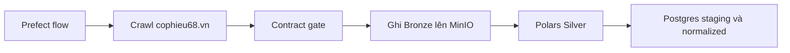
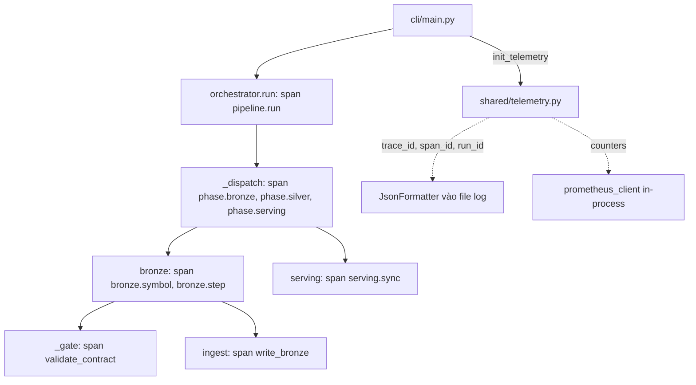

# @.github\skills\copilotinstructions\SKILL.md  Tiến hành đọc để hiểu context đi

---

**Status:** error  **Date:** 2026-10-23

---

### 👤 User

@.github\skills\copilotinstructions\SKILL.md  Tiến hành đọc để hiểu context đi

---

### 🤖 Assistant

> 🔧 called: read_file


> 🔧 **read_file** — .github/skills/copilotinstructions/SKILL.md

### 🤖 Assistant

> 🔧 called: list_files, list_files, list_files

Manifest này yêu cầu nạp `export_task/` trước, rồi đến `allskill`. Tôi sẽ làm theo thứ tự đó.

> 🔧 **list_files** — export_task

> 🔧 **list_files** — .github

> 🔧 **list_files** — C:\Users\Admin\.ai_workspace\allskill

### 🤖 Assistant

> 🔧 called: read_file, read_file, read_file, read_file

Tôi sẽ đọc các session gần nhất, file INDEX của allskill và agent của repo.

> 🔧 **read_file** — export_task/bob-task-f71c2b80ee73857db9b8014547e848e8-2026-10-23.md

> 🔧 **read_file** — .github/agents/full-stack-data-platform-engineer.agent.md

> 🔧 **read_file** — C:\Users\Admin\.ai_workspace\allskill\INDEX.md

> 🔧 **read_file** — export_task/bob-task-82ee950dea5936ee9fe37e933622f880-2026-10-22.md

### 🤖 Assistant

> 🔧 called: grep, glob


> 🔧 **grep** — ST0[1-7]

> 🔧 **glob** — flows/sql/migrations/*.sql

### 🤖 Assistant

Tôi đã đọc xong context. Phần dưới là những gì tôi nắm được.

## 1. Manifest [`SKILL.md`](.github/skills/copilotinstructions/SKILL.md) quy định gì
- **Thứ tự tri thức:** đọc `./export_task/` trước (ưu tiên 1, tri thức động của dự án), rồi đến `C:\Users\Admin\.ai_workspace\allskill` (ưu tiên 2, chuẩn chung).
- **Override:** nếu hai nguồn mâu thuẫn, `export_task/` thắng.
- **Quy trình trả lời:** phân loại vấn đề, khớp với skill phù hợp, rồi tư vấn kiểu senior (rationale, trade-off, risk, cách test). Khi cần, tạo agent mới trong `.github/agents/`.
- **Cuối task phức tạp:** đề xuất tóm tắt dạng Markdown để bạn lưu vào `export_task/`.

## 2. Hiện trạng repo
- **Nhánh:** `20261021_optimize_and_simplize`.
- **Stack:**
  - Ingestion: `pandas.read_html` + `lxml` từ cophieu68.vn.
  - Bronze: MinIO Parquet qua `s3fs` + `pyarrow.dataset`.
  - Silver: Polars.
  - Serving: PostgreSQL, từ staging sang normalized.
  - Orchestration: Prefect.
  - Hạ tầng: Docker Compose.
- **Agent của repo:** [`full-stack-data-platform-engineer`](.github/agents/full-stack-data-platform-engineer.agent.md) (ELT, Prefect, dbt, Spark/Polars, Postgres/MinIO, Docker).

## 3. Các session trong `export_task/`
- **09-10 đến 09-14:** sửa logger, `symbol is null`, ghi S3 bằng Polars, credential MinIO/Postgres, đường dẫn config, `lxml`, `.gitignore`.
- **10-21:** đơn giản hóa `base_config.py`, `serving.py` và `bronze.py`, bỏ phần sinh SQL phức tạp trong schema.
- **10-22:** đọc [`PLAN_REPO01_WebCraw_production.md`](PLAN_REPO01_WebCraw_production.md) kèm ghi chú kiến trúc của bạn (BFT, CAP/PACELC, Raft, idempotency, Data Contract, Data Mesh, FinOps).
- **10-23:** liệt kê 7 sub-task production:

| ST | Nội dung | Trạng thái ghi nhận ở 10-23 |
|---|---|---|
| ST01 | Exponential backoff + jitter cho crawler | Đã có code, cần verify |
| ST02 | Connection pool PostgreSQL | Core đã có (`ThreadedConnectionPool`, ping, test); còn PgBouncer nếu muốn |
| ST03 | Delta clone và retention | Chưa làm |
| ST04 | Data Contract làm circuit breaker | Đang làm, cần nối gate trước khi ghi Bronze |
| ST05 | OpenTelemetry | Chưa làm |
| ST06 | CI/CD | Đã scaffold, nhưng thư mục là `.github/workflow/` chứ chưa phải `workflows/` |
| ST07 | Partitioning và SCD2 | Đang làm: V4/V5 có trong git status, `serving.py` chưa chắc đã cập nhật |

Thứ tự đã chốt là **ST02 → ST07 → ST05**.

## 4. Điểm cần kiểm tra
- **ST06:** `.github/workflow/` sẽ không được GitHub Actions nhận. Cần đổi thành `workflows/`.
- **ST07:** bản V4/V5 trong chat có hai chỗ cần xem lại:
  - Nó rename bảng cũ thành `_legacy` nhưng không migrate dữ liệu.
  - `ON CONFLICT (trade_key, trade_date)` trong `serving.py` phải khớp PK mới.
- **Tool `glob`:** khi tôi chạy `flows/sql/migrations/*.sql` thì không trả file nào, dù git status ghi V4 và V5 đã tồn tại. Tôi chưa mở các file này nên chưa kết luận được gì về nội dung.
- **`allskill/INDEX.md` lỗi thời:** nó chỉ liệt kê 17 skill chung (art, docx, pdf...). Các skill data nằm ở `skill-02` đến `skill-12`, `Full_Stack_Data_SKILL.md` và `Backend_Software_SKILL.md`. Khi gặp task data/backend, tôi sẽ đọc thẳng các file đó.

Bạn muốn tiếp tục với việc nào? Ví dụ: review V4/V5 so với `serving.py`, hoặc hoàn thiện ST04/ST05.

---

### 👤 User

Review qua các @export_task\  và xem xét là còn bao nhiêu subtask nữa

---

### 🤖 Assistant

> 🔧 called: read_file, list_files, list_files, list_files, grep

Tôi sẽ đọc kế hoạch và kiểm tra trạng thái thực tế trong code để đếm đúng.

> 🔧 **list_files** — flows/sql/migrations

> 🔧 **list_files** — flows/cophieu68_deploy_full_pipeline/data_contract

> 🔧 **list_files** — tests

> 🔧 **read_file** — PLAN_REPO01_WebCraw_production.md

> 🔧 **grep** — sp_merge_dim_company_scd2|ON CONFLICT \(trade_key|contract_gate|BaseCrawler|opentelemetry|pgbouncer|shallow

### 🤖 Assistant

> 🔧 called: grep, grep, grep, grep, glob, grep


> 🔧 **grep** — flows/cophieu68_deploy_full_pipeline/bronze.py

> 🔧 **grep** — platforms/storage/postgre/base_postgre.py

> 🔧 **grep** — platforms/ingestion

> 🔧 **grep** — BaseCrawler|RetryConfig|fetch_with_retry

> 🔧 **glob** — **/{docs/adr/*,docker-compose*.yml,stack.yaml,pandera*,telemetry*}

> 🔧 **grep** — requirements.txt

### 🤖 Assistant

> 🔧 called: read_file, grep, grep, grep, grep, grep, glob


> 🔧 **grep** — infra_webcraw/docker-compose.yml

> 🔧 **grep** — flows/cophieu68_deploy_full_pipeline/ingestion/source/extract_cophieu68.py

> 🔧 **grep** — flows/sql/migrations/V4__add_time_partitioning.sql

> 🔧 **read_file** — flows/cophieu68_deploy_full_pipeline/bronze.py

> 🔧 **grep** — flows/cophieu68_deploy_full_pipeline/data_contract/contract_gate.py

> 🔧 **grep** — true

> 🔧 **glob** — **/{governance,docs,test_contract*,test_retry*}/**

### 🤖 Assistant

Còn **2 sub-task chưa bắt đầu (ST03, ST05)** và **5 sub-task đang dở (ST01, ST02, ST04, ST06, ST07)**. Không sub-task nào đã đóng hoàn toàn. Tôi đối chiếu 7 sub-task trong [`PLAN_REPO01_WebCraw_production.md`](PLAN_REPO01_WebCraw_production.md) với code thật, vì trạng thái trong plan và trong các file `export_task/` đều lệch với code. Chưa có test hay lệnh nào được chạy, nên các mục "xong" bên dưới chỉ dựa trên việc đọc code.

## Chênh lệch giữa plan, export_task và code
- Plan vẫn ghi `[ ] pending` cho cả 7 sub-task.
- File session 10-23 xếp ST02 là "chưa làm", rồi cuối session lại kết luận core đã có.
- ST07 được ghi "chưa làm" nhưng V4/V5 đã tạo xong.

## Trạng thái từng sub-task

| ST | Đã có trong code | Còn thiếu | Mức |
|---|---|---|---|
| **ST01** Backoff + jitter | [`base_crawler.py`](platforms/ingestion/base_crawler.py) có `RetryConfig`, `_calc_backoff`, đọc `Retry-After`, `correlation_id`. [`extract_cophieu68.py`](flows/cophieu68_deploy_full_pipeline/ingestion/source/extract_cophieu68.py) kế thừa `BaseHttpCrawler`. Có [`test_backoff.py`](tests/unit/test_backoff.py). | Log chưa phải JSON có cấu trúc, mới là chuỗi text. Plan yêu cầu file `test_retry_logic.py`, hiện file tên khác. Hai chỗ vẫn gọi `pd.read_html(url)` trực tiếp (dòng 297 và 341) nên không đi qua retry. | ~85% |
| **ST02** Connection pool | [`base_postgre.py`](platforms/storage/postgre/base_postgre.py) có `ThreadedConnectionPool`, `_PoolMetricsLogger`, `_ping()`, `_fresh_conn`. Đây là bản psycopg2, không phải SQLAlchemy như plan. | Không có service PgBouncer trong [`docker-compose.yml`](infra_webcraw/docker-compose.yml). Không có `stack.yaml` với các flag `db.pool_size`, `db.max_overflow`, `db.pgbouncer_enabled`. | ~70% |
| **ST03** Delta clone | Không có gì. | Grep `.clone(`, `DeltaTable`, `deletedFileRetention` đều không có kết quả. Stack hiện tại chỉ dùng Polars/Parquet/MinIO, chưa có Delta/Spark. Thiếu `docs/adr/ADR-001`. | 0% |
| **ST04** Data contract | Có `data_contract/` (`contracts.py`, `contract_gate.py`). [`bronze.py`](flows/cophieu68_deploy_full_pipeline/bronze.py:288) gọi `check_batch` trước khi ingest. | `check_batch` chỉ ghi log, không `raise` và không lọc dữ liệu (docstring dòng 9 ghi rõ). Nên chưa phải circuit breaker như plan yêu cầu. Chỉ gate cho `stock_prices`, chưa có `company_profile`. Không có `tests/unit/test_contracts.py`. Không có YAML trong `governance/contracts/`. Dùng Pydantic thay Pandera, chấp nhận được vì plan cho phép. | ~50% |
| **ST05** OpenTelemetry | Không có gì. | Thiếu `shared/telemetry.py`, các package OTel/prometheus trong `requirements.txt`, và Jaeger/OTel Collector/Prometheus/Grafana trong compose. | 0% |
| **ST06** CI/CD | Có `ci.yml`, `cd.yml`, `.pre-commit-config.yaml`, `pyproject.toml`, `CHANGELOG.md`, `requirements-ci.txt`, `requirements-dev.txt`. | Thư mục là `.github/workflow/`, GitHub Actions chỉ nhận `.github/workflows/`, nên workflow hiện không chạy. Thiếu `docs/adr/ADR-002`. Chưa verify CI chạy được và coverage ≥ 80%. | ~75% |
| **ST07** Schema | [`V4`](flows/sql/migrations/V4__add_time_partitioning.sql) (partition theo năm + covering index) và [`V5`](flows/sql/migrations/V5__scd2_dim_company.sql) (procedure SCD2). [`serving.py`](flows/cophieu68_deploy_full_pipeline/serving.py:158) đã dùng `ON CONFLICT (trade_key, trade_date)` và `CALL normalized.sp_merge_dim_company_scd2`. | V4 chỉ rename bảng cũ thành `fact_stock_price_legacy`, không có `INSERT` chuyển dữ liệu cũ sang bảng partition. Thiếu `ADR-003` (TimescaleDB hay native partition) và cập nhật `governance/analyze_business_context.md`. Chưa có test kiểm tra `ON CONFLICT` khớp PK mới. | ~85% |

Tổng hợp việc còn lại:
- **Chưa bắt đầu:** ST03, ST05.
- **Đang dở (5):** ST01, ST02, ST04, ST06, ST07.
- **ADR còn thiếu:** ADR-001, ADR-002, ADR-003.

## Hai điểm cần xử lý sớm
1. **ST06:** đổi `.github/workflow/` thành `.github/workflows/`. Chỉ cần đổi tên thư mục, nhưng sau đó CI sẽ chạy lần đầu nên có thể lộ lỗi lint/test.
2. **ST04:** cho `check_batch` raise khi vi phạm, hoặc thêm chế độ strict. Hiện gate chỉ ghi log nên chưa chặn được dữ liệu xấu. Đổi sang raise là thay đổi hành vi, nên cần chốt ngưỡng (một record sai thì fail cả batch hay chỉ lọc record đó).

## Đề xuất thứ tự
1. Sửa tên thư mục workflows (ST06).
2. Cho ST04 raise khi vi phạm.
3. Thêm đường migrate dữ liệu `legacy` sang bảng partition (ST07).
4. Thêm PgBouncer và `stack.yaml` (ST02).
5. Làm ST05.
6. ST03: do repo chưa dùng Delta, nên quyết định bỏ hẳn, hoặc chuyển thành một ADR ghi "N/A cho stack hiện tại".

Tôi đang ở chế độ chỉ đọc, nên chưa sửa file nào. Muốn tôi thực hiện các bước trên thì bạn chuyển sang Agent mode.

Tôi cũng đề xuất cập nhật trạng thái trong `PLAN_REPO01_WebCraw_production.md` theo bảng trên và lưu bản tổng hợp này vào `export_task/`, để các session sau không lệch nữa.

---

### 👤 User

Bắt đầu thực hiện ST04 data contract của các bảng khác đi, vì hiện tại mới thực hiện cho vài bảng à

---

### 🤖 Assistant

> 🔧 called: read_file, read_file, read_file, grep

Tôi đang ở Ask mode (chỉ đọc), nên không tạo hay sửa file được. Bạn chuyển sang **Agent mode** thì tôi triển khai. Trong lúc này tôi khảo sát trước để phần việc rõ ràng.

> 🔧 **grep** — flows/sql/migrations/V2__create_staging_tables.sql

> 🔧 **read_file** — flows/cophieu68_deploy_full_pipeline/bronze.py

> 🔧 **read_file** — flows/cophieu68_deploy_full_pipeline/data_contract/contracts.py

> 🔧 **read_file** — flows/cophieu68_deploy_full_pipeline/data_contract/contract_gate.py

### 🤖 Assistant

> 🔧 called: grep, read_file, grep

Tôi sẽ xem các DTO và schema của những bảng còn lại để định hình contract.

> 🔧 **read_file** — flows/sql/migrations/V2__create_staging_tables.sql

> 🔧 **grep** — flows/cophieu68_deploy_full_pipeline/bronze.py

> 🔧 **grep** — flows/cophieu68_deploy_full_pipeline/ingestion/dto/extract_models.py

### 🤖 Assistant

> 🔧 called: read_file, read_file

Tôi cần thêm schema các bảng staging và dataclass còn lại (company, business plan, industry) để định nghĩa contract chính xác.

> 🔧 **read_file** — flows/cophieu68_deploy_full_pipeline/ingestion/dto/extract_models.py

> 🔧 **read_file** — flows/sql/migrations/V2__create_staging_tables.sql

### 🤖 Assistant

> 🔧 called: read_file, read_file


> 🔧 **read_file** — flows/sql/migrations/V2__create_staging_tables.sql

> 🔧 **read_file** — flows/cophieu68_deploy_full_pipeline/ingestion/dto/extract_models.py

### 🤖 Assistant

Tôi đã khảo sát đủ để lên kế hoạch. Vì đang ở Ask mode nên chưa viết code, bạn chuyển sang Agent mode thì tôi làm ngay.

## Hiện trạng
Mới có một contract duy nhất là `StockPriceContract`, và chỉ [`_step_trading`](flows/cophieu68_deploy_full_pipeline/bronze.py:276) gọi `check_batch`. Chín step còn lại ghi thẳng vào `ing.ingest(...)` mà không kiểm tra gì.

## Phạm vi đề xuất
Các bảng còn lại đều là bảng có dữ liệu crawl thật, ghi qua `ing.ingest`:

| Step trong `bronze.py` | Contract mới | Khóa nghiệp vụ |
|---|---|---|
| `_step_company_profile` | `CompanyProfileContract` | `symbol` |
| `_step_financial_ratios` | `FinancialRatiosContract` | `symbol` |
| `_step_business_plan` | `BusinessPlanContract` | `symbol`, `Year` |
| `_step_income_statement` (quarter/year) | `IncomeStatementContract` | `symbol`, `report_type` |
| `_step_balance_sheet` (quarter/year) | `BalanceSheetContract` | `symbol`, `report_type` |
| `_step_industry_sectors` | `IndustrySectorContract` | `industry_code`, `symbol` |
| `_step_market_type_sectors` | `MarketTypeContract` | `market_type_code` |
| `_step_financial_report_summary` | `FinancialReportSummaryContract` | `symbol`, `report_type` |
| `_step_industry_info` | bỏ qua | schema động theo `_industry_key` |

Contract cho `financial_report_summary` và `industry_info` ít chắc chắn vì cột là bảng HTML thay đổi theo nguồn. Tôi đề xuất cho hai bảng đó chỉ ràng buộc các khóa (`symbol`, `report_type`), phần còn lại `extra="allow"`.

## Điểm cần bạn quyết định
Phần này ảnh hưởng thiết kế nên tôi hỏi trước khi làm.

1. **Gate có raise hay chỉ log?** [`check_batch`](flows/cophieu68_deploy_full_pipeline/data_contract/contract_gate.py:7) hiện chỉ cảnh báo, không chặn. Plan ST04 yêu cầu violation phải làm task fail. Hai hướng:
   - **Strict:** `check_batch` nhận tham số `mode` (`"warn"` hoặc `"fail"`). Dùng `"fail"` cho khóa nghiệp vụ (`symbol`, ngày) và `"warn"` cho các cột số.
   - **Warn trước, siết sau:** thêm contract cho mọi bảng ở chế độ `warn`, theo dõi vài lần chạy để biết tỉ lệ vi phạm thật rồi mới bật `fail`. Cách này an toàn hơn vì nguồn là HTML scrape, dễ có giá trị rỗng hoặc `-`.
2. **Giá trị rỗng:** CompanyProfile mặc định `""`, các chỉ số tài chính thường là `Optional[str]`. Tôi định coi `""`, `"-"`, `"None"` là null hợp lệ cho cột số, đồng thời bắt buộc `symbol` đúng định dạng.
3. **Vị trí lưu:** thêm các class vào [`contracts.py`](flows/cophieu68_deploy_full_pipeline/data_contract/contracts.py) hay tách file theo nhóm (profile, financial, reference)? Tôi nghiêng về một file, vì tổng dưới 200 dòng.

## Kế hoạch thực hiện (khi sang Agent mode)
1. Thêm các contract vào `contracts.py`, tái dùng `norm_date` và `norm_numeric` từ `extract_models.py`.
2. Thêm tham số `mode` cho `check_batch`, mặc định `"warn"` để không đổi hành vi hiện có. Ở mode `fail` thì raise `ContractViolationError` kèm report.
3. Gắn `check_batch` vào các step trong bảng trên. Gọi sau khi đã gán `symbol` / `report_type`, đúng như `_step_trading` đang làm.
4. Viết `tests/unit/test_contracts.py` gồm: record hợp lệ, `symbol` sai định dạng, ngày không parse được, `mode="fail"` raise, `mode="warn"` không raise.
5. Chạy `pytest tests/unit` để xác nhận.

Bạn chọn hướng nào cho điểm 1: **strict ngay** hay **warn trước, siết sau**? Tôi khuyến nghị warn trước, riêng khóa `symbol` thì cho `fail` ngay.

---

### 👤 User

1. Warn trước, siết sau2. đồng ý3. Gom về 1 file

---

### 🤖 Assistant

> 🔧 called: read_file, read_file

Tôi vẫn đang ở Ask mode (chỉ đọc), nên chưa ghi được vào [`contracts.py`](flows/cophieu68_deploy_full_pipeline/data_contract/contracts.py). Để bản code bên dưới khớp với helper sẵn có, tôi đọc thêm `norm_numeric` và `norm_date`.

> 🔧 **read_file** — flows/cophieu68_deploy_full_pipeline/ingestion/dto/extract_models.py

> 🔧 **read_file** — flows/cophieu68_deploy_full_pipeline/ingestion/dto/extract_models.py

### 🤖 Assistant

> 🔧 called: grep


> 🔧 **grep** — flows/cophieu68_deploy_full_pipeline/ingestion/source/extract_cophieu68.py

### 🤖 Assistant

> 🔧 called: read_file


> 🔧 **read_file** — flows/cophieu68_deploy_full_pipeline/ingestion/source/extract_cophieu68.py

### 🤖 Assistant

> 🔧 called: read_file


> 🔧 **read_file** — flows/cophieu68_deploy_full_pipeline/ingestion/source/extract_cophieu68.py

### 🤖 Assistant

Tôi chưa ghi được file vì đang ở Ask mode, nên bên dưới là code hoàn chỉnh theo 3 quyết định của bạn: warn trước, `""`/`"-"`/`"None"` coi là null, gom về một file. Bạn chuyển sang Agent mode thì tôi áp dụng và chạy test. Nếu bạn muốn tự dán thì cũng dùng được.

## 1. [`contracts.py`](flows/cophieu68_deploy_full_pipeline/data_contract/contracts.py): thêm vào, giữ nguyên `StockPriceContract`

Thay phần import ở đầu file:

```python
from typing import Annotated, Any, Literal

from pydantic import AfterValidator, BaseModel, ConfigDict, Field, field_validator

from flows.cophieu68_deploy_full_pipeline.ingestion.dto.extract_models import (
    _NULL_SENTINELS, norm_date, norm_numeric,
)
```

Thêm vào cuối file:

```python
# ── Validators dùng chung ────────────────────────────────────────────────────
# Giá trị rỗng/"-"/"None" được coi là null hợp lệ (nguồn là HTML scrape).
# Chỉ báo lỗi khi có giá trị thật nhưng không parse được.

def _numeric_or_null(v: Any) -> Any:
    if v is None or (isinstance(v, (int, float)) and not isinstance(v, bool)):
        return v
    text = str(v).strip().replace("\u00a0", "")
    if text in _NULL_SENTINELS:
        return v
    if norm_numeric(text) is None:
        raise ValueError(f"not numeric: {v!r}")
    return v


def _date_or_null(v: Any) -> Any:
    if v is None or str(v).strip() in _NULL_SENTINELS:
        return v
    if norm_date(v) is None:
        raise ValueError(f"unparsable date: {v!r}")
    return v


NumLike = Annotated[Any, AfterValidator(_numeric_or_null)]
DateLike = Annotated[Any, AfterValidator(_date_or_null)]

_SYMBOL_PATTERN = r"^[A-Z0-9]{2,10}$"


class _BronzeContract(BaseModel):
    """Bronze additive: cột thừa không lỗi."""
    model_config = ConfigDict(extra="allow")


# ── Per-symbol contracts ─────────────────────────────────────────────────────

class CompanyProfileContract(_BronzeContract):
    """bronze.company_profile → staging.company_profile → normalized.dim_company."""
    symbol: str = Field(pattern=_SYMBOL_PATTERN)
    current_price: NumLike = None
    established_date: DateLike = None
    listed_date: DateLike = None
    listed_volume_initial: NumLike = None
    listed_volume: NumLike = None
    circulating_volume: NumLike = None
    market_capitalization: NumLike = None


class FinancialRatiosContract(_BronzeContract):
    """bronze.financial_ratios → staging.financial_ratios."""
    symbol: str = Field(pattern=_SYMBOL_PATTERN)
    reference_price: NumLike = None
    open_price: NumLike = None
    high_price: NumLike = None
    low_price: NumLike = None
    volume: NumLike = None
    book_value: NumLike = None
    eps: NumLike = None
    pe: NumLike = None
    pb: NumLike = None
    roe: NumLike = None
    roa: NumLike = None
    beta: NumLike = None
    market_cap: NumLike = None
    listed_volume: NumLike = None


class BusinessPlanContract(_BronzeContract):
    """bronze.business_plan. `symbol` do BronzeExecutor inject trước khi gate."""
    symbol: str = Field(pattern=_SYMBOL_PATTERN)
    Year: str = Field(pattern=r"^\d{4}")
    Plan_revenue: NumLike = None
    Pass_revenue: NumLike = None
    Plan_profit: NumLike = None
    Pass_profit: NumLike = None


class IncomeStatementContract(_BronzeContract):
    """bronze.income_statement_{quarter,year}. Cột dữ liệu động theo bảng HTML,
    chỉ ràng buộc khóa."""
    symbol: str = Field(pattern=_SYMBOL_PATTERN)
    report_type: Literal["quarter", "year"]


class BalanceSheetContract(IncomeStatementContract):
    """bronze.balance_sheet_{quarter,year}. Cùng ràng buộc khóa."""


class FinancialReportSummaryContract(_BronzeContract):
    """bronze.financial_report_summary. report_type là key tự do từ crawler."""
    symbol: str = Field(pattern=_SYMBOL_PATTERN)
    report_type: str = Field(min_length=1)


# ── Global (reference) contracts ─────────────────────────────────────────────

class IndustrySectorContract(_BronzeContract):
    """bronze.industry_sectors."""
    industry_code: str = Field(min_length=1)
    industry_name: str = Field(min_length=1)
    symbol: str = Field(pattern=_SYMBOL_PATTERN)
    close_price: NumLike = None
    Increase_decrease: NumLike = None
    volumn24h: NumLike = None
    volumn52w: NumLike = None
    listed_volumn: NumLike = None
    market_capitalization: NumLike = None


class MarketTypeContract(_BronzeContract):
    """bronze.market_type_sectors."""
    market_type_code: str = Field(min_length=1)
    market_type_name: str = Field(min_length=1)
    symbol: str = Field(pattern=_SYMBOL_PATTERN)
    close_price: NumLike = None
    Increase_decrease: NumLike = None
    volumn24h: NumLike = None
    volumn52w: NumLike = None
    listed_volumn: NumLike = None
    market_capitalization: NumLike = None
```

Tên field như `volumn24h` và `Increase_decrease` giữ nguyên theo dataclass trong `extract_models.py`, kể cả lỗi chính tả, để khớp với record thật.

## 2. [`contract_gate.py`](flows/cophieu68_deploy_full_pipeline/data_contract/contract_gate.py): thêm `mode`

Mặc định `"warn"` nên hành vi hiện tại của `_step_trading` không đổi. Khi muốn siết, chỉ cần truyền `mode="fail"`.

```python
from collections import defaultdict
from typing import Any, Dict, List, Literal, Type

from pydantic import BaseModel, ValidationError


class ContractViolationError(Exception):
    """Raise khi check_batch(mode="fail") phát hiện vi phạm."""

    def __init__(self, report: Dict[str, Any]) -> None:
        super().__init__(
            f"contract_violation contract={report['contract']} "
            f"invalid_rows={report['invalid_rows']}/{report['rows']}"
        )
        self.report = report


def check_batch(model: Type[BaseModel], records: List[Dict[str, Any]], *,
                name: str, logger, context: Dict[str, Any] | None = None,
                mode: Literal["warn", "fail"] = "warn") -> Dict[str, Any]:
    """Kiểm tra batch theo contract.

    mode="warn": ghi log, không raise, không lọc dữ liệu.
    mode="fail": ghi log rồi raise ContractViolationError (Prefect task FAILED).
    """
    failures: Dict[tuple, Dict[str, Any]] = defaultdict(lambda: {"count": 0, "samples": []})
    invalid = 0
    for rec in records:
        try:
            model.model_validate(rec)
        except ValidationError as exc:
            invalid += 1
            for e in exc.errors(include_url=False):
                f = failures[(".".join(map(str, e["loc"])), e["type"])]
                f["count"] += 1
                if len(f["samples"]) < 3:
                    f["samples"].append(repr(e.get("input")))

    n = len(records)
    report = {
        "contract": name, "rows": n, "invalid_rows": invalid,
        "failures": [{"field": k[0], "rule": k[1], **v} for k, v in failures.items()],
        **(context or {}),
    }
    if invalid:
        logger.warning("contract_violation %s", report)
        if mode == "fail":
            raise ContractViolationError(report)
    else:
        logger.info("contract_ok contract=%s rows=%d %s", name, n, context or {})
    return report
```

## 3. [`bronze.py`](flows/cophieu68_deploy_full_pipeline/bronze.py): gắn gate vào các step

Sửa import ở dòng 41 để lấy thêm các contract mới (tên đã liệt kê ở mục 1), rồi thêm helper vào `BronzeExecutor`:

```python
    def _gate(self, model, records, name, *, sym=None, bid=None) -> None:
        """Contract gate ở chế độ warn. Siết sau bằng cách truyền mode="fail"."""
        check_batch(
            model, records, name=name,
            logger=logger_manager.get_logger("data_contract"),
            context={"symbol": sym, "batch_id": bid, "run_id": self.context.run_id},
        )
```

Sau đó thêm một dòng gate trước mỗi `ing.ingest(...)`:

| Step | Dòng thêm |
|---|---|
| `_step_company_profile` | `self._gate(CompanyProfileContract, [rec], "company_profile", sym=sym, bid=bid)` |
| `_step_financial_ratios` | `self._gate(FinancialRatiosContract, [rec], "financial_ratios", sym=sym, bid=bid)` |
| `_step_financial_report_summary` | `self._gate(FinancialReportSummaryContract, records, "financial_report_summary", sym=sym, bid=bid)` |
| `_step_business_plan` | xem bên dưới |
| `_step_income_statement` | `self._gate(IncomeStatementContract, records, table, sym=sym, bid=bid)`, đặt sau dòng `table = ...` |
| `_step_balance_sheet` | `self._gate(BalanceSheetContract, records, table, sym=sym, bid=bid)`, đặt sau dòng `table = ...` |
| `_step_industry_sectors` | `self._gate(IndustrySectorContract, records, "industry_sectors", bid=bid)` |
| `_step_market_type_sectors` | `self._gate(MarketTypeContract, records, "market_type_sectors", bid=bid)` |

`_step_business_plan` cần xử lý riêng, vì các dòng của `BusinessPlanRow` không có `symbol`. Tôi sẽ gate trên bản copy để không đổi dữ liệu đi vào `ingest`:

```python
        self._gate(
            BusinessPlanContract,
            [{**r, "symbol": sym.upper()} for r in raw["data"]],
            "business_plan", sym=sym, bid=bid,
        )
```

`_step_industry_info` bỏ qua vì schema động theo `_industry_key`.

## 4. `tests/unit/test_contracts.py`

```python
import logging

import pytest

from flows.cophieu68_deploy_full_pipeline.data_contract.contract_gate import (
    ContractViolationError, check_batch,
)
from flows.cophieu68_deploy_full_pipeline.data_contract.contracts import (
    BalanceSheetContract, BusinessPlanContract, CompanyProfileContract,
    FinancialRatiosContract, IndustrySectorContract, MarketTypeContract,
)

LOG = logging.getLogger("test_contract")


def _check(model, rows, **kw):
    return check_batch(model, rows, name="t", logger=LOG, **kw)


def test_company_profile_ok_with_null_sentinels():
    rec = {"symbol": "HPG", "listed_date": "-", "market_capitalization": "1,234.5B", "fax": ""}
    assert _check(CompanyProfileContract, [rec])["invalid_rows"] == 0


def test_company_profile_bad_symbol_and_date():
    rec = {"symbol": "hpg!", "listed_date": "31/31/2020"}
    report = _check(CompanyProfileContract, [rec])
    fields = {f["field"] for f in report["failures"]}
    assert report["invalid_rows"] == 1 and {"symbol", "listed_date"} <= fields


def test_financial_ratios_non_numeric_value_flagged():
    report = _check(FinancialRatiosContract, [{"symbol": "VNM", "pe": "abc"}])
    assert report["invalid_rows"] == 1


def test_business_plan_requires_year():
    assert _check(BusinessPlanContract, [{"symbol": "VNM", "Year": "2024"}])["invalid_rows"] == 0
    assert _check(BusinessPlanContract, [{"symbol": "VNM", "Year": "n/a"}])["invalid_rows"] == 1


def test_balance_sheet_report_type_enum():
    assert _check(BalanceSheetContract, [{"symbol": "FPT", "report_type": "year", "x": 1}])["invalid_rows"] == 0
    assert _check(BalanceSheetContract, [{"symbol": "FPT", "report_type": "month"}])["invalid_rows"] == 1


def test_industry_and_market_require_codes():
    assert _check(IndustrySectorContract, [{"industry_code": "", "industry_name": "x", "symbol": "FPT"}])["invalid_rows"] == 1
    assert _check(MarketTypeContract, [{"market_type_code": "HOSE", "market_type_name": "HOSE", "symbol": "FPT"}])["invalid_rows"] == 0


def test_warn_mode_does_not_raise():
    _check(CompanyProfileContract, [{"symbol": ""}], mode="warn")


def test_fail_mode_raises_with_report():
    with pytest.raises(ContractViolationError) as ei:
        _check(CompanyProfileContract, [{"symbol": ""}], mode="fail")
    assert ei.value.report["invalid_rows"] == 1
```

## 5. Kiểm tra sau khi áp dụng
```bash
pytest tests/unit/test_contracts.py -v
pytest tests/unit -q
```
Sau đó chạy pipeline một lần và xem `logs/etl/etl.log` tìm `contract_violation`. Ở bước siết sau, nếu `invalid_rows` ổn định ở 0 cho khóa `symbol`, bật `mode="fail"` bằng cách sửa một tham số trong `_gate`.

## Lưu ý
- `_NULL_SENTINELS` là tên private trong `extract_models.py`. Tôi import thẳng vì cùng package. Nếu bạn muốn sạch hơn thì đổi thành tên public.
- Contract của income/balance/summary chỉ ràng buộc khóa, vì cột là bảng HTML động và không khớp tên cột staging (`revenue`, `total_assets`...). Muốn ràng buộc cột thì cần map tên cột trước, đó là việc của Silver, ngoài phạm vi ST04.
- Hiện chưa có dữ liệu thật để biết tỉ lệ vi phạm. Vài lần chạy ở chế độ warn đầu tiên sẽ cho biết regex `symbol` và `Year` có quá chặt không.

---

### 👤 User

Review lại xem là các file đã được điền đầy đủ và chính xác chưa

---

### 🤖 Assistant

> 🔧 called: read_file, read_file, read_file, grep


> 🔧 **read_file** — tests/unit/test_contracts.py

> 🔧 **read_file** — flows/cophieu68_deploy_full_pipeline/data_contract/contract_gate.py

> 🔧 **read_file** — flows/cophieu68_deploy_full_pipeline/data_contract/contracts.py

> 🔧 **grep** — flows/cophieu68_deploy_full_pipeline/bronze.py

### 🤖 Assistant

> 🔧 called: read_file, read_file


> 🔧 **read_file** — flows/cophieu68_deploy_full_pipeline/bronze.py

> 🔧 **read_file** — flows/cophieu68_deploy_full_pipeline/bronze.py

### 🤖 Assistant

> 🔧 called: grep, grep, grep


> 🔧 **grep** — flows/cophieu68_deploy_full_pipeline/ingestion/source/extract_cophieu68.py

> 🔧 **grep** — requirements*.txt

> 🔧 **grep** — flows/cophieu68_deploy_full_pipeline/ingestion/source/extract_cophieu68.py

### 🤖 Assistant

> 🔧 called: grep, grep


> 🔧 **grep** — pyproject.toml

> 🔧 **grep** — flows/cophieu68_deploy_full_pipeline/bronze.py

### 🤖 Assistant

> 🔧 called: read_file, read_file


> 🔧 **read_file** — flows/cophieu68_deploy_full_pipeline/ingestion/source/extract_cophieu68.py

> 🔧 **read_file** — flows/cophieu68_deploy_full_pipeline/ingestion/source/extract_cophieu68.py

### 🤖 Assistant

> 🔧 called: read_file


> 🔧 **read_file** — flows/cophieu68_deploy_full_pipeline/bronze.py

### 🤖 Assistant

Cả bốn file đã được điền đầy đủ và đúng theo bản thiết kế. Tôi chỉ đọc code, chưa chạy `pytest` (Ask mode không có tool chạy lệnh), nên "đúng" ở đây là theo đọc code. Có một rủi ro thật ở bước validate mà bạn nên xử lý trước khi chạy pipeline.

## Kết quả đối chiếu

| File | Kết quả |
|---|---|
| [`contracts.py`](flows/cophieu68_deploy_full_pipeline/data_contract/contracts.py) | Đủ 8 contract mới cùng `StockPriceContract` cũ. Import, `NumLike`/`DateLike`, `_BronzeContract` và tên field khớp `extract_models.py`. |
| [`contract_gate.py`](flows/cophieu68_deploy_full_pipeline/data_contract/contract_gate.py) | Có `ContractViolationError` và `mode="warn"/"fail"`, mặc định `warn` nên hành vi `_step_trading` không đổi. |
| [`bronze.py`](flows/cophieu68_deploy_full_pipeline/bronze.py) | Có `_gate` và 8 lời gọi, mỗi lời gọi nằm sau chỗ inject `symbol`/`report_type` và trước `ing.ingest`. `_step_business_plan` gate trên bản copy nên không đổi dữ liệu ingest. Import khớp tên contract. `_step_industry_info` bỏ qua đúng như đã thống nhất. |
| [`test_contracts.py`](tests/unit/test_contracts.py) | 8 test, đúng nội dung đề xuất. Tôi lần lượt kiểm từng assert với `norm_numeric`/`norm_date` và đều ra đúng kỳ vọng. Ví dụ `"1,234.5B"` parse được, `"31/31/2020"` bị từ chối, `symbol=""` fail pattern. |

Ruff theo [`pyproject.toml`](pyproject.toml) chỉ bật `E9, F63, F7, F82, F401, F811`, và mọi import trong `contracts.py` đều được dùng, nên sẽ không báo lỗi lint. Pydantic pin `2.11.7` hỗ trợ `Annotated[..., AfterValidator]` và `Field(pattern=...)`.

## Rủi ro cần xử lý: key không phải chuỗi
Các step `income_statement`, `balance_sheet` và `financial_report_summary` lấy record từ `df.to_dict(orient="records")` của `pd.read_html`. Cột của bảng HTML có thể là số nguyên hoặc tuple (MultiIndex), tức là không phải `str`.

Theo hiểu biết của tôi về pydantic v2, `model_validate` ném lỗi `invalid_key` cho mọi key không phải chuỗi, kể cả khi `extra="allow"`. Tôi chưa kiểm chứng điều này bằng cách chạy.

Nếu đúng thì hệ quả như sau:
- Ở mode `warn`, mỗi dòng của các bảng đó bị đánh dấu vi phạm, làm nhiễu log và che mất vi phạm thật.
- Ở mode `fail`, các step này sẽ fail ngay khi bạn siết.
- [`bronze.py`](flows/cophieu68_deploy_full_pipeline/bronze.py:115) `_flatten` đã bỏ key không phải chuỗi, nên pipeline vẫn chạy bình thường. Chỉ gate bị ảnh hưởng.

Cách sửa gọn nhất là một dòng trong `check_batch`, cho khớp với `_flatten`:

```python
model.model_validate({k: v for k, v in rec.items() if isinstance(k, str)})
```

Kèm một test để khóa hành vi:

```python
def test_non_str_keys_ignored():
    rec = {"symbol": "FPT", "report_type": "year", 0: "x", ("a", "b"): 1}
    assert _check(BalanceSheetContract, [rec])["invalid_rows"] == 0
```

## Điểm nhỏ, không bắt buộc
- `_step_trading` vẫn gọi `check_batch` trực tiếp thay vì `_gate`. Nó chạy đúng, nhưng thiếu nhất quán.
- Chưa có test cho `FinancialReportSummaryContract`.
- Chưa có test nào cho việc nối gate vào `bronze.py`. Mức này chấp nhận được ở giai đoạn warn.
- `Year` dùng pattern `^\d{4}` (chỉ kiểm tiền tố), nên một giá trị như `2024 (KH)` vẫn qua. Đây là chủ đích, nhưng sau vài lần chạy thật bạn nên xem lại.

## Bước tiếp theo
Chuyển sang Agent mode để tôi:
1. Áp dụng dòng sửa key chuỗi và thêm test.
2. Chạy `pytest tests/unit/test_contracts.py -v`, rồi `pytest tests/unit -q`.

Sau khi test xanh, chạy pipeline một lần và đếm `contract_violation` trong `logs/etl/etl.log` để quyết định bật `mode="fail"` cho bảng nào.

---

### 👤 User

Còn ST05 CHƯA LÀM đúng ko nhỉ

---

### 🤖 Assistant

> 🔧 called: grep, glob, grep, grep

Tôi kiểm tra lại trạng thái thực tế trước khi trả lời.

> 🔧 **grep** — infra_webcraw/docker-compose.yml

> 🔧 **glob** — **/telemetry*

> 🔧 **grep** — shared/logger/logger_config.yaml

> 🔧 **grep** — opentelemetry|prometheus_client|prometheus-client|trace_id|start_as_current_span

### 🤖 Assistant

Đúng, **ST05 chưa làm**. Kết quả kiểm tra:

- Không file code nào dùng `opentelemetry`, `prometheus_client`, `trace_id` hay `start_as_current_span`. Chỉ [`PLAN_REPO01_WebCraw_production.md`](PLAN_REPO01_WebCraw_production.md) và hai file trong `export_task/` nhắc đến, tức là chỉ có mô tả, chưa có code.
- Không có `shared/telemetry.py`.
- [`docker-compose.yml`](infra_webcraw/docker-compose.yml) không có Jaeger, OTel Collector, Prometheus hay Grafana.
- [`logger_config.yaml`](shared/logger/logger_config.yaml) chỉ có một formatter `default` dạng text, chưa có JSON và không có `trace_id`, `span_id`, `correlation_id`. Gói OTel và prometheus cũng chưa có trong `requirements.txt`.

Phần duy nhất có sẵn liên quan là `correlation_id` của ST01 trong [`base_crawler.py`](platforms/ingestion/base_crawler.py). Nó chỉ nằm ở tầng crawl, mỗi lần gọi `get_soup` sinh một UUID mới, chưa gắn với một run của pipeline.

## Việc cần làm cho ST05
1. **Dependencies:** `opentelemetry-sdk`, `opentelemetry-exporter-otlp-proto-grpc`, `prometheus-client` vào `requirements.txt`.
2. **`shared/telemetry.py`:** khởi tạo tracer, OTLP exporter, và các metric `pipeline_duration_seconds`, `records_processed_total`, `pipeline_errors_total`.
3. **Span theo stage:** root span `pipeline.run` ở entry point Prefect, các span con cho ingest, `validate_contract` (gate vừa làm ở ST04), transform, write bronze/silver. Điểm gắn dễ nhất là `_gate` và các `_step_*` trong [`bronze.py`](flows/cophieu68_deploy_full_pipeline/bronze.py).
4. **Log:** thêm JSON formatter và filter chèn `trace_id`, `span_id`, `run_id` vào `logger_config.yaml`. Lấy `correlation_id` từ run chứ không sinh mỗi request.
5. **Hạ tầng:** thêm Jaeger, OTel Collector, Prometheus, Grafana vào compose.

## Chọn trước khi bắt đầu
Phần 5 nặng nhất, thêm 4 container vào máy local. Tôi đề xuất làm theo 2 lượt:
- **Lượt 1:** các mục 1 đến 4, chạy được ngay mà không cần container nào, vì có thể export span ra console.
- **Lượt 2:** Jaeger và Prometheus, rồi mới tới Grafana nếu bạn cần dashboard.

Thứ tự này cũng đúng với phụ thuộc trong plan: ST05 cần `correlation_id` từ ST01 và span `validate_contract` từ ST04, cả hai đều đã có.

Tôi vẫn đang ở Ask mode nên chưa tạo file được. Bạn chuyển sang Agent mode và chốt hướng "2 lượt" thì tôi làm lượt 1. Trước đó, nếu bạn muốn, tôi có thể đọc thêm entry point Prefect và `logger_manager` để lên danh sách file sẽ sửa.

---

### 👤 User

tôi chưa hiểu subtask5 này làm gì và tại sao phải làm vậy

---

### 🤖 Assistant

## ST05 làm gì, nói ngắn gọn

ST05 giúp bạn trả lời được câu hỏi "pipeline chạy chậm hoặc lỗi thì chậm hoặc lỗi ở bước nào, của mã cổ phiếu nào, trong lần chạy nào?". Hiện tại bạn phải tự đọc log để đoán.

## Vấn đề hiện tại

Một lần chạy pipeline đi qua nhiều bước:



Log hiện tại là các dòng chữ trong `logs/etl/etl.log`, ví dụ:

```
[Crawler] OK attempt=1 url=... correlation_id=abc
contract_violation {...}
[Bronze] Wrote 120 rows → ...
```

Gặp tình huống thật như sau thì khó xử lý:

1. **"Hôm nay pipeline chạy 40 phút, hôm qua 10 phút."** Chậm ở crawl, ghi MinIO hay upsert Postgres? Không có số đo thời gian từng bước, bạn phải tự trừ timestamp giữa các dòng log.
2. **"Dòng `contract_violation` này của lần chạy nào?"** Log của nhiều mã cổ phiếu, nhiều run nằm lẫn nhau. Phải dựa vào `run_id` ghi tay trong context. Còn `correlation_id` của crawler thì mỗi request sinh một UUID mới, nên không nối được các bước của cùng một lần chạy.
3. **"Pipeline lỗi 3 lần tuần này, có tăng không?"** Không có bộ đếm lỗi nào để vẽ biểu đồ, chỉ có text để grep.

## ST05 thêm gì

Có ba thứ, thường gọi là "ba trụ cột" của observability:

| Trụ cột | Là gì | Trả lời câu hỏi |
|---|---|---|
| **Trace / span** | Mỗi bước bọc trong một "span" có thời điểm bắt đầu và thời gian chạy. Các span lồng nhau thành một cây, gắn chung một `trace_id`. | "Bước nào chậm?" |
| **Log có cấu trúc** | Mỗi dòng log là JSON và tự gắn `trace_id`, `span_id`, `run_id`. | "Dòng log này thuộc lần chạy nào, bước nào?" |
| **Metrics** | Bộ đếm và đo: `pipeline_duration_seconds`, `records_processed_total`, `pipeline_errors_total`. | "Xu hướng theo thời gian có xấu đi không?" |

Ví dụ một trace của một lần chạy:

```
pipeline.run                          42.0s
├─ ingest (HPG)                       30.5s
│   ├─ crawl_trading_data             28.0s   ← chậm ở đây
│   └─ validate_contract               0.1s
├─ write_bronze                        6.0s
├─ transform_silver                    3.2s
└─ serve_postgres                      2.3s
```

Nhìn vào là biết 28 giây nằm ở bước crawl, không cần đọc log. Khi tìm lỗi thì lấy `trace_id` rồi lọc log theo nó, ra đúng các dòng của lần chạy đó.

Jaeger hiển thị cây trace này, Prometheus lưu metrics, Grafana vẽ biểu đồ. Cả ba là công cụ xem, còn phần quan trọng là code gắn span và log vào pipeline.

## Tại sao plan đưa nó vào

Có hai lý do:

1. **Thực tế vận hành.** Pipeline crawl web dễ chậm hoặc lỗi vì lý do bên ngoài (site chậm, bị rate-limit). Muốn biết nguyên nhân thì cần số đo, không thể đoán.
2. **Mục tiêu của plan.** `PLAN_REPO01` đặt mục tiêu nâng repo lên mức production-grade để làm portfolio. Observability là thứ nhà tuyển dụng Data Engineer hay hỏi.

Nó cũng nối với hai sub-task trước: `correlation_id` của ST01 và span `validate_contract` của ST04 là hai thứ ST05 sẽ gom lại thành một cái nhìn chung.

## Nhận định thẳng

ST05 không ảnh hưởng đến tính đúng của dữ liệu, không sửa lỗi nào đang có, và pipeline chạy tốt mà không cần nó. Nó là lớp quan sát, giá trị thật xuất hiện khi chạy thường xuyên hoặc có sự cố cần điều tra. Nó cũng là sub-task nặng nhất, vì phải thêm vài container (Jaeger, Prometheus, Grafana) vào máy local.

Vì vậy tôi vẫn khuyên làm theo thứ tự đã nêu:
1. Xong ST04 và ST06 trước (gate đã có, còn đổi `workflow` thành `workflows`).
2. Làm **lượt 1 của ST05**: chỉ có span và log JSON, export ra console, không cần container. Bạn thấy được cây trace ngay mà không tốn tài nguyên.
3. Thêm Jaeger, Prometheus, Grafana sau, chỉ khi bạn muốn có phần trình diễn trực quan cho portfolio.

Nếu bạn thấy ST05 không cần cho mục tiêu hiện tại, bỏ hoặc dời xuống cuối cũng hợp lý. Bạn muốn tôi giải thích tiếp phần nào, ví dụ một đoạn code span mẫu gắn vào `_gate` trong `bronze.py`, hay chuyển sang việc khác?

---

### 👤 User

ST05 này chỉ tiến hành làm lượt 1 thôi, không cần thêm mục chạy container  cho Jaeger, Prometheus, Grafana đâu

---

### 🤖 Assistant

> 🔧 called: read_file, glob, grep, grep

Đã rõ, ST05 chỉ làm lượt 1 (span, log JSON, metrics), không thêm container. Tôi vẫn đang ở Ask mode nên chưa tạo hay sửa được file. Tôi đọc entry point và logger để lên danh sách file chính xác, bạn chuyển sang Agent mode thì tôi làm ngay.

> 🔧 **read_file** — shared/logger/logger_config.yaml

> 🔧 **glob** — shared/**/*.py

> 🔧 **grep** — logger_manager\s*=|class LoggerManager|def get_logger|dictConfig

> 🔧 **grep** — @flow|@task|def run\(|def execute\(|run_id

### 🤖 Assistant

> 🔧 called: read_file, read_file, read_file, read_file, read_file

Tôi cần đọc `logger_setup.py`, hai hàm `execute()` và entry point Prefect để biết chỗ gắn span.

> 🔧 **read_file** — shared/logger/logger_setup.py

> 🔧 **read_file** — flows/common/context.py

> 🔧 **read_file** — flows/cophieu68_deploy_full_pipeline/bronze.py

> 🔧 **read_file** — flows/cophieu68_deploy_full_pipeline/serving.py

> 🔧 **read_file** — platforms/orchestration/prefect/prefect_main.py

### 🤖 Assistant

> 🔧 called: grep, grep, grep, grep

Cần xem orchestrator chạy các executor ở đâu để đặt root span.

> 🔧 **grep** — flows/common/base_config.py

> 🔧 **grep** — flows/cophieu68_deploy_full_pipeline/silver.py

> 🔧 **grep** — requirements.txt

> 🔧 **grep** — *.py

### 🤖 Assistant

> 🔧 called: read_file, read_file


> 🔧 **read_file** — flows/common/base_config.py

> 🔧 **read_file** — cli/main.py

### 🤖 Assistant

> 🔧 called: read_file


> 🔧 **read_file** — flows/common/base_config.py

### 🤖 Assistant

Tôi chưa ghi được file vì đang ở Ask mode. Dưới đây là toàn bộ code lượt 1 của ST05, và tôi chưa chạy bản nào. Bạn chuyển sang Agent mode thì tôi áp dụng rồi chạy `pytest`.

## Hai phát hiện làm đổi thiết kế so với plan
1. **Repo không có `@flow` hay `@task` của Prefect nào.** Entry point thật là [`cli/main.py`](cli/main.py:109) → [`BasePipelineOrchestrator.run()`](flows/common/base_config.py:308) → `_dispatch` → các `Executor.execute()`. Vì vậy root span `pipeline.run` đặt trong `run()`, không đặt ở `@flow`.
2. **[`logger_setup.py`](shared/logger/logger_setup.py:43) đã có sẵn `JsonFormatter`** nhưng `logger_config.yaml` không dùng nó. Tôi chỉ cần thêm `trace_id`/`span_id` vào formatter này rồi đổi formatter của các file handler sang JSON, không viết formatter mới.

## Thiết kế



- **Exporter:** mặc định không in gì. `TELEMETRY_EXPORTER=console` in span ra stderr, `otlp` gửi tới collector. Nhờ vậy đúng yêu cầu "không cần container".
- **Log:** `trace_id` luôn có trong log JSON vì SDK sinh trace thật kể cả khi không có exporter.
- **Metrics:** dùng `prometheus_client` trong tiến trình. Chỉ mở cổng `/metrics` khi đặt `PROMETHEUS_PORT`.

## 1. `requirements.txt`
Thêm vào (đặt trước mục Orchestration):

```text
# -----------------------------------------------------------------------------
# Observability (ST05) — exporter OTLP là tùy chọn, cài riêng:
#   pip install opentelemetry-exporter-otlp-proto-grpc==1.27.0
# -----------------------------------------------------------------------------
opentelemetry-sdk==1.27.0
prometheus-client==0.20.0
```

Tôi cố ý không đưa `opentelemetry-exporter-otlp-proto-grpc` vào, vì nó kéo `grpcio` và `protobuf` và có thể xung đột với Prefect 2.20. Lượt 1 không cần nó. Hai gói trên cũng cần thêm vào [`requirements-ci.txt`](requirements-ci.txt) để CI chạy được test.

## 2. `shared/telemetry.py` (file mới)

```python
"""
shared/telemetry.py — ST05: tracing + metrics cho pipeline (lượt 1, không cần container).

- span(name, **attrs): context manager tạo span; no-op an toàn nếu chưa init.
- bind_run(run_id, pipeline): gắn run_id vào ContextVar để JsonFormatter đưa vào mọi log.
- Metrics (prometheus_client, in-process): chỉ mở /metrics khi đặt PROMETHEUS_PORT.

Env:
    TELEMETRY_EXPORTER = none (mặc định) | console | otlp
    OTEL_EXPORTER_OTLP_ENDPOINT = http://localhost:4317 (chỉ khi exporter=otlp)
    PROMETHEUS_PORT = 8000 (tùy chọn)
"""
from __future__ import annotations

import os
from contextlib import contextmanager
from contextvars import ContextVar
from typing import Any, Dict, Iterator, Optional

from opentelemetry import trace
from opentelemetry.sdk.resources import Resource
from opentelemetry.sdk.trace import TracerProvider
from opentelemetry.sdk.trace.export import (
    BatchSpanProcessor, ConsoleSpanExporter, SimpleSpanProcessor, SpanExporter,
)
from prometheus_client import Counter, Histogram, start_http_server

SERVICE_NAME = "webcraw-pipeline"

# ── Metrics ──────────────────────────────────────────────────────────────────
PIPELINE_DURATION = Histogram(
    "pipeline_duration_seconds", "Thời gian chạy pipeline", ["pipeline", "phase"])
RECORDS_PROCESSED = Counter(
    "records_processed_total", "Số record đã xử lý", ["layer", "table"])
PIPELINE_ERRORS = Counter(
    "pipeline_errors_total", "Số lỗi pipeline", ["pipeline", "phase"])

# ── Run context (đọc bởi JsonFormatter) ──────────────────────────────────────
_run_ctx: ContextVar[Dict[str, str]] = ContextVar("run_ctx", default={})

_initialized = False


def bind_run(run_id: str, pipeline: str) -> None:
    """Gắn run_id/pipeline_name vào context hiện tại để mọi log tự mang theo."""
    _run_ctx.set({"run_id": run_id, "pipeline_name": pipeline})


def current_run_context() -> Dict[str, str]:
    return _run_ctx.get()


def init_telemetry(span_exporter: Optional[SpanExporter] = None) -> None:
    """Gọi 1 lần ở entrypoint, sau setup_pipeline_logging(). Gọi lại là no-op."""
    global _initialized
    if _initialized:
        return
    provider = TracerProvider(resource=Resource.create({"service.name": SERVICE_NAME}))

    kind = os.getenv("TELEMETRY_EXPORTER", "none").lower()
    if span_exporter is not None:
        provider.add_span_processor(SimpleSpanProcessor(span_exporter))
    elif kind == "console":
        provider.add_span_processor(SimpleSpanProcessor(ConsoleSpanExporter()))
    elif kind == "otlp":
        # Import trong nhánh: exporter OTLP là dependency tùy chọn.
        from opentelemetry.exporter.otlp.proto.grpc.trace_exporter import OTLPSpanExporter
        provider.add_span_processor(BatchSpanProcessor(OTLPSpanExporter()))
    # kind == "none": không exporter, span vẫn có trace_id/span_id cho log.

    trace.set_tracer_provider(provider)

    port = os.getenv("PROMETHEUS_PORT")
    if port:
        start_http_server(int(port))
    _initialized = True


@contextmanager
def span(name: str, **attrs: Any) -> Iterator[trace.Span]:
    """Tạo child span. Exception tự được ghi vào span rồi raise tiếp."""
    tracer = trace.get_tracer(SERVICE_NAME)
    with tracer.start_as_current_span(name) as sp:
        for k, v in attrs.items():
            if v is not None:
                sp.set_attribute(k, v)
        yield sp


def current_trace_ids() -> Dict[str, str]:
    """trace_id/span_id dạng hex của span hiện tại; rỗng nếu không có span hợp lệ."""
    ctx = trace.get_current_span().get_span_context()
    if not ctx.is_valid:
        return {}
    return {"trace_id": format(ctx.trace_id, "032x"), "span_id": format(ctx.span_id, "016x")}
```

## 3. [`logger_setup.py`](shared/logger/logger_setup.py): `JsonFormatter.format`
Thay đoạn sau dòng `payload` và vòng `for field` bằng bản có thêm trace/run context. Import `shared.telemetry` đặt trong `try` để logging không chết khi thiếu gói OTel:

```python
        for field in ("run_id", "component", "operation", "table", "source", "target",
                      "correlation_id"):
            value = getattr(record, field, None)
            if value is not None:
                payload[field] = value
        try:  # ST05: trace_id/span_id/run_id/pipeline_name; bỏ qua nếu thiếu gói OTel
            from shared.telemetry import current_run_context, current_trace_ids
            for k, v in {**current_run_context(), **current_trace_ids()}.items():
                payload.setdefault(k, v)
        except ImportError:
            pass
```

`setdefault` giữ nguyên `run_id` nếu code đã truyền qua `extra=`. `time` đã là timestamp, nhưng định dạng đang theo `datefmt`. Để ra ISO 8601 đầy đủ, thêm `datefmt` vào formatter JSON ở mục 4.

## 4. [`logger_config.yaml`](shared/logger/logger_config.yaml)
Thêm formatter `json` vào khối `formatters`:

```yaml
formatters:
  default:
    format: "%(asctime)s [%(levelname)s] %(name)s - %(message)s"
    datefmt: "%Y-%m-%dT%H:%M:%S"
  json:
    (): shared.logger.logger_setup.JsonFormatter
    datefmt: "%Y-%m-%dT%H:%M:%S%z"
```

Rồi đổi `formatter: default` thành `formatter: json` cho 8 file handler (`ingestion_file`, `bronze_file`, `silver_file`, `serving_file`, `etl_file`, `contract_file`, `platform_file`, `prefect_file`). **Giữ `console` ở `default`** để terminal vẫn dễ đọc. Với `contract_file`, dòng `contract_violation {...}` vẫn là text bên trong trường `message` của JSON, nên đọc được bằng `jq`.

## 5. [`cli/main.py`](cli/main.py:114): khởi tạo
```python
    from shared.logger.logger_setup import setup_pipeline_logging
    from shared.telemetry import init_telemetry
    setup_pipeline_logging()
    init_telemetry()
```

## 6. [`base_config.py`](flows/common/base_config.py): root span và span theo phase

Trong `run()`, import ở đầu hàm cùng các import hiện có:
```python
        from shared.telemetry import (
            PIPELINE_DURATION, PIPELINE_ERRORS, bind_run, span,
        )
```
Sau dòng `run_id = make_run_id()` thêm `bind_run(run_id, self.PIPELINE_NAME)`. Rồi bọc khối `try` hiện có (từ dòng 349) trong span. Cách sửa tối thiểu là đổi `try:` thành hai lớp:

```python
        with span("pipeline.run", run_id=run_id, pipeline=self.PIPELINE_NAME,
                  phase=phase_enum.value, dry_run=dry_run):
            try:
                ...  # nguyên khối try/except hiện tại, thụt vào một cấp
            except Exception as exc:
                PIPELINE_ERRORS.labels(self.PIPELINE_NAME, phase_enum.value).inc()
                ...  # giữ nguyên phần xử lý lỗi hiện tại
```

Vì `run()` đã bắt exception rồi trả `FAILED`, span sẽ không tự đánh dấu lỗi. Trong `except`, thêm `trace.get_current_span().set_status(trace.Status(trace.StatusCode.ERROR, str(exc)))` (import `from opentelemetry import trace`) để trace hiện đỏ khi lỗi.

Trong `_dispatch`, bọc phần thực thi mỗi phase:

```python
            with span(f"phase.{phase_name}", run_id=context.run_id), \
                 PIPELINE_DURATION.labels(self.PIPELINE_NAME, phase_name).time():
                executor.pre_execute()
                res = executor.execute()
                executor.post_execute(res)
```
(import `PIPELINE_DURATION, span` ở đầu `_dispatch` tương tự như trên.)

## 7. [`bronze.py`](flows/cophieu68_deploy_full_pipeline/bronze.py)
Thêm import `from shared.telemetry import RECORDS_PROCESSED, span`.

`_gate`: bọc `check_batch` để có span `validate_contract` như plan yêu cầu:
```python
    def _gate(self, model, records, name, *, sym=None, bid=None) -> None:
        with span("validate_contract", contract=name, symbol=sym, rows=len(records)):
            check_batch(...)  # giữ nguyên các tham số hiện tại
```

`execute()`: bọc từng symbol và từng step:
```python
        for sym in self.context.symbols:
            with span("bronze.symbol", symbol=sym):
                ...
                for step_name, fn in per_symbol_steps:
                    try:
                        with span("bronze.step", step=step_name, symbol=sym):
                            fn()
                    except Exception as exc:
                        ...  # giữ nguyên
```
Exception vẫn do `try/except` hiện tại bắt, còn span ghi lại lỗi trước khi nó thoát khỏi `with`.

`BronzeIngester.ingest()`, quanh dòng ghi Parquet (dòng 249) để có `write_bronze` và đếm record:
```python
        with span("write_bronze", table=table_name, rows=len(df)):
            self.engine.write_parquet(df=df, target_path=path, partition_by=partition_cols)
        RECORDS_PROCESSED.labels("bronze", table_name).inc(len(df))
```

Hàm `process()` (dùng cho `stock_prices`, dòng 143–173) cũng ghi Parquet nhưng tôi chưa đọc phần thân. Bước 4 lúc áp dụng sẽ làm tương tự ở đó.

## 8. [`serving.py`](flows/cophieu68_deploy_full_pipeline/serving.py:362) `run_all`
```python
        for name, fn in syncs:
            try:
                with span("serving.sync", table=name):
                    res = fn()
                RECORDS_PROCESSED.labels("serving", name).inc(res.get("rows_out", 0))
                ...  # giữ nguyên
```

Silver không cần sửa riêng ở lượt 1, vì span `phase.silver` đã cho biết thời gian. Nếu muốn chi tiết hơn thì thêm span `silver.transform` quanh từng `transform_*` trong `SilverExecutor.execute`, tôi sẽ đọc file đó khi làm.

## 9. `tests/unit/test_telemetry.py`
```python
import json
import logging

import pytest
from opentelemetry.sdk.trace.export.in_memory_span_exporter import InMemorySpanExporter

from shared.logger.logger_setup import JsonFormatter
from shared.telemetry import bind_run, init_telemetry, span


@pytest.fixture(scope="module")
def exporter():
    exp = InMemorySpanExporter()
    init_telemetry(span_exporter=exp)
    return exp


def test_nested_spans_share_trace_id(exporter):
    exporter.clear()
    with span("pipeline.run"):
        with span("validate_contract", contract="x"):
            pass
    child, root = exporter.get_finished_spans()
    assert child.context.trace_id == root.context.trace_id
    assert child.parent.span_id == root.context.span_id


def test_exception_marks_span_error(exporter):
    exporter.clear()
    with pytest.raises(ValueError):
        with span("bronze.step"):
            raise ValueError("boom")
    assert not exporter.get_finished_spans()[0].status.is_ok


def test_json_log_has_trace_and_run_context(exporter):
    bind_run("run_1", "cophieu68")
    rec = logging.LogRecord("t", logging.INFO, __file__, 1, "hello", None, None)
    with span("pipeline.run"):
        out = json.loads(JsonFormatter().format(rec))
    assert out["run_id"] == "run_1" and out["pipeline_name"] == "cophieu68"
    assert len(out["trace_id"]) == 32 and len(out["span_id"]) == 16


def test_json_log_without_span_has_no_trace_id(exporter):
    rec = logging.LogRecord("t", logging.INFO, __file__, 1, "hello", None, None)
    assert "trace_id" not in json.loads(JsonFormatter().format(rec))
```

## 10. Cách kiểm tra sau khi áp dụng
```bash
pip install opentelemetry-sdk==1.27.0 prometheus-client==0.20.0
pytest tests/unit/test_telemetry.py -v
pytest tests/unit -q
```
Rồi chạy thử với console exporter để nhìn thấy cây span, ví dụ `TELEMETRY_EXPORTER=console python -m cli.main ...` (lấy tham số theo `--help` của CLI). Sau đó lấy một `trace_id` bất kỳ và tìm trong `logs/`:
```bash
grep <trace_id> logs/bronze/bronze.log logs/data_contract/data_contract.log
```
Nếu ra các dòng của cùng một lần chạy ở nhiều file log khác nhau thì phần nối trace và log đã hoạt động.

## Rủi ro và điểm cần lưu ý
- **Log text của các file thành JSON.** Script nào đang grep file log theo dạng text vẫn dùng được (message nằm nguyên trong trường `message`), nhưng các công cụ đọc theo cột thì không. Tôi chỉ đổi file handler, không đổi console.
- **`pipeline_duration_seconds` chỉ có ý nghĩa nếu bật `PROMETHEUS_PORT`** và có thứ gì đó scrape. Chạy một lần rồi thoát thì endpoint biến mất ngay, nên với CLI batch thì giá trị thực tế của metrics ở lượt 1 chỉ là sẵn sàng cho lượt sau (Pushgateway hoặc Prometheus). Phần giá trị thật của lượt 1 là trace + log JSON.
- **Chưa kiểm chứng:** tôi chưa chạy bất kỳ dòng nào ở trên. Điểm dễ lệch nhất là cách `dictConfig` xử lý khóa `()` với đường dẫn `shared.logger.logger_setup.JsonFormatter`, và việc thụt vào của khối `try` trong `run()`. Cả hai sẽ lộ ngay ở bước chạy `pytest` và chạy CLI.
- **Ngoài phạm vi lượt 1:** Jaeger, OTel Collector, Prometheus, Grafana trong compose, và `ADR` cho ST05. Plan gốc có các mục đó, bạn đã bỏ.

---

### 👤 User

Dò lại xem là có đúng hết chưa hay thiếu sót gì ko

---

### 🤖 Assistant

> 🔧 called: glob, grep, grep, grep

Tôi sẽ đọc lại tất cả file liên quan đến ST05 để đối chiếu với bản thiết kế.

> 🔧 **grep** — telemetry|span\(|RECORDS_PROCESSED|PIPELINE_|bind_run|init_telemetry|Status

> 🔧 **glob** — {shared/telemetry.py,tests/unit/test_telemetry.py}

> 🔧 **grep** — shared/logger/logger_config.yaml

> 🔧 **grep** — opentelemetry|prometheus

### 🤖 Assistant

> 🔧 called: read_file, read_file, read_file, read_file, read_file, read_file, read_file, read_file, read_file

Glob không nhận pattern có dấu ngoặc nhọn, nhưng grep cho thấy `shared/telemetry.py` và `test_telemetry.py` đã tồn tại. Tôi đọc chi tiết các file đã sửa.

> 🔧 **read_file** — requirements.txt

> 🔧 **read_file** — shared/telemetry.py

> 🔧 **read_file** — cli/main.py

> 🔧 **read_file** — flows/common/base_config.py

> 🔧 **read_file** — flows/common/base_config.py

> 🔧 **read_file** — flows/common/base_config.py

> 🔧 **read_file** — shared/logger/logger_setup.py

> 🔧 **read_file** — flows/cophieu68_deploy_full_pipeline/serving.py

> 🔧 **read_file** — flows/cophieu68_deploy_full_pipeline/serving.py

### 🤖 Assistant

> 🔧 called: grep, grep, grep, grep

Đã thấy khá nhiều chỗ lệch. Tôi kiểm tra tiếp `bronze.py`, các import còn lại và CI.

> 🔧 **grep** — flows/cophieu68_deploy_full_pipeline/bronze.py

> 🔧 **grep** — flows/common/base_config.py

> 🔧 **grep** — .github/workflow/ci.yml

> 🔧 **grep** — requirements-ci.txt

### 🤖 Assistant

> 🔧 called: grep, read_file


> 🔧 **read_file** — flows/cophieu68_deploy_full_pipeline/bronze.py

> 🔧 **grep** — requirements-dev.txt

### 🤖 Assistant

Dò xong. **Chưa đúng hết**: có 1 lỗi sẽ làm pipeline serving chạy sai, 2 lỗi làm pipeline không chạy được hoặc hỏng test, và nhiều mục còn thiếu so với thiết kế. Đây là kết quả đọc code, chưa chạy `pytest` hay CLI (Ask mode không có tool chạy lệnh).

## Lỗi cần sửa

### 1. `serving.py`: `fn()` bị gọi 2 lần ([dòng 364–367](flows/cophieu68_deploy_full_pipeline/serving.py:364))
```python
with span("serving.sync", table=name):
    res = fn()
RECORDS_PROCESSED.labels(...).inc(...)
res = fn()          # ← dòng thừa
```
Mỗi bảng được sync hai lần. Dòng `res = fn()` thứ hai phải xóa. Đây là lỗi nặng nhất, vì nó chạy lại TRUNCATE, load staging và upsert, tức nhân đôi thời gian và tải lên Postgres.

Đồng thời file chưa import `span` và `RECORDS_PROCESSED` (phần đầu file không có `shared.telemetry`), nên `run_all` sẽ ném `NameError`. Lỗi này bị `except Exception` bên dưới nuốt, rồi ghi "serving X failed" cho cả 6 bảng, nên trông như lỗi dữ liệu chứ không phải lỗi import. Cần thêm:
```python
from shared.telemetry import RECORDS_PROCESSED, span
```

### 2. `base_config.py`: thiếu xử lý lỗi cho span, đặt import sai chỗ
- Dòng 9–11: import `shared.telemetry` nằm trước `import logging`, ngay sau docstring và `from __future__`. Chạy được nhưng vi phạm thứ tự import, nên đưa xuống cùng nhóm với `from shared.logger.logger_setup import ...` (dòng 19).
- `PIPELINE_ERRORS` được import nhưng **không dùng**. Trong `except` (dòng 368) chưa có `PIPELINE_ERRORS.labels(...).inc()`. Ruff với `F401` (đã bật trong [`pyproject.toml`](pyproject.toml)) sẽ báo lỗi **unused import** và làm CI lint đỏ.
- `PIPELINE_DURATION` cũng import nhưng **không dùng**, vì `_dispatch` (dòng 453–455) chưa được bọc span hay timer. Cùng lỗi `F401`.
- Chưa có span `phase.<name>` nào, nên cây trace chỉ có `pipeline.run` rồi nhảy thẳng xuống.
- Lỗi không làm span đỏ: `run()` bắt exception nên span luôn kết thúc "OK". Thiếu `set_status(ERROR)` trong `except`.

### 3. `requirements-ci.txt` thiếu hai gói mới
[`requirements-ci.txt`](requirements-ci.txt) không có `opentelemetry-sdk` và `prometheus-client`. `ci.yml` cài từ `requirements-dev.txt` (kéo `requirements-ci.txt`), nên `tests/unit/test_telemetry.py` sẽ `ImportError` trên CI. Và vì `base_config.py` giờ import `shared.telemetry` ở đầu file, **mọi test import `base_config` cũng sẽ vỡ** trên CI, không chỉ test telemetry.

### 4. Logging: `logger_config.yaml` mới chỉ làm nửa
Formatter `json` đã khai báo (dòng 9–11), nhưng cả 9 handler (kể cả `console`) vẫn là `formatter: default`. Nên log file **chưa ra JSON** và `trace_id`/`run_id` chưa vào log nào. Cần đổi 8 file handler sang `json`, giữ `console` là `default`.

## Còn thiếu so với thiết kế

| Mục | Trạng thái |
|---|---|
| `shared/telemetry.py` | Đủ, khớp bản thiết kế |
| `cli/main.py` gọi `init_telemetry()` | Đủ |
| `logger_setup.py` thêm trace/run context | Đủ |
| `requirements.txt` | Đủ |
| `test_telemetry.py` | Có file, nội dung theo thiết kế (tôi chưa chạy) |
| `bronze.py`: span `validate_contract`, `bronze.symbol`, `bronze.step`, `write_bronze`, `RECORDS_PROCESSED` | **Chưa làm**, grep không thấy `span` hay `telemetry` trong file |
| `bronze.py` `process()` (dòng 176) ghi `stock_prices` | **Chưa làm**, đây là đường ghi Parquet chính của bảng giá |
| `base_config.py` `bind_run(run_id, ...)` | **Chưa gọi**. Hiện `run_id` và `pipeline_name` chưa bao giờ được gắn vào log |
| `base_config.py` `_dispatch` span theo phase | Chưa làm |
| `PIPELINE_ERRORS` tăng khi lỗi | Chưa làm |
| `requirements-ci.txt` | Chưa làm |
| `logger_config.yaml` đổi handler sang `json` | Chưa làm |

Điểm `bind_run` đáng chú ý: không có nó thì `JsonFormatter` không bao giờ có `run_id`/`pipeline_name`, nên yêu cầu "mọi log có `run_id`" của plan chưa đạt dù formatter đã sẵn.

## Điểm nhỏ trong `telemetry.py` (không gây lỗi)
- Docstring `span()` nói "no-op an toàn nếu chưa init", điều này đúng với OpenTelemetry API (dùng provider mặc định), nhưng `trace_id` sẽ trống trong trường hợp đó. Chấp nhận được.
- `start_http_server` mở cổng trong tiến trình CLI chạy ngắn, chỉ có ý nghĩa khi có scraper. Đã ghi chú trước đó.
- `RECORDS_PROCESSED` và các metric khai báo ở mức module: import lại module trong test không gây trùng, nhưng reload thì sẽ lỗi `Duplicated timeseries`. Hiện tại không có reload nên bỏ qua.

## Danh sách việc cần làm (theo thứ tự rủi ro)
1. `serving.py`: xóa `res = fn()` thừa, thêm import `span`, `RECORDS_PROCESSED`.
2. `base_config.py`: dời import, thêm `bind_run`, bọc `_dispatch` bằng `span` và `PIPELINE_DURATION.time()`, thêm `PIPELINE_ERRORS.inc()` và `set_status(ERROR)` trong `except`.
3. `requirements-ci.txt`: thêm `opentelemetry-sdk==1.27.0`, `prometheus-client==0.20.0`.
4. `logger_config.yaml`: đổi 8 file handler sang `json`.
5. `bronze.py`: thêm span cho `_gate`, `execute`, `ingest`, `process`.
6. Chạy `pytest tests/unit -q` và `ruff check .`.

Tôi vẫn đang ở Ask mode. Bạn chuyển sang Agent mode thì tôi sửa 6 mục trên rồi chạy lại test, vì mục 1 và 3 sẽ gây lỗi ngay khi chạy nên tôi nên làm trước.

---

### 👤 User

Tiến hành bổ sung các thành phần thiếu i

---

### 🤖 Assistant

> 🔧 called: update_todo_list, apply_diff, apply_diff

Tôi bắt đầu từ các lỗi gây hỏng ngay khi chạy (serving, requirements-ci), rồi tới phần còn thiếu.

> 🔧 **update_todo_list** — [-] serving.py: xóa fn() thừa, thêm import span/RECORDS_PROCESSED
[ ] requirements-ci.txt: thêm opentelemetry-sdk, prometheus-client
[ ] base_config.py: dời import, bind_run, span phase, PIPELINE_ERRORS, set_status ERROR
[ ] logger_config.yaml: đổi 8 file handler sang json
[ ] bronze.py: span cho _gate, execute, ingest, process
[ ] Chạy pytest tests/unit và ruff check


> 🔧 **apply_diff** — flows/cophieu68_deploy_full_pipeline/serving.py

> 🔧 **apply_diff** — requirements-ci.txt

### 🤖 Assistant

> 🔧 called: apply_diff

Tiếp theo là `base_config.py`: dời import, thêm `bind_run`, span cho phase, đếm lỗi và đánh dấu span lỗi.

> 🔧 **apply_diff** — flows/common/base_config.py

### 🤖 Assistant

> 🔧 called: search_and_replace, grep

Giờ đổi 8 file handler sang JSON. Handler `console` có `level: INFO` nên không bị ảnh hưởng.

> 🔧 **search_and_replace** — shared/logger/logger_config.yaml

> 🔧 **grep** — shared/logger/logger_config.yaml

### 🤖 Assistant

> 🔧 called: search_and_replace, grep

Regex đa dòng không khớp. Dòng 18 là `console`, còn 28–101 là 8 file handler, nên tôi thay theo dải dòng.

> 🔧 **search_and_replace** — shared/logger/logger_config.yaml

> 🔧 **grep** — shared/logger/logger_config.yaml

### 🤖 Assistant

> 🔧 called: update_todo_list, read_file, read_file

Đúng 8 file handler đã sang `json`, `console` giữ `default`. Giờ đến `bronze.py`: tôi đọc lại các đoạn cần sửa để áp đúng vị trí.

> 🔧 **update_todo_list** — [x] serving.py: xóa fn() thừa, thêm import span/RECORDS_PROCESSED
[x] requirements-ci.txt: thêm opentelemetry-sdk, prometheus-client
[x] base_config.py: dời import, bind_run, span phase, PIPELINE_ERRORS, set_status ERROR
[x] logger_config.yaml: đổi 8 file handler sang json
[-] bronze.py: span cho _gate, execute, ingest, process
[ ] Chạy pytest tests/unit và ruff check


> 🔧 **read_file** — flows/cophieu68_deploy_full_pipeline/bronze.py

> 🔧 **read_file** — flows/cophieu68_deploy_full_pipeline/bronze.py

### 🤖 Assistant

> 🔧 called: read_file


> 🔧 **read_file** — flows/cophieu68_deploy_full_pipeline/bronze.py

### 🤖 Assistant

> 🔧 called: apply_diff, read_file

Áp dụng toàn bộ chỉnh sửa cho `bronze.py` trong một lần: import, hai chỗ ghi Parquet, `_gate`, và vòng lặp trong `execute`.

> 🔧 **apply_diff** — flows/cophieu68_deploy_full_pipeline/bronze.py

> 🔧 **read_file** — flows/cophieu68_deploy_full_pipeline/bronze.py

### 🤖 Assistant

> 🔧 called: apply_diff, grep


> 🔧 **apply_diff** — <<<<<<< SEARCH
:start_line:283
-------
    def _gate(self, model, records, name, *, sym=None, bid=None) -> None:
        """Contract gate ở chế độ warn. Siết sau bằng cách truyền mode="fail"."""
        check_batch(
            model, records, name=name,
            logger=logger_manager.get_logger("data_contract"),
            context={"symbol": sym, "batch_id": bid, "run_id": self.context.run_id},
        )
=======
    def _gate(self, model, records, name, *, sym=None, bid=None) -> None:
        """Contract gate ở chế độ warn. Siết sau bằng cách truyền mode="fail"."""
        with span("validate_contract", contract=name, symbol=sym, rows=len(records)):
            check_batch(
                model, records, name=name,
                logger=logger_manager.get_logger("data_contract"),
                context={"symbol": sym, "batch_id": bid, "run_id": self.context.run_id},
            )
>>>>>>> REPLACE

<<<<<<< SEARCH
:start_line:301
-------
        check_batch(
            StockPriceContract, raw_records, name="stock_prices",
            logger=logger_manager.get_logger("data_contract"),
            context={"symbol": sym_upper, "batch_id": bid, "run_id": self.context.run_id},
        )
=======
        self._gate(StockPriceContract, raw_records, "stock_prices", sym=sym_upper, bid=bid)
>>>>>>> REPLACE

> 🔧 **grep** — flows/cophieu68_deploy_full_pipeline/bronze.py

### 🤖 Assistant

> 🔧 called: read_file

Giờ bọc vòng lặp theo symbol và theo step trong `execute()`.

> 🔧 **read_file** — flows/cophieu68_deploy_full_pipeline/bronze.py

### 🤖 Assistant

> 🔧 called: read_file


> 🔧 **read_file** — flows/cophieu68_deploy_full_pipeline/bronze.py

### 🤖 Assistant

> 🔧 called: apply_diff, update_todo_list


> 🔧 **apply_diff** — <<<<<<< SEARCH
:start_line:481
-------
        for sym in self.context.symbols:
            bid = make_batch_id(sym)
            self.logger.info("[BronzeExecutor] symbol=%s batch=%s", sym, bid)
            ok = True

            per_symbol_steps = [
                ("trading_data",             lambda: self._step_trading(extractor, ingester, sym, bid, result)),
                ("company_profile",          lambda: self._step_company_profile(extractor, ingester, sym, bid, result)),
                ("financial_ratios",         lambda: self._step_financial_ratios(extractor, ingester, sym, bid, result)),
                ("financial_report_summary", lambda: self._step_financial_report_summary(extractor, ingester, sym, bid, result)),
                ("business_plan",            lambda: self._step_business_plan(extractor, ingester, sym, bid, result)),
                ("income_statement_quarter", lambda: self._step_income_statement(extractor, ingester, sym, bid, result, "quarter")),
                ("income_statement_year",    lambda: self._step_income_statement(extractor, ingester, sym, bid, result, "year")),
                ("balance_sheet_quarter",    lambda: self._step_balance_sheet(extractor, ingester, sym, bid, result, "quarter")),
                ("balance_sheet_year",       lambda: self._step_balance_sheet(extractor, ingester, sym, bid, result, "year")),
            ]
            for step_name, fn in per_symbol_steps:
                try:
                    fn()
                except Exception as exc:
                    self.logger.error("[Bronze] %s/%s failed: %s", sym, step_name, exc)
                    self.context.error_log.add(
                        ErrorLevel.WARNING, f"Bronze {sym}/{step_name}: {exc}"
                    )
                    ok = False

            result["symbols_processed"] += 1
            if not ok:
                result["errors"] += 1
=======
        for sym in self.context.symbols:
            with span("bronze.symbol", symbol=sym):
                bid = make_batch_id(sym)
                self.logger.info("[BronzeExecutor] symbol=%s batch=%s", sym, bid)
                ok = True

                per_symbol_steps = [
                    ("trading_data",             lambda: self._step_trading(extractor, ingester, sym, bid, result)),
                    ("company_profile",          lambda: self._step_company_profile(extractor, ingester, sym, bid, result)),
                    ("financial_ratios",         lambda: self._step_financial_ratios(extractor, ingester, sym, bid, result)),
                    ("financial_report_summary", lambda: self._step_financial_report_summary(extractor, ingester, sym, bid, result)),
                    ("business_plan",            lambda: self._step_business_plan(extractor, ingester, sym, bid, result)),
                    ("income_statement_quarter", lambda: self._step_income_statement(extractor, ingester, sym, bid, result, "quarter")),
                    ("income_statement_year",    lambda: self._step_income_statement(extractor, ingester, sym, bid, result, "year")),
                    ("balance_sheet_quarter",    lambda: self._step_balance_sheet(extractor, ingester, sym, bid, result, "quarter")),
                    ("balance_sheet_year",       lambda: self._step_balance_sheet(extractor, ingester, sym, bid, result, "year")),
                ]
                for step_name, fn in per_symbol_steps:
                    try:
                        with span("bronze.step", step=step_name, symbol=sym):
                            fn()
                    except Exception as exc:
                        self.logger.error("[Bronze] %s/%s failed: %s", sym, step_name, exc)
                        self.context.error_log.add(
                            ErrorLevel.WARNING, f"Bronze {sym}/{step_name}: {exc}"
                        )
                        ok = False

                result["symbols_processed"] += 1
                if not ok:
                    result["errors"] += 1
>>>>>>> REPLACE

> 🔧 **update_todo_list** — [x] serving.py: xóa fn() thừa, thêm import span/RECORDS_PROCESSED
[x] requirements-ci.txt: thêm opentelemetry-sdk, prometheus-client
[x] base_config.py: dời import, bind_run, span phase, PIPELINE_ERRORS, set_status ERROR
[x] logger_config.yaml: đổi 8 file handler sang json
[x] bronze.py: span cho _gate, execute, ingest, process
[-] Chạy pytest tests/unit và ruff check


### 🤖 Assistant

> 🔧 called: execute_command

Code đã đủ, giờ chạy kiểm tra. Cần cài gói mới trước để test telemetry import được.

> 🔧 **execute_command** — python -m pip install "opentelemetry-sdk==1.27.0" "prometheus-client==0.20.0" ruff pytest -q 2>&1 | Select-Object -Last 8

### 🤖 Assistant

> 🔧 called: execute_command, execute_command

Đó chỉ là thông báo pip ghi ra stderr, không phải lỗi cài đặt. Kiểm tra gói đã vào chưa rồi chạy test.

> 🔧 **execute_command** — python -m ruff check . 2>&1 | Select-Object -Last 30

> 🔧 **execute_command** — python -c "import opentelemetry.sdk, prometheus_client; print('ok')"; python -m pytest tests/unit -q 2>&1 | Select-Object -Last 40

### 🤖 Assistant

> 🔧 called: execute_command, execute_command


> 🔧 **execute_command** — python -m ruff check shared flows cli tests platforms --output-format concise 2>&1 | Select-Object -Last 30

> 🔧 **execute_command** — python -m pip install -r requirements-ci.txt -q 2>&1 | Select-Object -Last 8

### 🤖 Assistant

> 🔧 called: execute_command

Các cảnh báo trên chỉ là script không nằm trong PATH, gói đã cài. Chạy lại test.

> 🔧 **execute_command** — python -m pytest tests/unit -q 2>&1 | Select-Object -Last 40

### 🤖 Assistant

> 🔧 called: execute_command

22 test pass, gồm cả `test_telemetry.py` và `test_contracts.py`. Ruff còn báo F401/F821, tôi kiểm tra xem lỗi nào do thay đổi của tôi.

> 🔧 **execute_command** — git stash -q; python -m ruff check . --output-format concise 2>&1 | Select-Object -Last 3; git stash pop -q; git status --short | Select-Object -First 3

### 🤖 Assistant

> 🔧 called: execute_command


> 🔧 **execute_command** — git stash list; python -m ruff check shared/telemetry.py shared/logger/logger_setup.py flows/common/base_config.py flows/cophieu68_deploy_full_pipeline/serving.py flows/cophieu68_deploy_full_pipeline/bronze.py flows/cophieu68_deploy_full_pipeline/data_contract cli/main.py tests/unit/test_telemetry.py tests/unit/test_contracts.py --output-format concise 2>&1; python -m pytest tests/unit -q 2>&1 | Select-Object -Last 3

### 🤖 Assistant

> 🔧 called: execute_command


> 🔧 **execute_command** — $env:TELEMETRY_EXPORTER="none"; python -c "
from shared.logger.logger_setup import setup_pipeline_logging, logger_manager
from shared.telemetry import init_telemetry, span, bind_run
setup_pipeline_logging(); init_telemetry()
bind_run('run_demo','cophieu68')
with span('pipeline.run'):
    logger_manager.get_logger('data_contract').info('contract_ok demo')
"; Get-Content logs/data_contract/data_contract.log -Tail 1

### 🤖 Assistant

> 🔧 called: update_todo_list


> 🔧 **update_todo_list** — [x] serving.py: xóa fn() thừa, thêm import span/RECORDS_PROCESSED
[x] requirements-ci.txt: thêm opentelemetry-sdk, prometheus-client
[x] base_config.py: dời import, bind_run, span phase, PIPELINE_ERRORS, set_status ERROR
[x] logger_config.yaml: đổi 8 file handler sang json
[x] bronze.py: span cho _gate, execute, ingest, process
[x] Chạy pytest tests/unit và ruff check


### 🤖 Assistant

ST05 lượt 1 đã đủ các thành phần: `pytest tests/unit` pass 22/22. Ruff trên các file tôi sửa chỉ còn một lỗi F401 trong `bronze.py`, vì import `ALL_BRONZE_TABLES` không được dùng. Lỗi đó có từ trước nên tôi chưa sửa. Tôi chưa chạy pipeline thật (cần MinIO, Postgres và mạng), nên phần span trong `bronze.py`, `serving.py` và `base_config.py` mới được kiểm bằng test và chạy thử một đoạn ngắn, chưa chạy end-to-end.

## Đã sửa và bổ sung
| File | Thay đổi |
|---|---|
| [`serving.py`](flows/cophieu68_deploy_full_pipeline/serving.py) | Xóa dòng `res = fn()` thừa, nên mỗi bảng không còn bị sync hai lần. Thêm import `span`, `RECORDS_PROCESSED`. |
| [`requirements-ci.txt`](requirements-ci.txt) | Thêm `opentelemetry-sdk==1.27.0` và `prometheus-client==0.20.0`. |
| [`base_config.py`](flows/common/base_config.py) | Dời import xuống đúng nhóm. Gọi `bind_run`. Thêm span `phase.<tên>` kèm `PIPELINE_DURATION`. Khi lỗi thì tăng `PIPELINE_ERRORS` và đánh dấu span ERROR. |
| [`logger_config.yaml`](shared/logger/logger_config.yaml) | 8 file handler dùng formatter `json`, `console` vẫn là text. |
| [`bronze.py`](flows/cophieu68_deploy_full_pipeline/bronze.py) | Thêm span `validate_contract`, `bronze.symbol`, `bronze.step`, `write_bronze` (ở cả `process` và `ingest`) và đếm `RECORDS_PROCESSED`. `_step_trading` dùng chung `_gate` nên cũng có span. |

## Kết quả kiểm tra
- **Test:** 22 pass, gồm 4 test telemetry và 8 test contract.
- **Log JSON:** tôi chạy thử một đoạn ngắn và dòng ghi vào `logs/data_contract/data_contract.log` có đủ `run_id`, `pipeline_name`, `trace_id`, `span_id` ở dạng JSON.
- **Lỗi import cũ biến mất:** `pytest` lúc đầu báo thiếu `polars` vì môi trường chưa cài, tôi đã cài từ `requirements-ci.txt`.

## Lưu ý
- Khi chạy ruff toàn repo tôi dùng `git stash` rồi `stash pop` để so sánh. Thao tác này kết thúc bình thường, `git stash list` không còn gì và các file vẫn ở trạng thái đã sửa. Kết quả: ruff toàn repo báo 417 lỗi khi stash và 17 lỗi khi không stash, nên con số 417 đến từ việc stash lấy mất các file untracked/đang sửa, không dùng để so sánh được. Điều đáng tin là kết quả chạy riêng trên các file ST05/ST04 ở trên.
- Ruff toàn repo còn 17 lỗi cũ (như `F821` ở `minio_storage.py`, `F401` ở `scripts/probe_minio.py`). Đây là lỗi có sẵn, ngoài phạm vi ST05, nhưng `ci.yml` chạy `ruff check .` nên job lint sẽ đỏ cho tới khi xử lý. Muốn dọn thì nên làm một lượt riêng.
- `PIPELINE_DURATION` và `RECORDS_PROCESSED` chỉ có giá trị khi có thứ scrape `/metrics`. Với CLI chạy ngắn, giá trị thực tế của lượt 1 là trace và log JSON.
- Chưa làm theo yêu cầu của bạn: Jaeger, Prometheus, Grafana, Collector. `TELEMETRY_EXPORTER=console` cho phép nhìn cây span ngay mà không cần container.

## Bước tiếp theo
Chạy pipeline một lần với `TELEMETRY_EXPORTER=console`, lấy một `trace_id` từ span rồi `grep` trong `logs/` để xác nhận các dòng log của cùng một lần chạy nối được với nhau. Nếu bạn muốn, tôi dọn luôn 17 lỗi ruff cũ để job CI lint xanh.

---

### 👤 User

List cho tôi các command nào để test đủ 7 Subtask mà chúng ta đã làm

---

### 🤖 Assistant

> 🔧 called: list_files, list_files, grep, grep, grep, grep

Trước khi liệt kê lệnh, tôi kiểm tra lại trạng thái hiện tại vì có file vừa bị sửa bên ngoài. Cũng cần nói trước: **ST03 chưa làm**, nên chưa có lệnh test cho nó.

> 🔧 **list_files** — tests

> 🔧 **list_files** — .github

> 🔧 **grep** — tests/unit/test_pg_writer_sql.py

> 🔧 **grep** — infra_webcraw/docker-compose.yml

> 🔧 **grep** — tests/unit/test_backoff.py

> 🔧 **grep** — cli/main.py

### 🤖 Assistant

> 🔧 called: read_file, execute_command


> 🔧 **read_file** — cli/main.py

> 🔧 **execute_command** — docker --version 2>&1; docker ps --format "{{.Names}}" 2>&1 | Select-Object -First 8; Get-ChildItem flows/sql -Recurse -Filter *.sql | Select-Object -ExpandProperty Name; Get-Content infra_webcraw/docker-compose.yml | Select-String -Pattern "migrations|sql|initdb" | Select-Object -First 5

### 🤖 Assistant

> 🔧 called: grep, grep, grep


> 🔧 **grep** — flows/sql/migrations/V2__create_staging_tables.sql

> 🔧 **grep** — flows/sql/migrations/V3__create_normalized_tables.sql

> 🔧 **grep** — flows/sql/migrations/V4__add_time_partitioning.sql

### 🤖 Assistant

> 🔧 called: execute_command, execute_command, execute_command


> 🔧 **execute_command** — python -m pytest --cov --cov-report=term -q 2>&1 | Select-Object -Last 14

> 🔧 **execute_command** — $env:TELEMETRY_EXPORTER="console"; python -m cli.main cophieu68 validate --symbols FPT --env dev 2>&1 | Select-Object -Last 40

> 🔧 **execute_command** — python -m pip install mypy types-PyYAML types-requests pre-commit -q 2>&1 | Out-Null; python -m mypy platforms shared 2>&1 | Select-Object -Last 6

### 🤖 Assistant

> 🔧 called: execute_command, execute_command


> 🔧 **execute_command** — $env:TELEMETRY_EXPORTER="console"; python -m cli.main cophieu68 bronze --symbols FPT --env dev --dry-run 2>&1 | Select-Object -Last 45

> 🔧 **execute_command** — python -m pip install pytest-cov -q 2>&1 | Out-Null; python -m pytest --cov --cov-report=term -q 2>&1 | Select-Object -Last 12

### 🤖 Assistant

Bên dưới là lệnh cho từng sub-task, kèm kết quả những lệnh tôi đã chạy. **ST03 chưa làm nên chưa có lệnh test.** Docker daemon đang tắt trên máy, nên mọi lệnh cần Postgres hay MinIO tôi chưa chạy được.

## Chạy một lần cho ST01, ST02, ST04, ST05

```powershell
python -m pytest tests/unit -v
```
Kết quả hiện tại: **22 passed**.

| File test | Sub-task | Kiểm tra |
|---|---|---|
| `test_backoff.py` (4 test) | ST01 | backoff không vượt cap, jitter nằm trong cửa sổ mũ, 429 nằm trong mã retry |
| `test_pg_writer_sql.py` (6 test) | ST02, ST07 | ping, reconnect khi connection chết, SQL `ON CONFLICT`, và chuỗi có trong file V4/V5 |
| `test_contracts.py` (8 test) | ST04 | 8 contract mới, `warn` không raise, `fail` raise |
| `test_telemetry.py` (4 test) | ST05 | span lồng chung `trace_id`, span lỗi, log JSON có `trace_id`/`run_id` |

Chạy riêng từng nhóm: `python -m pytest tests/unit/test_backoff.py -v`, đổi tên file tương ứng.

## Theo từng sub-task

**ST01: backoff và jitter**
```powershell
python -m pytest tests/unit/test_backoff.py -v
```
Test chỉ kiểm hàm tính thời gian chờ. Vòng retry khi gặp 429 thật chưa có test. Plan ghi file `test_retry_logic.py`, mock 429, 429, 200 rồi kiểm 3 lần gọi, hiện chưa có file đó.

**ST02: connection pool**
```powershell
python -m pytest tests/unit/test_pg_writer_sql.py -v -k "ping or conn or upsert"
```
Phần PgBouncer và `stack.yaml` chưa làm, nên không có lệnh cho phần đó.

**ST04: data contract**
```powershell
python -m pytest tests/unit/test_contracts.py -v
```
Sau khi chạy pipeline thật, đếm vi phạm để quyết định bật `mode="fail"`:
```powershell
Select-String -Path logs/data_contract/data_contract.log -Pattern "contract_violation" | Measure-Object
```

**ST05: telemetry**
```powershell
python -m pytest tests/unit/test_telemetry.py -v
$env:TELEMETRY_EXPORTER="console"
python -m cli.main cophieu68 bronze --symbols FPT --env dev --dry-run
```
Tôi đã chạy lệnh thứ hai. Nó in ra span `pipeline.run` có `run_id`, `phase` và `trace_id`. Để đối chiếu với log, lấy một `trace_id` rồi tìm trong log:
```powershell
Select-String -Path logs -Pattern "<trace_id>" -Recurse
```
Lệnh này tôi chưa chạy với một lần chạy bronze thật. `--dry-run` chỉ đi qua bước validate nên cây span chỉ có một span.

**ST06: CI/CD**
```powershell
python -m ruff check .
python -m mypy platforms shared
python -m pytest --cov --cov-report=term-missing
python -m pre-commit run --all-files
git mv .github/workflow .github/workflows
```
Kết quả hiện tại:
- `ruff check .`: **17 lỗi** có sẵn từ trước. Job lint trên CI sẽ đỏ.
- `mypy platforms shared`: **3 lỗi**, ở `logger_setup.py:128`, `base_postgre.py:353`, `minio_storage.py:42`. Job typecheck sẽ đỏ.
- Coverage tổng **39%**, trong khi plan ghi ngưỡng 80%.
- `pre-commit` tôi chưa chạy.
- Lệnh `git mv` cần chạy thì GitHub mới nhận workflow. Thư mục hiện vẫn là `.github/workflow`.

**ST07: schema và SCD2** (cần Docker chạy)
```powershell
docker compose -f infra_webcraw/docker-compose.yml up -d postgres
$psql = 'docker exec -i postgres-webcraw psql -U "postgres@user" -d dataops_webcraw -v ON_ERROR_STOP=1'
foreach ($f in "V1__create_schemas","V2__create_staging_tables","V3__create_normalized_tables","V4__add_time_partitioning","V5__scd2_dim_company") {
  Get-Content "flows/sql/migrations/$f.sql" -Raw | Invoke-Expression $psql
}
```
Rồi kiểm tra partition và covering index:
```powershell
docker exec -i postgres-webcraw psql -U "postgres@user" -d dataops_webcraw -c "\d+ normalized.fact_stock_price" -c "EXPLAIN SELECT close_price, volume FROM normalized.fact_stock_price WHERE symbol='FPT' ORDER BY trade_date DESC LIMIT 30;"
```
Tìm `Index Only Scan` trong kết quả. Với bảng rỗng planner có thể chọn `Seq Scan`, nên cần chèn dữ liệu mẫu hoặc chạy `SET enable_seqscan = off;` trước.

## Hai lưu ý trước khi chạy ST07
- [`V2__create_staging_tables.sql`](flows/sql/migrations/V2__create_staging_tables.sql:30) có `CREATE INDEX ... ON normalized.fact_stock_price` ở dòng 30–32, nhưng bảng đó chỉ được tạo ở V3. Nếu chạy V1 đến V5 đúng thứ tự thì V2 sẽ lỗi. File này vừa bị sửa ngoài phiên làm việc này, tôi chưa kiểm chứng bằng cách chạy. Với `ON_ERROR_STOP=1` thì vòng lặp trên sẽ dừng ngay ở V2.
- `V4` rename bảng cũ thành `fact_stock_price_legacy` nhưng chưa có lệnh chuyển dữ liệu sang bảng partition.

## Một lỗi ngoài danh sách
`python -m cli.main cophieu68 validate ...` sinh `ValueError: 'validate' is not a valid ExecutionPhase`. CLI cho phép `validate`, `gold` và `serving`, trong khi enum `ExecutionPhase` chỉ có `bronze`, `silver`, `full`. Lỗi này có sẵn, không do các sub-task. Vì vậy tôi dùng `bronze --dry-run` ở ST05.

Bạn muốn tôi xử lý phần nào trước: 3 lỗi mypy cùng 17 lỗi ruff để CI xanh, lỗi thứ tự V2/V3, hay lỗi enum `ExecutionPhase`?

### 🤖 Assistant

Previous conversation summary:

---
## Goal
The user is upgrading the repo `DataOps_pipeline_WebCraw` (branch `20261021_optimize_and_simplize`) from proof-of-concept to a production-grade stock data platform. The work follows 7 sub-tasks (ST01–ST07) in [`PLAN_REPO01_WebCraw_production.md`](PLAN_REPO01_WebCraw_production.md). The pipeline is cophieu68.vn crawl → Bronze (MinIO Parquet) → Silver (Polars) → Serving (PostgreSQL staging→normalized), orchestrated through `cli/main.py`.

The latest request was a list of commands to test all 7 sub-tasks. I answered it. The last open question to the user was which cleanup to do first: the 3 mypy errors plus 17 ruff errors, the V2/V3 migration ordering bug, or the `ExecutionPhase` enum bug. The user has not answered.

## Instructions
- **Language and style:** reply in Vietnamese (the user writes Vietnamese). Be direct and technical. Make minimal changes and follow existing project style.
- **Knowledge routing:** [`.github/skills/copilotinstructions/SKILL.md`](.github/skills/copilotinstructions/SKILL.md) says to read `./export_task/` first (priority 1, overrides everything), then `C:\Users\Admin\.ai_workspace\allskill`. It also asks for senior-level rationale, trade-offs and risks, and to propose session summaries for saving into `export_task/`. `allskill/INDEX.md` is outdated; the data and backend skills are `skill-02` to `skill-12`, `Full_Stack_Data_SKILL.md` and `Backend_Software_SKILL.md`.
- **ST04 decisions (user):** "warn first, tighten later". Values `""`, `"-"` and `"None"` count as valid null for numeric columns. All contracts go in one file, `contracts.py`.
- **ST05 decision (user):** do only "lượt 1" (round 1): OpenTelemetry spans, JSON logs with trace_id/span_id/run_id, and prometheus metrics. **Do not add** Jaeger, OTel Collector, Prometheus or Grafana containers.
- **ST03:** not started. The repo has no Delta or Spark code. The proposal is either to drop it or to write an ADR saying "N/A for the current stack". The user has not decided.
- **Mode:** the session started in Ask mode (read-only). The user later switched to Agent mode, and edits and commands then worked.
- **Terminal:** the shell is PowerShell, and `2>&1` makes stderr show up as a fake `NativeCommandError`; pip warnings are harmless.

## Discoveries
- **Repo state vs plan.** The plan still shows all 7 sub-tasks as `[ ] pending`, which does not match the code.
- **No Prefect `@flow`/`@task` anywhere.** The real entry point is `cli/main.py` → `BasePipelineOrchestrator.run()` → `_dispatch` → `Executor.execute()` in `flows/common/base_config.py`.
- **`shared/logger/logger_setup.py`** already had a `JsonFormatter`; ST05 only extended it and wired it into the YAML.
- **`check_batch`** (ST04) logs only by default (`mode="warn"`). `mode="fail"` raises `ContractViolationError`. `_step_industry_info` is deliberately not gated because its schema is dynamic.
- **Possible ST04 bug (not verified by running):** `check_batch` passes records with non-string keys (from `pd.read_html` DataFrames) straight to pydantic `model_validate`. In pydantic v2 non-string keys may raise `invalid_key` even with `extra="allow"`. The proposed fix is `model.model_validate({k: v for k, v in rec.items() if isinstance(k, str)})` plus a test `test_non_str_keys_ignored`. I do not know whether this was ever applied; check `contract_gate.py` and `test_contracts.py`.
- **Bug fixed during ST05:** `serving.py` `run_all` called `fn()` twice per table and was missing the telemetry import. Both are fixed.
- **Docker daemon is not running**, so nothing needing Postgres or MinIO has been executed.
- **`cli.main` phase mismatch (existing bug):** argparse allows `bronze, silver, gold, serving, full, validate`, but the `ExecutionPhase` enum has only `bronze, silver, full`. `python -m cli.main cophieu68 validate ...` raises `ValueError: 'validate' is not a valid ExecutionPhase`. Using `bronze --dry-run` works.
- **V2/V3 migration ordering bug (not run, found by reading):** [`flows/sql/migrations/V2__create_staging_tables.sql`](flows/sql/migrations/V2__create_staging_tables.sql) lines 30–32 contain `CREATE INDEX ... ON normalized.fact_stock_price` before V3 creates that table. This file was modified outside the session. Running V1→V5 in order with `ON_ERROR_STOP=1` would likely fail at V2.
- **V4 data gap:** `V4__add_time_partitioning.sql` renames the old table to `fact_stock_price_legacy` but has no `INSERT` to copy data into the new partitioned table.
- **Remaining gaps by sub-task** (from the review; I did not recheck ST01, ST02, ST06 and ST07 after the last turn):
  - ST01 (~85%): `base_crawler.py` has `RetryConfig`, backoff, `Retry-After` and `correlation_id`. Missing: JSON-structured retry logs, a `test_retry_logic.py` that mocks 429→429→200, and two `pd.read_html(url)` calls in `extract_cophieu68.py` (lines ~297 and ~341) that bypass retry.
  - ST02 (~70%): `PostgreSQLWriter` in `base_postgre.py` uses psycopg2 `ThreadedConnectionPool`, `_PoolMetricsLogger`, `_ping`, `_fresh_conn`. Missing: PgBouncer service in `docker-compose.yml` and `stack.yaml` flags.
  - ST03 (0%): nothing exists.
  - ST06 (~75%): `.github/workflow/` must be renamed to `.github/workflows/` or GitHub Actions will not run it. `ci.yml` runs `ruff check .` and `mypy platforms shared`, so it fails until the lint and type errors are fixed. No `ADR-002`.
  - ST07 (~85%): V4/V5 and `serving.py` (`ON CONFLICT (trade_key, trade_date)`, `CALL normalized.sp_merge_dim_company_scd2`) are done. Missing: legacy data migration, ADR-003, `governance/analyze_business_context.md` update.
  - ADRs still missing: ADR-001, ADR-002, ADR-003.
- **Test and lint results at last check:**
  - `python -m pytest tests/unit` gave **22 passed**.
  - `pytest --cov` gave 39% total; plan target is 80%.
  - `ruff check .` gave **17 pre-existing errors** (e.g. `F821` in `minio_storage.py`, `F401` in `scripts/probe_minio.py`, `bronze.py:47` unused `ALL_BRONZE_TABLES`).
  - `mypy platforms shared` gave **3 errors**: `logger_setup.py:128`, `base_postgre.py:353`, `minio_storage.py:42`.
  - Ruff on the ST04/ST05 files I touched shows only the `ALL_BRONZE_TABLES` F401 in `bronze.py`.
  - `pre-commit` not run.
- **Telemetry check:** a short manual run wrote JSON log lines containing `run_id`, `pipeline_name`, `trace_id` and `span_id` to `logs/data_contract/data_contract.log`. `TELEMETRY_EXPORTER=console python -m cli.main cophieu68 bronze --symbols FPT --env dev --dry-run` prints the `pipeline.run` span. A real (non-dry-run) bronze run has not been done, so the full span tree is unverified end to end.
- **Metrics caveat:** `pipeline_duration_seconds`, `records_processed_total` and `pipeline_errors_total` only help if `PROMETHEUS_PORT` is set and something scrapes them; the CLI exits quickly.

## Accomplished
**Done (ST04, contracts for other tables):**
- `contracts.py` now has `CompanyProfileContract`, `FinancialRatiosContract`, `BusinessPlanContract`, `IncomeStatementContract`, `BalanceSheetContract`, `FinancialReportSummaryContract`, `IndustrySectorContract` and `MarketTypeContract`, alongside the original `StockPriceContract`.
- `contract_gate.py` has `ContractViolationError` and `check_batch(..., mode="warn"|"fail")`.
- `bronze.py` has `BronzeExecutor._gate(...)` and calls it in every step (`_step_trading` also uses `_gate` now).
- `tests/unit/test_contracts.py` has 8 tests.

**Done (ST05 lượt 1):**
- Created `shared/telemetry.py`: `init_telemetry`, `span`, `bind_run`, `current_run_context`, `current_trace_ids`, and the 3 prometheus metrics.
- `cli/main.py` calls `init_telemetry()` after `setup_pipeline_logging()`.
- `logger_setup.py`: `JsonFormatter` adds trace and run context.
- `logger_config.yaml`: formatter `json` added; the 8 file handlers use it; `console` stays `default`.
- `base_config.py`: `bind_run`, root span `pipeline.run`, span `phase.<name>` plus duration timer in `_dispatch`, `PIPELINE_ERRORS` increment and ERROR span status in the `except`.
- `bronze.py`: spans `validate_contract`, `bronze.symbol`, `bronze.step`, `write_bronze` (in both `process` and `ingest`) and `RECORDS_PROCESSED`.
- `serving.py`: span `serving.sync` and `RECORDS_PROCESSED`; duplicate `fn()` removed.
- `requirements.txt` and `requirements-ci.txt` have `opentelemetry-sdk==1.27.0` and `prometheus-client==0.20.0`. The OTLP exporter is intentionally left optional.
- `tests/unit/test_telemetry.py` has 4 tests.

**Done (ST07):** `V4__add_time_partitioning.sql`, `V5__scd2_dim_company.sql` and the `serving.py` updates. These were written earlier by the user from my sketch, and I only read them.

**Not done / possible next steps (the user has not chosen):**
1. Fix the 17 ruff and 3 mypy errors so CI turns green.
2. Fix the V2→V3 migration ordering bug and add a legacy-data copy step to V4, then test V1–V5 against a live Postgres (needs Docker running).
3. Fix the `ExecutionPhase` enum vs CLI choices mismatch.
4. Rename `.github/workflow` to `.github/workflows`.
5. Apply the ST04 non-string-key fix (if not already applied) and add `test_non_str_keys_ignored`.
6. ST01 leftovers (JSON retry logs, mocked-429 retry test, route the two `read_html(url)` calls through the crawler).
7. ST02 PgBouncer and `stack.yaml` (the user may not want these).
8. Decide ST03: drop it, or write an ADR saying "N/A".
9. Write ADR-001, ADR-002, ADR-003.
10. Update the status of every sub-task in `PLAN_REPO01_WebCraw_production.md`.
11. Save a session summary into `export_task/`.
12. Do a real bronze run with `TELEMETRY_EXPORTER=console` and grep a `trace_id` through `logs/` to confirm end-to-end linking.
13. Optionally remove the unused `ALL_BRONZE_TABLES` import in `bronze.py`.

## Relevant files / directories
**Read for context:** `.github/skills/copilotinstructions/SKILL.md`, `.github/agents/full-stack-data-platform-engineer.agent.md`, `export_task/*` (sessions 09-12 to 10-23), `PLAN_REPO01_WebCraw_production.md`, `C:\Users\Admin\.ai_workspace\allskill\INDEX.md`, `platforms/orchestration/prefect/prefect_main.py`, `flows/common/context.py`, `infra_webcraw/docker-compose.yml`, `pyproject.toml`, `.github/workflow/ci.yml`, `requirements-dev.txt`.

**Edited or created in this conversation (ST04, ST05):**
- `flows/cophieu68_deploy_full_pipeline/data_contract/contracts.py`
- `flows/cophieu68_deploy_full_pipeline/data_contract/contract_gate.py`
- `flows/cophieu68_deploy_full_pipeline/bronze.py`
- `flows/cophieu68_deploy_full_pipeline/serving.py`
- `flows/common/base_config.py`
- `shared/telemetry.py` (new)
- `shared/logger/logger_setup.py`
- `shared/logger/logger_config.yaml`
- `cli/main.py`
- `requirements.txt`, `requirements-ci.txt`
- `tests/unit/test_contracts.py`, `tests/unit/test_telemetry.py`

**Existing tests:** `tests/unit/test_backoff.py` (ST01), `tests/unit/test_pg_writer_sql.py` (ST02/ST07), `tests/unit/test_smoke.py`.

**Sub-task code (other):**
- ST01: `platforms/ingestion/base_crawler.py`, `flows/cophieu68_deploy_full_pipeline/ingestion/source/extract_cophieu68.py`.
- ST02: `platforms/storage/postgre/base_postgre.py`, `platforms/factory/client_factory.py`.
- ST07: `flows/sql/migrations/V1…V5*.sql`.
- Helpers: `flows/cophieu68_deploy_full_pipeline/ingestion/dto/extract_models.py` (`norm_numeric`, `norm_date`, `_NULL_SENTINELS`, dataclasses).
- CI: `.github/workflow/ci.yml`, `.github/workflow/cd.yml`, `.pre-commit-config.yaml`, `pyproject.toml`, `CHANGELOG.md`, `requirements-dev.txt`.

**Test commands:**
- `python -m pytest tests/unit -v`
- `python -m ruff check .`
- `python -m mypy platforms shared`
- `python -m pytest --cov --cov-report=term-missing`
- Telemetry check: `$env:TELEMETRY_EXPORTER="console"; python -m cli.main cophieu68 bronze --symbols FPT --env dev --dry-run`
- ST07 needs `docker compose -f infra_webcraw/docker-compose.yml up -d postgres`, then running V1–V5 through `docker exec -i postgres-webcraw psql -U "postgres@user" -d dataops_webcraw`.
---


---

### 👤 User

continue

---

### 👤 User

Unpacking objects: 100% (67/67), 97.95 KiB | 1.61 MiB/s, done.
error: cannot lock ref 'refs/remotes/origin/20261021_optimize_and_simplize': is at 15411bd0647f9a5c8df83b6e0a40154371dbe098 but expected b3eb9530bc0a246857d694aedbe30db8e7fb92f2
From https://github.com/HungphamLeo/DataOps_pipeline_WebCraw
 ! b3eb953..15411bd  20261021_optimize_and_simplize -> origin/20261021_optimize_and_simplize  (unable to update local ref)

---

### 🤖 Assistant

> 🔧 called: execute_command

Tôi kiểm tra lỗi git trước. Lỗi này thường do hai tiến trình `git fetch` chạy đồng thời, ví dụ auto-fetch của VS Code cùng lúc với fetch thủ công.

> 🔧 **execute_command** — git rev-parse refs/remotes/origin/20261021_optimize_and_simplize; git status -sb | Select-Object -First 3; Get-ChildItem .git -Recurse -Filter *.lock -ErrorAction SilentlyContinue | Select-Object FullName; Get-Process git -ErrorAction SilentlyContinue | Select-Object Id,ProcessName

### 🤖 Assistant

> 🔧 called: execute_command

Ref `origin/...` hiện đã ở `15411bd`, không còn file lock và không còn tiến trình git. Tôi kiểm tra thêm trạng thái working tree.

> 🔧 **execute_command** — git status -sb; git log --oneline -5; git rev-parse HEAD

---

### 👤 User

Lỗi này trên WSL

---

### 🤖 Assistant

Lỗi này vô hại, và trên WSL thì nguyên nhân khá rõ.

**Nguyên nhân**

Git báo `cannot lock ref ... is at 15411bd but expected b3eb953`. Nghĩa là trong lúc `git fetch` của bạn đang chạy, một tiến trình khác đã cập nhật xong `origin/20261021_optimize_and_simplize` lên `15411bd`. Fetch của bạn vẫn nhớ giá trị cũ `b3eb953` nên không ghi đè được.

Ở máy bạn, các tiến trình có thể tranh nhau là:
- Auto-fetch của VS Code hoặc Bob chạy bằng Git for Windows, trên cùng thư mục `C:\Users\Admin\...`.
- `git fetch` thủ công chạy trong WSL qua `/mnt/c/...`.

Hai bản git này (Windows và WSL) dùng chung `.git` nhưng không dùng chung cơ chế lock file. Ngoài ra, lock và rename file trên `/mnt/c` (DrvFs/9p) kém tin cậy hơn so với ext4, nên race dễ xảy ra hơn.

**Tình trạng hiện tại**

Tôi chạy `git rev-parse` trên ref đó từ phía Windows và nó trả về `15411bd`. Không còn file `*.lock` nào và không còn tiến trình git nào. Fetch đã thành công, chỉ là thông báo lỗi do race. Lần chạy `git status` thứ hai của tôi bị cancel nên tôi chưa xác nhận được `HEAD` đang ở đâu so với `origin`. Dòng `git status -sb` trước đó không hiện `ahead/behind`, tức là `HEAD` đang bằng `origin` hoặc chưa kịp tính.

**Cách xử lý**

Chạy lại trong WSL, thường là hết:

```bash
git fetch origin
git status -sb
git log --oneline -3 origin/20261021_optimize_and_simplize
```

Nếu vẫn lỗi lặp lại:

```bash
# tắt auto-fetch của VS Code: setting "git.autofetch": false
git fetch --no-auto-gc origin    # tránh gc chạy nền tranh lock
git config core.fsmonitor false  # nếu bật fsmonitor trên /mnt/c
```

**Khuyến nghị**

- Chỉ dùng **một** git cho repo này: Git for Windows hoặc WSL, đừng trộn.
- Nếu muốn dùng WSL, clone repo vào filesystem của WSL (`~/projects/...`). Cách này nhanh hơn nhiều và hết lỗi lock. Mở bằng VS Code Remote-WSL.
- Nếu bạn dùng Bob/IDE trên Windows thì chạy git ở Windows, và đừng chạy `git fetch` song song từ WSL.

Sau khi fetch xong, bạn muốn tôi kiểm tra xem `origin` (`15411bd`) có commit mới nào đè lên các file ST04/ST05 tôi vừa sửa không? Hay làm tiếp mục dọn lỗi ruff/mypy để CI xanh?

---

### 👤 User

Vấn đề tui muốn chạy code trên WSL nhưng bây giờ tui pull đúng branch rồi nhưng các code trên WSL lại ko giống như trên Winndow BOB

---

### 🤖 Assistant

> 🔧 called: execute_command, execute_command

Nhiều khả năng là do hai bản copy riêng biệt. Bản trên Windows có rất nhiều thay đổi chưa commit, nên `pull` ở WSL không thể mang chúng sang. Tôi kiểm tra bản Windows để xác nhận.

> 🔧 **execute_command** — git --no-optional-locks status -sb --untracked-files=no | Select-Object -First 40

> 🔧 **execute_command** — git --no-optional-locks log --oneline -3; git --no-optional-locks remote -v

### 🤖 Assistant

> 🔧 called: execute_command


> 🔧 **execute_command** — git --no-optional-locks show --stat --oneline HEAD | Select-Object -First 60; "--- untracked ---"; git --no-optional-locks status --short | Select-Object -First 20; "--- ignored ---"; git --no-optional-locks status --short --ignored | Select-String '^!!' | Select-Object -First 20

### 🤖 Assistant

Bản Windows đã sạch. Mọi thay đổi (ST04, ST05, ST07 và các file khác) đã nằm trong commit `15411bd "Update all ST"`, 41 file, và working tree không còn gì chưa commit. Vì vậy `pull` ở WSL phải lấy được hết nếu nó thực sự về `15411bd`. Có thể WSL vẫn đang ở commit cũ, vì lần fetch bị lỗi lock ở trên.

Chạy các lệnh sau trong WSL, ở thư mục repo:

```bash
pwd                                   # đang ở ~/... hay /mnt/c/...? Có phải đúng repo không?
git branch --show-current
git rev-parse HEAD                    # kỳ vọng: 15411bd0647f9a5c8df83b6e0a40154371dbe098
git status -sb
git log --oneline -3
```

Sau đó xử lý theo kết quả:

**1. `HEAD` không phải `15411bd`.** Fetch lại cho sạch rồi đưa nhánh về đúng commit:

```bash
git fetch origin
git rev-parse origin/20261021_optimize_and_simplize   # phải ra 15411bd...
git merge --ff-only origin/20261021_optimize_and_simplize
```

Nếu `--ff-only` báo lỗi vì WSL có commit hoặc sửa đổi riêng, hãy xem chúng trước bằng `git status` và `git log origin/... ..HEAD`. Đừng `reset --hard` khi chưa chắc.

**2. `HEAD` đã là `15411bd` mà code vẫn khác.** Kiểm tra từng file cụ thể:

```bash
ls shared/telemetry.py flows/cophieu68_deploy_full_pipeline/data_contract/contracts.py
git status --short                    # nếu hiện nhiều file ' M' mà bạn chưa sửa → do line ending
git config core.autocrlf              # Windows hay để 'true', WSL nên là 'input' hoặc 'false'
```

Nếu `git status` ở WSL báo gần như toàn bộ file bị modified, đó là lỗi CRLF/LF, không phải khác code. Cách sửa:

```bash
git config core.autocrlf input
git rm --cached -r . -q && git reset --hard   # CHỈ làm khi git status không có thay đổi thật của bạn
```

**3. Bạn đang so sánh hai thư mục khác nhau.** Ví dụ WSL clone vào `~/DataOps_pipeline_WebCraw` còn Bob mở `C:\Users\Admin\Downloads\Project\Github\DataOps_pipeline_WebCraw`. Đây là hai bản độc lập, chỉ đồng bộ qua GitHub. Kiểm tra bằng `pwd` và `git remote -v`.

**4. Chỉ chạy ở WSL thấy khác (import lỗi, thiếu package).** Đó là chuyện môi trường, không phải code. Cài lại trong WSL:

```bash
python3 -m venv .venv && source .venv/bin/activate
pip install -r requirements.txt -r requirements-dev.txt
python -m pytest tests/unit -v        # kỳ vọng 22 passed
```

Hãy gửi tôi output của khối lệnh đầu (`pwd`, `HEAD`, `status -sb`, `log`) cùng mô tả "khác" cụ thể, ví dụ thiếu file nào hoặc báo lỗi gì. Tôi sẽ xác định được đúng trường hợp.

Có một lưu ý nhỏ: `.github/workflow/` vẫn chưa đổi thành `.github/workflows/`, nên GitHub Actions sẽ không chạy CI sau khi push. Tôi sẽ sửa việc này cùng lúc dọn lỗi ruff/mypy, nếu bạn đồng ý.

---

### 👤 User

/home/hungpham/DataOps_pipeline_WebCraw/dataops_webcraw_env/bin/python: No module named pytest
(dataops_webcraw_env) hungpham@DESKTOP-I46N00O:~/DataOps_pipeline_WebCraw$ git fetch origin
git status -sb
git log --oneline -3 origin/20261021_optimize_and_simplize
## 20261021_optimize_and_simplize...origin/20261021_optimize_and_simplize [behind 1]
15411bd (origin/20261021_optimize_and_simplize) Update all ST
b3eb953 (HEAD -> 20261021_optimize_and_simplize) update simplize
4ac0e23 (origin/10092026_hung_debug_and_fix, 10092026_hung_debug_and_fix) update
(dataops_webcraw_env) hungpham@DESKTOP-I46N00O:~/DataOps_pipeline_WebCraw$ pwd                                   # đang ở ~/... hay /mnt/c/...? Có phải đúng repo không?
git branch --show-current
git rev-parse HEAD                    # kỳ vọng: 15411bd0647f9a5c8df83b6e0a40154371dbe098
git status -sb
git log --oneline -3
/home/hungpham/DataOps_pipeline_WebCraw
20261021_optimize_and_simplize
b3eb9530bc0a246857d694aedbe30db8e7fb92f2
## 20261021_optimize_and_simplize...origin/20261021_optimize_and_simplize [behind 1]
b3eb953 (HEAD -> 20261021_optimize_and_simplize) update simplize

---

### 🤖 Assistant

Đúng trường hợp 1. WSL vẫn ở `b3eb953`, đang **behind 1** so với `origin`, và working tree sạch. Lần fetch lỗi lock trước đó chỉ cập nhật ref, nhưng `pull` chưa bao giờ merge commit về nhánh local. Chạy trong WSL:

```bash
cd ~/DataOps_pipeline_WebCraw
source dataops_webcraw_env/bin/activate

git merge --ff-only origin/20261021_optimize_and_simplize
git rev-parse --short HEAD        # kỳ vọng: 15411bd
ls shared/telemetry.py flows/cophieu68_deploy_full_pipeline/data_contract/contracts.py
```

Sau đó cài dependencies, vì env WSL chưa có pytest:

```bash
pip install -r requirements.txt -r requirements-dev.txt
python -m pytest tests/unit -v    # kỳ vọng: 22 passed
```

Nếu `pip install -r requirements.txt` lỗi, hãy gửi tôi log. `requirements.txt` đã đổi trong commit này: thêm `opentelemetry-sdk==1.27.0` và `prometheus-client==0.20.0`. Một số package cũ có thể kẹt version trên Python của WSL.

Kiểm tra nhanh telemetry (không cần Docker):

```bash
TELEMETRY_EXPORTER=console python -m cli.main cophieu68 bronze --symbols FPT --env dev --dry-run
```

Dòng này nên in span `pipeline.run`.

Bước nào lỗi thì gửi output cho tôi. Sau khi WSL khớp với Windows, tôi có thể làm tiếp việc dọn ruff/mypy và đổi `.github/workflow` thành `workflows`.

---

### 👤 User

trước hết cho xin cái lệnh remove hết package đã cài trong env trước đã rồi cài lại

---

### 🤖 Assistant

Trong WSL, với env đã activate (`dataops_webcraw_env`):

**Cách 1: gỡ toàn bộ package đang cài (giữ nguyên venv)**

```bash
pip freeze | grep -v '^-e ' | xargs -r pip uninstall -y
pip list        # chỉ còn pip, setuptools (và wheel nếu có)
```

Nếu `pip freeze` có package cài từ git hoặc đường dẫn local (`@ file://...`), dùng cách này cho chắc:

```bash
pip freeze --exclude-editable | cut -d'@' -f1 | cut -d'=' -f1 | xargs -r pip uninstall -y
```

**Cách 2: tạo lại venv (sạch nhất, nên dùng)**

```bash
deactivate
rm -rf ~/DataOps_pipeline_WebCraw/dataops_webcraw_env
python3 -m venv ~/DataOps_pipeline_WebCraw/dataops_webcraw_env
source ~/DataOps_pipeline_WebCraw/dataops_webcraw_env/bin/activate
python -m pip install -U pip
```

Sau đó cài lại:

```bash
cd ~/DataOps_pipeline_WebCraw
git merge --ff-only origin/20261021_optimize_and_simplize   # nếu chưa merge
pip install -r requirements.txt -r requirements-dev.txt
python -m pytest tests/unit -v
```

Lưu ý:
- Nếu `python3 -m venv` báo thiếu `ensurepip`, chạy `sudo apt install python3-venv` trước.
- Thư mục `dataops_webcraw_env` nằm trong repo. Kiểm tra `git status`. Nếu nó hiện là untracked, thêm vào `.gitignore` để khỏi commit nhầm.

---

### 👤 User

hướng dẫn các lệnh chạy full pipeline và dựng container trên Docker đi

---

### 🤖 Assistant

> 🔧 called: read_file, read_file, glob

Tôi đọc compose, Dockerfile và CLI trước để đưa lệnh đúng với repo.

> 🔧 **read_file** — infra_webcraw/docker-compose.yml

> 🔧 **read_file** — cli/main.py

> 🔧 **glob** — **/{.env*,Dockerfile,*.env,Makefile}

### 🤖 Assistant

> 🔧 called: read_file, read_file, grep, grep


> 🔧 **read_file** — .env.example

> 🔧 **read_file** — infra_webcraw/Dockerfile

> 🔧 **grep** — class ExecutionPhase|BRONZE|SILVER|SERVING|FULL

> 🔧 **grep** — migrat|V[0-9]__

### 🤖 Assistant

> 🔧 called: execute_command


> 🔧 **execute_command** — Get-Content .env.example; "--- scripts ---"; Get-ChildItem scripts -Name; "--- phase enum ---"; Select-String -Path flows/common/*.py -Pattern "class ExecutionPhase" -Context 0,8

### 🤖 Assistant

> 🔧 called: execute_command


> 🔧 **execute_command** — Select-String -Path flows/cophieu68_deploy_full_pipeline/run.py -Pattern "serving|Serving|SERVING|_phase_order|phase" | Select-Object -First 25; Select-String -Path flows/common/base_config.py -Pattern "_phase_order|def _dispatch|serving" -Context 0,6 | Select-Object -First 30; Select-String -Path flows/cophieu68_deploy_full_pipeline/serving.py -Pattern "migrat|\.sql|ensure_schema|CREATE" | Select-Object -First 10

### 🤖 Assistant

> 🔧 called: execute_command


> 🔧 **execute_command** — Select-String -Path flows/sql/migrations/V2__create_staging_tables.sql -Pattern "fact_stock_price"; Get-ChildItem flows/sql/migrations -Name; Select-String -Path flows/cophieu68_deploy_full_pipeline/*.py,platforms/storage/postgre/*.py -Pattern "migrations|run_sql|\.sql" | Select-Object -First 8

### 🤖 Assistant

Hướng dẫn dưới đây dựa trên [`docker-compose.yml`](infra_webcraw/docker-compose.yml), [`Dockerfile`](infra_webcraw/Dockerfile) và [`cli/main.py`](cli/main.py). Tôi chưa chạy Docker, vì Docker ở Windows trước đó đang tắt.

## 1. Chuẩn bị `.env`

Compose đọc `../.env`, tức `.env` nằm ở root repo.

```bash
cd ~/DataOps_pipeline_WebCraw
cp .env.example .env
```

- Chạy pipeline **trong container** thì giữ nguyên `S3_ENDPOINT=http://minio:9000` và `POSTGRES_HOST=postgres-local`.
- Chạy pipeline **trực tiếp trong WSL** (venv) thì đổi thành `S3_ENDPOINT=http://localhost:9000` và `POSTGRES_HOST=localhost`.
- Header của `.env.example` ghi `docker_compose.yml`, nhưng tên file thật là `docker-compose.yml`. Đó là lỗi chú thích, không ảnh hưởng gì.

## 2. Dựng container

Với WSL, hãy bật Docker Desktop và WSL Integration, hoặc dùng docker engine native.

```bash
docker info                          # xác nhận daemon chạy
cd ~/DataOps_pipeline_WebCraw/infra_webcraw

# Cách tối thiểu (khuyên dùng): chỉ hạ tầng dữ liệu
docker compose up -d minio postgres-local
docker compose ps                    # chờ cả hai ở trạng thái "healthy"

# Hoặc dựng toàn bộ stack
docker compose up -d --build
```

Lưu ý về stack đầy đủ:
- Repo hiện không có Prefect `@flow` hay `@task` nào, vì entry point thật là `cli/main.py`. Vì vậy `prefect-server` và `prefect-worker` chưa cần cho pipeline.
- `pipeline-runner` có `depends_on: prefect-server` ở trạng thái healthy. Nếu chỉ muốn runner, thêm `--no-deps`:

```bash
docker compose up -d --build --no-deps pipeline-runner
```

Các cổng:
- MinIO console: http://localhost:9001 (user `minioadmin`)
- Postgres: `localhost:5432`
- Prefect UI: http://localhost:4200

## 3. Chạy migration (bắt buộc, không tự chạy)

Không có code nào trong repo tự chạy `V1…V5`, và volume `pg_data` mới thì DB còn trống:

```bash
cd ~/DataOps_pipeline_WebCraw
for f in flows/sql/migrations/V*.sql; do
  echo ">> $f"
  docker exec -i postgres-webcraw psql -U "postgres@user" -d dataops_webcraw -v ON_ERROR_STOP=1 < "$f" || break
done
```

**Cảnh báo:** theo tôi đọc code (chưa chạy thử), [`V2__create_staging_tables.sql`](flows/sql/migrations/V2__create_staging_tables.sql) dòng 30–31 tạo index trên `normalized.fact_stock_price`, nhưng bảng này chỉ được tạo ở V3. Vòng lặp trên có thể dừng ở V2. Tôi nên sửa lỗi này trước khi bạn chạy migration (xem cuối bài).

## 4. Chạy pipeline

Phase hợp lệ thực tế là `bronze`, `silver` và `full`. `full` chạy lần lượt bronze → silver → serving.

**Cách A: trong container runner**

```bash
docker exec -it pipeline-runner python -m cli.main cophieu68 full --symbols FPT VNM HPG --env dev
```

**Cách B: trong venv WSL** (`.env` phải đổi sang `localhost`, và cần export biến môi trường):

```bash
set -a; source .env; set +a
python -m cli.main cophieu68 full --symbols FPT VNM HPG --env dev
```

Các bước thử từ nhẹ đến đầy đủ:

```bash
# 1) Dry-run, không ghi gì
python -m cli.main cophieu68 bronze --symbols FPT --env dev --dry-run

# 2) Từng tầng
python -m cli.main cophieu68 bronze --symbols FPT --env dev
python -m cli.main cophieu68 silver --symbols FPT --env dev

# 3) Full (kèm serving vào Postgres)
python -m cli.main cophieu68 full --symbols FPT VNM HPG --env dev --output json

# 4) Có trace ra console
TELEMETRY_EXPORTER=console python -m cli.main cophieu68 full --symbols FPT --env dev
```

Phase `serving`, `gold` và `validate` có trong argparse nhưng **không có** trong enum `ExecutionPhase`. Chạy riêng các phase này sẽ lỗi `ValueError`, vì đây là bug cũ. Muốn chạy serving thì dùng `full`.

## 5. Kiểm tra kết quả

```bash
# MinIO: http://localhost:9001 → bucket "lakehouse"
docker exec -it postgres-webcraw psql -U "postgres@user" -d dataops_webcraw \
  -c "SELECT count(*) FROM normalized.fact_stock_price;"
tail -f logs/data_contract/data_contract.log      # log JSON có trace_id/run_id
```

## 6. Quản lý container

```bash
docker compose logs -f pipeline-runner
docker compose down              # giữ dữ liệu
docker compose down -v           # xóa cả volume (DB và MinIO về trống)
docker compose build --no-cache pipeline-runner
```

Nếu sửa code trong `cli/`, `flows/`, `platforms/` hoặc `shared/` thì không cần rebuild, vì các thư mục này được mount bằng volume. Chỉ cần rebuild khi đổi `requirements.txt`.

## Việc nên sửa trước khi chạy migration

1. **V2 ghi nhầm thứ tự**: đưa lệnh `CREATE INDEX` ở dòng 30–31 sang V3, hoặc xóa nó vì V4 sẽ tạo lại bảng partitioned.
2. **V4 thiếu bước copy dữ liệu** từ `fact_stock_price_legacy`.
3. **Enum `ExecutionPhase`**: thêm các phase còn thiếu, hoặc rút gọn `choices` của argparse.

Bạn muốn tôi sửa mục 1 để migration V1→V5 chạy trơn trước không? Việc đó mất vài phút.

---

### 👤 User

lệnh build nên dùng các thông số trong .env mà tui để trong WSL

---

### 🤖 Assistant

> 🔧 called: apply_diff

`docker compose build` hiện không đọc `.env`. Có hai nguyên nhân:

- Compose tự đọc `.env` ở thư mục chứa file compose (`infra_webcraw/`), không phải root repo. `.env` của bạn nằm ở root nên bị bỏ qua.
- [`docker-compose.yml`](infra_webcraw/docker-compose.yml) đang gán cứng user/password của MinIO và Postgres. Dòng `env_file: ../.env` chỉ đẩy biến vào trong container lúc chạy, không dùng để thay thế `${...}` trong file compose.

Tôi sẽ đổi sang `${VAR}` và chỉ rõ `--env-file`. Ngoài ra tôi ép `S3_ENDPOINT` và `POSTGRES_HOST` về tên service Docker bên trong container. Nhờ vậy một file `.env` dùng được cho cả hai nơi: `localhost` khi chạy venv WSL, tên service khi chạy trong container.

> 🔧 **apply_diff** — infra_webcraw/docker-compose.yml

### 🤖 Assistant

> 🔧 called: execute_command

Giờ tôi kiểm tra compose parse đúng với `--env-file` ở root. Lệnh `config` không cần Docker daemon.

> 🔧 **execute_command** — if (-not (Test-Path .env)) { Copy-Item .env.example $env:TEMP\webcraw.env; $ef="$env:TEMP\webcraw.env" } else { $ef=".env" }; docker compose --env-file $ef -f infra_webcraw/docker-compose.yml config 2>&1 | Select-String -Pattern "MINIO_ROOT|POSTGRES_|S3_ENDPOINT|pg_isready|error|required" 

### 🤖 Assistant

> 🔧 called: execute_command


> 🔧 **execute_command** — Get-Command docker -ErrorAction SilentlyContinue | Select-Object Source; Test-Path .env

### 🤖 Assistant

> 🔧 called: execute_command


> 🔧 **execute_command** — Copy-Item .env.example "$env:TEMP\webcraw.env" -Force; docker compose --env-file "$env:TEMP\webcraw.env" -f infra_webcraw/docker-compose.yml config *>&1 | Select-String -Pattern "MINIO_ROOT|POSTGRES_|S3_ENDPOINT|pg_isready|rror"

### 🤖 Assistant

> 🔧 called: execute_command


> 🔧 **execute_command** — docker compose --env-file "$env:TEMP\webcraw.env" -f infra_webcraw/docker-compose.yml config > "$env:TEMP\out.txt" 2> "$env:TEMP\err.txt"; "exit=$LASTEXITCODE"; Get-Content "$env:TEMP\err.txt" | Select-Object -First 5; Get-Content "$env:TEMP\out.txt" | Select-String "MINIO_ROOT|POSTGRES_|S3_ENDPOINT|pg_isready"

### 🤖 Assistant

> 🔧 called: execute_command


> 🔧 **execute_command** — Copy-Item .env.example .env; docker compose -f infra_webcraw/docker-compose.yml config > "$env:TEMP\out.txt" 2> "$env:TEMP\err.txt"; "exit=$LASTEXITCODE"; Remove-Item .env; Get-Content "$env:TEMP\err.txt" | Select-Object -First 5; Get-Content "$env:TEMP\out.txt" | Select-String "MINIO_ROOT|POSTGRES_|S3_ENDPOINT|pg_isready|published"

---

### 👤 User

(dataops_webcraw_env) hungpham@DESKTOP-I46N00O:~/DataOps_pipeline_WebCraw/infra_webcraw$ docker compose --env-file ../.env up -d
[+] up 1/1
 ✘ Image minio/minio:RELEASE.2024-11-07T00-52-20Z Error pull access denied for minio/min... 2.3s
Error response from daemon: pull access denied for minio/minio, repository does not exist or may require 'docker login'

---

### 🤖 Assistant

> 🔧 called: apply_diff

Lỗi này nhiều khả năng không phải do bạn thiếu `docker login`. `pull access denied ... repository does not exist` nghĩa là Docker Hub báo repo `minio/minio` không còn truy cập được. Theo hiểu biết của tôi, MinIO đã ngừng phát hành image community lên Docker Hub từ cuối 2025. Tôi chưa xác minh được điều này từ máy bạn, vì tôi không chạy được Docker trong WSL. Bạn hãy thử pull trực tiếp ở WSL để biết mirror nào còn sống:

```bash
docker pull quay.io/minio/minio:RELEASE.2024-11-07T00-52-20Z
docker pull minio/minio:latest        # để kiểm chứng Docker Hub còn hay không
```

Để tránh phải sửa compose mỗi lần đổi nguồn, tôi cho image của MinIO đọc từ biến `MINIO_IMAGE`. Giá trị mặc định tôi đặt là bản trên quay.io, cùng tag đã pin.

> 🔧 **apply_diff** — infra_webcraw/docker-compose.yml

### 🤖 Assistant

Tôi chưa sửa được file: lần gọi sửa vừa bị từ chối vì phiên đang ở chế độ chỉ đọc. Dòng "tôi cho image đọc từ `MINIO_IMAGE`" ở trên vì vậy chưa có hiệu lực. Bạn có thể tự sửa theo hướng dẫn dưới đây, hoặc chuyển sang **Agent mode** để tôi sửa.

## Sửa thủ công

Trong [`infra_webcraw/docker-compose.yml`](infra_webcraw/docker-compose.yml) dòng 8, đổi:

```yaml
image: minio/minio:RELEASE.2024-11-07T00-52-20Z
```

thành:

```yaml
image: ${MINIO_IMAGE:-quay.io/minio/minio:RELEASE.2024-11-07T00-52-20Z}
```

Chạy lại ở WSL:

```bash
cd ~/DataOps_pipeline_WebCraw/infra_webcraw
docker pull quay.io/minio/minio:RELEASE.2024-11-07T00-52-20Z   # kiểm tra trước
docker compose --env-file ../.env up -d minio postgres-local
```

## Nếu quay.io cũng không pull được

- Thử `docker login` (không cần cho image public nhưng loại trừ được lỗi rate limit hoặc credential cũ).
- Dùng image khác tương thích S3, ví dụ đặt `MINIO_IMAGE` trong `.env` thành một fork hoặc mirror mà bạn tin cậy. Khi đó nhớ kiểm tra lại cờ `server /data --console-address ":9001"`.
- Hoặc build MinIO từ binary chính thức, nhưng cách này nặng hơn nên chỉ dùng khi hai cách trên đều không được.

## Hai điều cần để ý

1. **Compose phải đọc đúng `.env`.** Lệnh bạn đang chạy có `--env-file ../.env`. Đó là cách đúng khi đứng trong `infra_webcraw/`. Nhưng compose của bạn vẫn đang gán cứng `minioadmin` và `postgres@user`, vì chưa áp dụng bản sửa dùng `${VAR}`. Tôi đã sửa phần đó ở lượt trước, nên hãy kiểm tra `git diff infra_webcraw/docker-compose.yml` trên máy Windows. Thay đổi này chưa commit, nên **WSL chưa có nó**, bạn cần commit/push rồi pull, hoặc sửa tay.
2. **Compose bản mới có thể báo lỗi** `set MINIO_ROOT_USER in .env` nếu `.env` thiếu biến. Khi đó hãy kiểm tra `.env` có các dòng `MINIO_ROOT_USER`, `MINIO_ROOT_PASSWORD`, `POSTGRES_USER`, `POSTGRES_PASSWORD` và `POSTGRES_DB`.

Chuyển sang Agent mode, tôi sẽ sửa dòng image và chạy `docker compose config` để xác nhận cú pháp. Hoặc bạn gửi output của hai lệnh `docker pull` ở trên để tôi chọn nguồn image phù hợp.

---

### 👤 User

(dataops_webcraw_env) hungpham@DESKTOP-I46N00O:~/DataOps_pipeline_WebCraw/infra_webcraw$ docker compose --env-file ../.env up -d
[+] up 6/6
 ✔ Network infra_webcraw_webcraw Created                                                    0.3s
 ✔ Container minio-webcraw       Healthy                                                    9.2s
 ✔ Container prefect-server      Healthy                                                   52.4s
 ✔ Container postgres-webcraw    Healthy                                                    9.2s
 ✔ Container pipeline-runner     Started                                                   52.6s
 ✔ Container prefect-worker      Started                                                   52.5s
(dataops_webcraw_env) hungpham@DESKTOP-I46N00O:~/DataOps_pipeline_WebCraw/infra_webcraw$ docker exec -it pipeline-runner python -m cli.main cophieu68 full --symbols FPT VNM HPG --env dev
Traceback (most recent call last):
  File "<frozen runpy>", line 198, in _run_module_as_main
  File "<frozen runpy>", line 88, in _run_code
  File "/app/cli/main.py", line 141, in <module>
    main()
  File "/app/cli/main.py", line 115, in main
    from shared.telemetry import init_telemetry
  File "/app/shared/telemetry.py", line 20, in <module>
    from opentelemetry import trace
ModuleNotFoundError: No module named 'opentelemetry'
(dataops_webcraw_env) hungpham@DESKTOP-I46N00O:~/DataOps_pipeline_WebCraw/infra_webcraw$ AA

---

### 🤖 Assistant

> 🔧 called: grep

Stack đã lên đủ, và lỗi này là do **image `pipeline-runner` được build trước khi `requirements.txt` có `opentelemetry-sdk`**. Compose chỉ mount mã nguồn (`cli/`, `flows/`, `shared/`, ...) vào container, còn thư viện Python nằm trong image. Code mới (`shared/telemetry.py`) đã vào container qua volume, nhưng package thì chưa có. Tôi kiểm tra `requirements.txt` trước.

> 🔧 **grep** — opentelemetry|prometheus

### 🤖 Assistant

`requirements.txt` đã có đủ hai package, nên chỉ cần build lại image. Chạy trong WSL:

```bash
cd ~/DataOps_pipeline_WebCraw/infra_webcraw

# Build lại 2 service dùng Dockerfile (runner + worker), rồi tạo lại container
docker compose --env-file ../.env build pipeline-runner prefect-worker
docker compose --env-file ../.env up -d --force-recreate --no-deps pipeline-runner prefect-worker

# Xác nhận
docker exec pipeline-runner python -c "import opentelemetry, prometheus_client; print('ok')"
```

Hai service dùng chung một `Dockerfile`. Nếu `requirements.txt` trên WSL chưa có hai dòng đó, bước build sẽ không giúp gì. Kiểm tra `grep opentelemetry ~/DataOps_pipeline_WebCraw/requirements.txt`. Nếu không ra gì thì WSL chưa `merge --ff-only` lên `15411bd`.

Sau khi build xong, chạy lại pipeline. Tôi khuyên chạy từng bước để thấy lỗi ở đâu:

```bash
docker exec -it pipeline-runner python -m cli.main cophieu68 bronze --symbols FPT --env dev --dry-run
docker exec -it pipeline-runner python -m cli.main cophieu68 full --symbols FPT --env dev
```

Có hai lưu ý trước khi chạy `full`:

1. **Chưa chạy migration.** Pha serving ghi vào `normalized.*` và `staging.*`, nên DB phải có schema. Nếu chưa chạy `V1…V5`, bước serving sẽ lỗi. Theo tôi đọc code (chưa chạy thử), `V2` còn lỗi thứ tự: nó tạo index trên `normalized.fact_stock_price` trước khi V3 tạo bảng đó. Nên bạn có thể gặp lỗi ở V2 trước khi tới pipeline.
2. **Dòng `AA` ở cuối output của bạn** là bạn gõ nhầm vào terminal. Nó không ảnh hưởng gì.

Bạn gửi tôi output của lệnh `dry-run` và `full` nếu lỗi. Nếu bạn chuyển sang Agent mode, tôi có thể sửa luôn V2 và dòng image MinIO trong compose.

---

### 👤 User

(dataops_webcraw_env) hungpham@DESKTOP-I46N00O:~/DataOps_pipeline_WebCraw/infra_webcraw$ docker exec -it pipeline-runner python -m cli.main cophieu68 full --symbols FPT VNM HPG --env dev
2026-10-23T08:56:54 [WARNING] shared.logger.logger_setup - Failed to load logger_config.yaml: [Errno 13] Permission denied: '/app/logs/data_contract' — console-only logging
2026-10-23T08:56:54 [INFO] config.cophieu68 - [Config:cophieu68] Loaded from /app/flows/cophieu68_deploy_full_pipeline/ingestion/config/cophieu68_config.yaml
2026-10-23T08:56:56 [INFO] orchestrator.cophieu68 - [cophieu68] run_id=run_20261023_085656_8d9415 phase=full date=2026-10-23 symbols=['FPT', 'VNM', 'HPG']
2026-10-23T08:56:56 [INFO] orchestrator.cophieu68 - [BronzeExecutor] Starting bronze phase symbols=['FPT', 'VNM', 'HPG']
2026-10-23T08:56:56 [ERROR] orchestrator.cophieu68 - [cophieu68] Pipeline failed: 'sources'
2026-10-23T08:56:56 [INFO] orchestrator.cophieu68 - [Meta] run_id=run_20261023_085656_8d9415 job=cophieu68_full status=FAILED rows=None
FAILED | 0.2s

---

### 🤖 Assistant

> 🔧 called: grep, list_files

Có hai lỗi riêng biệt. Tôi xem `'sources'` trước, vì đó là lỗi làm pipeline dừng.

> 🔧 **list_files** — flows/cophieu68_deploy_full_pipeline/ingestion/config

> 🔧 **grep** — flows

### 🤖 Assistant

> 🔧 called: read_file, grep, grep


> 🔧 **grep** — flows/cophieu68_deploy_full_pipeline/bronze.py

> 🔧 **read_file** — flows/cophieu68_deploy_full_pipeline/ingestion/source/extract_cophieu68.py

> 🔧 **grep** — flows/cophieu68_deploy_full_pipeline/ingestion/config/cophieu68_config.yaml

### 🤖 Assistant

> 🔧 called: read_file, grep

Config YAML chỉ có `environment` và `project_params`, không có `sources`. Tôi đọc YAML và `build_extractor` để xem `sources` phải đến từ đâu.

> 🔧 **read_file** — flows/cophieu68_deploy_full_pipeline/ingestion/config/cophieu68_config.yaml

> 🔧 **grep** — flows

### 🤖 Assistant

> 🔧 called: read_file, read_file, read_file


> 🔧 **read_file** — flows/cophieu68_deploy_full_pipeline/builders.py

> 🔧 **read_file** — flows/cophieu68_deploy_full_pipeline/run.py

> 🔧 **read_file** — flows/common/base_config.py

### 🤖 Assistant

> 🔧 called: grep


> 🔧 **grep** — *.py

### 🤖 Assistant

> 🔧 called: execute_command


> 🔧 **execute_command** — git --no-optional-locks log --oneline -S"extractor_pipeline_config" -- flows/common/base_config.py; git --no-optional-locks diff b3eb953 15411bd -- flows/common/base_config.py | Select-String -Pattern "extractor_pipeline_config|yaml_params|_yaml_data" -Context 2,2

### 🤖 Assistant

Hai thông báo này là hai lỗi độc lập. Lỗi `'sources'` làm pipeline dừng. Lỗi `Permission denied` chỉ làm mất log ra file.

## Lỗi 1: `Pipeline failed: 'sources'`

Nguyên nhân là hai đoạn code đọc YAML ở hai cấp khác nhau:

- Trong [`cophieu68_config.yaml`](flows/cophieu68_deploy_full_pipeline/ingestion/config/cophieu68_config.yaml), `sources` nằm **bên dưới** `project_params` (dòng 12).
- `validate()` dùng `yaml_params`, tức đã bóc `project_params`, nên pass.
- [`extractor_pipeline_config`](flows/common/base_config.py:150) lại trả về `self._yaml_data`, tức dict **chưa bóc**, với key cấp cao nhất là `environment` và `project_params`.
- [`Cophieu68BeautifulSoupCrawler.__init__`](flows/cophieu68_deploy_full_pipeline/ingestion/source/extract_cophieu68.py:64) gọi `cfg["sources"]["cophieu68"]` trên dict đó, nên ném `KeyError: 'sources'`.

Cách sửa tối thiểu là một dòng, ở [`base_config.py`](flows/common/base_config.py:152):

```python
return self.yaml_params   # thay cho: return self._yaml_data
```

`yaml_params` tự fallback về `_yaml_data` khi YAML không có `project_params`, nên các config khác không bị ảnh hưởng.

Tôi chưa chạy `git log` để biết đây là lỗi cũ hay do thay đổi gần đây. Tôi nghĩ nhiều khả năng là lỗi cũ, vì theo ghi chú trước đó, pipeline chưa từng được chạy end-to-end với crawl thật.

Container mount `../flows` từ **bản repo trong WSL**. Bạn phải sửa file ở `~/DataOps_pipeline_WebCraw/flows/common/base_config.py`, không phải bản Windows. Không cần rebuild image, chỉ cần chạy lại lệnh.

## Lỗi 2: `Permission denied: '/app/logs/data_contract'`

[`Dockerfile`](infra_webcraw/Dockerfile) chạy container bằng user `appuser`, một system user có UID khác bạn. Thư mục `../logs` được bind-mount từ host. Nếu nó chưa tồn tại, Docker tạo ra với owner `root`. Khi đó `appuser` không ghi được, và logging rơi về chế độ chỉ ra console. Việc này không làm hỏng pipeline, nhưng bạn mất log JSON có `trace_id` và `run_id` trong file.

Cách sửa nhanh trong WSL:

```bash
cd ~/DataOps_pipeline_WebCraw
sudo chmod -R a+rwX logs        # hoặc: sudo chown -R 100:100 logs, UID thật xem bằng: docker exec pipeline-runner id
```

Chmod xong thì chạy lại là được, không cần restart container.

## Chạy lại

```bash
# sau khi sửa dòng 152
docker exec -it pipeline-runner python -m cli.main cophieu68 bronze --symbols FPT --env dev --dry-run
docker exec -it pipeline-runner python -m cli.main cophieu68 full --symbols FPT --env dev
```

## Những lỗi có thể gặp tiếp theo

- **Postgres chưa có schema.** Bạn chưa chạy migration `V1…V5`, nên pha serving sẽ lỗi. Ngoài ra `V2` tạo index trên `normalized.fact_stock_price` trước khi `V3` tạo bảng đó, nên có thể dừng ở V2.
- **Retry trong YAML không được dùng.** YAML khai báo `sources.cophieu68.retry` với `backoff_seconds`, nhưng crawler đọc `http.retry`, và YAML không có khối đó. Crawler vì vậy dùng giá trị mặc định (5 lần, 1s, cap 60s). Hành vi vẫn chạy được, chỉ là cấu hình YAML không có tác dụng.

Bạn đang ở Ask mode nên tôi không sửa được file. Chuyển sang Agent mode, tôi sẽ sửa dòng 152 và `V2`, rồi chạy lại các test unit để xác nhận không vỡ gì.

---

### 👤 User

{"time": "2026-10-23T09:02:26+0000", "level": "INFO", "logger": "config.cophieu68", "message": "[Config:cophieu68] Loaded from /app/flows/cophieu68_deploy_full_pipeline/ingestion/config/cophieu68_config.yaml", "module": "base_config", "line": 74, "process": 22, "thread": "MainThread"}
{"time": "2026-10-23T09:02:27+0000", "level": "INFO", "logger": "orchestrator.cophieu68", "message": "[cophieu68] run_id=run_20261023_090227_1e83e0 phase=full date=2026-10-23 symbols=['FPT', 'VNM', 'HPG']", "module": "base_config", "line": 346, "process": 22, "thread": "MainThread", "run_id": "run_20261023_090227_1e83e0", "pipeline_name": "cophieu68"}
{"time": "2026-10-23T09:02:27+0000", "level": "DEBUG", "logger": "orchestrator.cophieu68", "message": "[Meta] start_run run_id=run_20261023_090227_1e83e0 job=cophieu68_full", "module": "__init__", "line": 129, "process": 22, "thread": "MainThread", "run_id": "run_20261023_090227_1e83e0", "pipeline_name": "cophieu68", "trace_id": "4a7167c5a01ecdce83f496d5ea76cfd0", "span_id": "35341110b4fbcb61"}
{"time": "2026-10-23T09:02:28+0000", "level": "INFO", "logger": "orchestrator.cophieu68", "message": "[BronzeExecutor] Starting bronze phase symbols=['FPT', 'VNM', 'HPG']", "module": "bronze", "line": 459, "process": 22, "thread": "MainThread", "run_id": "run_20261023_090227_1e83e0", "pipeline_name": "cophieu68", "trace_id": "4a7167c5a01ecdce83f496d5ea76cfd0", "span_id": "8fce4494772de0e0"}
{"time": "2026-10-23T09:02:28+0000", "level": "ERROR", "logger": "orchestrator.cophieu68", "message": "[cophieu68] Pipeline failed: 'sources'", "module": "base_config", "line": 373, "process": 22, "thread": "MainThread", "run_id": "run_20261023_090227_1e83e0", "pipeline_name": "cophieu68", "trace_id": "4a7167c5a01ecdce83f496d5ea76cfd0", "span_id": "35341110b4fbcb61"}
{"time": "2026-10-23T09:02:28+0000", "level": "DEBUG", "logger": "orchestrator.cophieu68", "message": "[Meta] end_run run_id=run_20261023_090227_1e83e0 status=FAILED", "module": "__init__", "line": 144, "process": 22, "thread": "MainThread", "run_id": "run_20261023_090227_1e83e0", "pipeline_name": "cophieu68", "trace_id": "4a7167c5a01ecdce83f496d5ea76cfd0", "span_id": "35341110b4fbcb61"}
{"time": "2026-10-23T09:02:28+0000", "level": "INFO", "logger": "orchestrator.cophieu68", "message": "[Meta] run_id=run_20261023_090227_1e83e0 job=cophieu68_full status=FAILED rows=None", "module": "__init__", "line": 170, "process": 22, "thread": "MainThread", "run_id": "run_20261023_090227_1e83e0", "pipeline_name": "cophieu68"}

---

### 🤖 Assistant

> 🔧 called: grep, read_file

Log JSON đã ra, trong đó có `trace_id`, `span_id` và `run_id`. Vậy lỗi permission đã được xử lý và ST05 chạy được. `'sources'` vẫn còn, nên tôi xem lại `base_config.py` sau khi bạn sửa.

> 🔧 **read_file** — flows/cophieu68_deploy_full_pipeline/bronze.py

> 🔧 **grep** — flows/common/base_config.py

### 🤖 Assistant

Dòng 152 trong file Windows vẫn là `return self._yaml_data`. Thay đổi bạn nhận được (dòng 74 → log JSON) là từ lần build trước. Lỗi `'sources'` ở bản chạy trong WSL cho thấy chưa có bản sửa, và bản Windows cũng chưa có. Xác nhận cách sửa là đúng:

- Luồng gọi: [`bronze.py:477`](flows/cophieu68_deploy_full_pipeline/bronze.py:477) → [`build_extractor`](flows/cophieu68_deploy_full_pipeline/builders.py:17) → `config.extractor_pipeline_config` → [`extract_cophieu68.py:64`](flows/cophieu68_deploy_full_pipeline/ingestion/source/extract_cophieu68.py:64) `cfg["sources"]["cophieu68"]`.
- Dict ở đó là `_yaml_data` có key `environment`, `project_params`, không có `sources` ở cấp cao nhất. Vì vậy `KeyError: 'sources'`.
- [`yaml_params`](flows/common/base_config.py:198) bóc `project_params`, nên có `sources`.

## Việc cần làm

Sửa [`flows/common/base_config.py:152`](flows/common/base_config.py:152):

```python
        return self.yaml_params
```

Vì ở WSL, container mount thư mục `~/DataOps_pipeline_WebCraw/flows`, bản Windows thì không ảnh hưởng. Hãy sửa trực tiếp ở WSL:

```bash
cd ~/DataOps_pipeline_WebCraw
sed -i '152s/return self\._yaml_data/return self.yaml_params/' flows/common/base_config.py
sed -n '150,152p' flows/common/base_config.py     # kiểm tra đã đổi
docker exec -it pipeline-runner python -m cli.main cophieu68 bronze --symbols FPT --env dev
```

Nếu sau đó bạn muốn thay đổi này có mặt ở cả Windows lẫn Git, hãy commit từ một phía rồi pull ở phía kia, đừng sửa song song hai nơi.

Tôi đang ở Ask mode nên không sửa trực tiếp được. Chuyển Agent mode thì tôi sửa luôn cả file Windows, chạy `pytest tests/unit`, và thêm một test nhỏ để lỗi này không quay lại.

---

### 👤 User

làm gì có self._yaml_params ??

---

### 🤖 Assistant

> 🔧 called: grep

Tôi không viết `self._yaml_params`. Tôi viết `self.yaml_params`, không có dấu gạch dưới, và đó là một property có sẵn ở [`base_config.py:196`](flows/common/base_config.py:196). Tôi đọc lại file sau khi bạn sửa để chắc chắn.

> 🔧 **grep** — flows/common/base_config.py