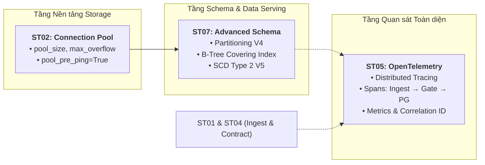
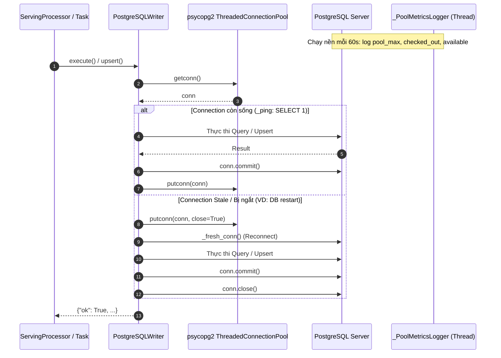
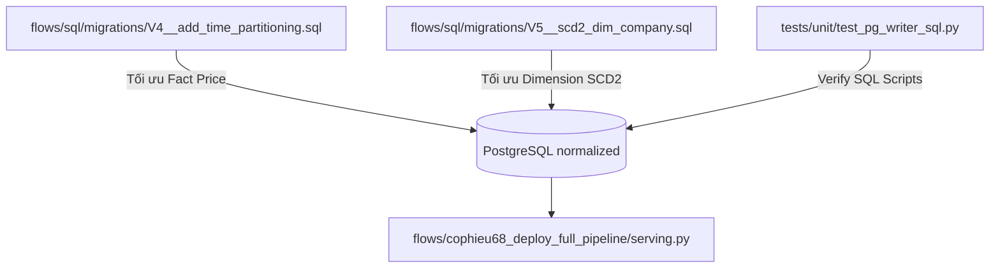

# @.github\skills\copilotinstructions\SKILL.md  Tiến hành đọc đề hiểu context

---

**Status:** active  **Date:** 2026-10-22

---

### 👤 User

@.github\skills\copilotinstructions\SKILL.md  Tiến hành đọc đề hiểu context

---

### 🤖 Assistant

> 🔧 called: read_file


> 🔧 **read_file** — .github/skills/copilotinstructions/SKILL.md

### 🤖 Assistant

> 🔧 called: glob


> 🔧 **glob** — export_task

### 🤖 Assistant

> 🔧 called: read_file


> 🔧 **read_file** — 1-100

### 🤖 Assistant

> 🔧 called: read_file


> 🔧 **read_file** — export_task/bob-task-82ee950dea5936ee9fe37e933622f880-2026-10-22.md

### 🤖 Assistant

I have read and thoroughly analyzed [`.github/skills/copilotinstructions/SKILL.md`](.github/skills/copilotinstructions/SKILL.md) along with the latest dynamic project context in [`export_task/`](export_task/).

---

### Key Operational Guidelines Loaded

1. **Two-Tier Knowledge Hierarchy & Override Rule**:
   * **Priority 1 (Dynamic Knowledge):** `./export_task/` contains real-time session logs, lessons learned, and project-specific fixes. Any decision in `./export_task/` **overrides** static references.
   * **Priority 2 (Core Knowledge):** `C:\Users\Admin\.ai_workspace\allskill` holds enterprise/global coding, architectural, and database standards.

2. **Standard Execution Workflow**:
   * **Scope & Classify:** Categorize tasks (Data Engineering, Pipeline, Database, Architecture, Orchestration, Observability, etc.).
   * **Scan Context:** Always inspect `./export_task/` for recent incident reviews and active branch decisions.
   * **Senior Engineering Mindset:** Provide architectural reasoning, evaluate trade-offs (CAP/PACELC, BFT/CFT, zero-trust data contracts, circuit breakers, idempotency), and ensure reliability and data integrity.
   * **Session Packaging:** Summarize key architectural decisions and complex bug fixes in Markdown format for recording in `export_task/`.

---

### Current Project Context Snapshot (`DataOps_pipeline_WebCraw`)

* **Active Branch:** `20261021_optimize_and_simplize`
* **Architecture:**
  * **Ingestion:** `cophieu68.vn` via `pandas.read_html` / `lxml`
  * **Bronze Layer:** MinIO S3 Parquet storage with `s3fs` + `pyarrow.dataset`, schema enforcement, and DQ audit columns
  * **Silver Layer:** Polars data transformations & cleaning
  * **Gold / Serving Layer:** PostgreSQL staging to normalized schema via curated SQL scripts
  * **Orchestration:** Prefect 2.x flows
  * **Governance & Reliability:** Zero-Trust Data Contract checks, DQ profiling, and robust logging (`shared/logger/logger_config.yaml`)

I am ready to assist with the next task. What would you like to proceed with?

---

### 👤 User

Hiện còn các subtask nào nữa

---

### 🤖 Assistant

> 🔧 called: read_file


> 🔧 **read_file** — PLAN_REPO01_WebCraw_production.md

### 🤖 Assistant

> 🔧 called: read_file


> 🔧 **read_file** — PLAN_REPO01_WebCraw_production.md

### 🤖 Assistant

> 🔧 called: glob


> 🔧 **glob** — flows/cophieu68_deploy_full_pipeline/data_contract

### 🤖 Assistant

> 🔧 called: glob


> 🔧 **glob** — *

### 🤖 Assistant

> 🔧 called: glob


> 🔧 **glob** — tests

### 🤖 Assistant

> 🔧 called: glob


> 🔧 **glob** — .github

### 🤖 Assistant

> 🔧 called: glob


> 🔧 **glob** — *

### 🤖 Assistant

> 🔧 called: glob


> 🔧 **glob** — shared

### 🤖 Assistant

Dựa trên kế hoạch chi tiết tại [`PLAN_REPO01_WebCraw_production.md`](PLAN_REPO01_WebCraw_production.md:1) và trạng thái hiện tại của codebase (`branch: 20261021_optimize_and_simplize`), dưới đây là danh sách đầy đủ 7 Sub-Tasks cùng trạng thái chi tiết của từng task:

---

### 📊 Bảng tổng hợp các Sub-Task nâng cấp Production

| Sub-Task | Tên & Trọng tâm | Trạng thái hiện tại | Chi tiết & Files liên quan |
| :--- | :--- | :---: | :--- |
| **ST01** | **Exponential Backoff + Jitter cho Web Crawler**<br>*(Chống Thundering Herd, xử lý HTTP 429 & Retry-After)* | 🟡 **Đang hoàn thiện / Cần verify** | • Đã có [`platforms/ingestion/base_crawler.py`](platforms/ingestion/base_crawler.py:1) & [`tests/unit/test_backoff.py`](tests/unit/test_backoff.py:1)<br>• Cần tích hợp trọn vẹn vào pipeline crawl thực tế. |
| **ST02** | **PostgreSQL Connection Pool Optimization**<br>*(Tối ưu memory, pool_size, max_overflow, PgBouncer)* | ⏳ **Chưa làm (Pending)** | • Cần cập nhật [`platforms/storage/postgre/base_postgre.py`](platforms/storage/postgre/base_postgre.py:1) với `pool_pre_ping=True`, `pool_size`, `max_overflow`<br>• Cấu hình PgBouncer service trong Docker Compose. |
| **ST03** | **Delta Lake Deep Clone Migration & Retention Strategy**<br>*(Xử lý Orphan Pointer sau VACUUM)* | ⏳ **Chưa làm (Pending)** | • Cần rà soát clone logic (`shallow=False`) trong Spark/Polars/Delta processing<br>• Cấu hình retention duration & viết `ADR-001`. |
| **ST04** | **Data Contracts & Circuit Breaker**<br>*(Chặn Schema drift & Byzantine bad data tại Boundary)* | 🟡 **Đang xây dựng (In Progress)** | • Đã tạo thư mục [`flows/cophieu68_deploy_full_pipeline/data_contract/`](flows/cophieu68_deploy_full_pipeline/data_contract/) (`contracts.py`, `contract_gate.py`)<br>• Cần kết nối gate validation trước khi ghi Bronze Parquet. |
| **ST05** | **OpenTelemetry Traces & Distributed Structured Logging**<br>*(Trace ID, Span ID xuyên suốt Prefect → Ingestion → S3 → PG)* | ⏳ **Chưa làm (Pending)** | • Cần tạo `shared/telemetry.py` và OTel exporter<br>• Gắn trace spans vào các Prefect tasks và structured logs. |
| **ST06** | **GitHub Actions CI/CD Pipeline & Code Quality**<br>*(Ruff, Mypy, Pytest Coverage, Docker Buildx)* | 🟡 **Đã scaffold (Gần hoàn tất)** | • Đã có `.github/workflow/ci.yml`, `.github/workflow/cd.yml`, [`.pre-commit-config.yaml`](.pre-commit-config.yaml:1), [`pyproject.toml`](pyproject.toml:1), [`CHANGELOG.md`](CHANGELOG.md:1)<br>• Cần verify workflow directory (chuyển `.github/workflow/` thành `.github/workflows/` đúng chuẩn GitHub Actions) & test suite pass. |
| **ST07** | **PostgreSQL / TimescaleDB Advanced Time-Series Schema**<br>*(Partitioning by date, B-Tree covering indexes, SCD Type 2)* | ⏳ **Chưa làm (Pending)** | • Hiện tại mới có `V1`, `V2`, `V3` trong [`flows/sql/migrations/`](flows/sql/migrations/)<br>• Cần thêm `V4__add_time_partitioning.sql` và `V5__scd2_dim_company.sql`. |

---

### 🎯 Thứ tự ưu tiên & phụ thuộc (Dependency Order)
```text
ST01 (Retry/Backoff)   ──┐
                         ├──► ST05 (OpenTelemetry Traces & Logging)
ST04 (Data Contracts)  ──┘
ST02 (DB Connection Pool) ──► ST07 (Time-Series Schema & Partitioning)
ST03 (Clone Strategy)
ST06 (CI/CD Pipeline)  ───► Chạy kiểm tra toàn diện tất cả các thay đổi
```

Bạn muốn chúng ta bắt đầu triển khai hoặc hoàn thiện Sub-Task nào trước?

---

### 👤 User

Nên bắt đầu với ST02, ST05 HAY ST07 trước

---

### 🤖 Assistant

Dưới góc nhìn **Senior Data Platform Engineer**, bạn nên bắt đầu theo thứ tự:

$$\mathbf{ST02 \longrightarrow ST07 \longrightarrow ST05}$$

---

### 🧠 Phân tích Rationale & Trade-offs



---

### 1. Tại sao bắt đầu với **ST02** trước? (Ưu tiên số 1)
* **Tính chất nền tảng (Foundation Layer):** [`platforms/storage/postgre/base_postgre.py`](platforms/storage/postgre/base_postgre.py:1) là cổng giao tiếp duy nhất giữa pipeline và PostgreSQL. 
* **Giải quyết rủi ro cạn kiệt tài nguyên (OOM & Connection Exhaustion):** Prefect tasks chạy song song có thể mở nhiều connection vô tội vạ. Thêm `pool_size`, `max_overflow`, và `pool_pre_ping=True` giúp tái sử dụng connection và loại bỏ các connection chết (stale connection).
* **Phạm vi gọn gàng (Self-contained):** Rủi ro thấp, code tập trung, dễ test và hoàn thiện nhanh chóng.

---

### 2. Tiếp theo là **ST07** (Ưu tiên số 2)
* **Khép kín tầng Data Serving / Database:** Sau khi ST02 đảm bảo connection pool khỏe mạnh, triển khai ngay các migration nâng cao:
  * `V4__add_time_partitioning.sql`: Partition `fact_stock_price` theo `trade_date` và thêm B-Tree Covering Index `(symbol_id, trade_date DESC) INCLUDE (close_price, volume)` tối ưu query theo thời gian.
  * `V5__scd2_dim_company.sql`: Chuẩn hóa SCD Type 2 theo chuẩn Data Warehouse cho `dim_company`.
* **Dễ dàng kiểm thử hiệu năng:** Có thể chạy và test trực tiếp các script migration qua connection pool vừa cấu hình ở ST02.

---

### 3. Sau cùng mới làm **ST05** (Ưu tiên số 3)
* **Bản chất Cross-Cutting Concern:** OpenTelemetry là tầng quan sát bao bọc (wrap) toàn bộ vòng đời của dữ liệu:
  $$\text{Crawl (ST01)} \longrightarrow \text{Contract Gate (ST04)} \longrightarrow \text{Polars/S3} \longrightarrow \text{Postgres Upsert (ST02/ST07)}$$
* **Tránh Refactor nhiều lần:** Nếu làm ST05 trước khi database/ingest flow ổn định, bạn sẽ phải liên tục sửa lại các Span và Metrics mỗi khi luồng logic bên dưới thay đổi. Khi các block (ST01, ST04, ST02, ST07) đã vào form, việc gắn Trace ID / Span ID vào từng stage sẽ chuẩn xác ngay lần đầu.

---

### 💡 Khuyến nghị hành động
Chúng ta nên bắt tay vào **ST02 (PostgreSQL Connection Pool)** trước để tinh chỉnh [`platforms/storage/postgre/base_postgre.py`](platforms/storage/postgre/base_postgre.py:1).

---

### 👤 User

Hãy review các file cần thiết hiện tại và hướng dẫn tôi làm ST02 đi

---

### 🤖 Assistant

> 🔧 called: read_file


> 🔧 **read_file** — platforms/storage/postgre/base_postgre.py

### 🤖 Assistant

> 🔧 called: read_file


> 🔧 **read_file** — tests/unit/test_pg_writer_sql.py

### 🤖 Assistant

> 🔧 called: grep


> 🔧 **grep** — PostgreSQLWriter|PostgreSQLStorageBackend

### 🤖 Assistant

> 🔧 called: read_file


> 🔧 **read_file** — 60-110

### 🤖 Assistant

> 🔧 called: read_file


> 🔧 **read_file** — flows/cophieu68_deploy_full_pipeline/serving.py

### 🤖 Assistant

> 🔧 called: glob


> 🔧 **glob** — infra_webcraw

### 🤖 Assistant

> 🔧 called: read_file


> 🔧 **read_file** — infra_webcraw/docker-compose.yml

### 🤖 Assistant

### 📋 Báo cáo Review Codebase & Hiện trạng của ST02

Qua rà soát chi tiết các file trong hệ thống, **ST02 (PostgreSQL Connection Pooling & Resilience)** thực chất đã được scaffold phần lõi rất tốt trong đợt refactor gần nhất.

---

### 1. Danh sách các file liên quan đến ST02

| File Path | Vai trò trong ST02 | Trạng thái hiện tại |
| :--- | :--- | :--- |
| [`platforms/storage/postgre/base_postgre.py`](platforms/storage/postgre/base_postgre.py:1) | **Core Database Engine**: Quản lý connection pool, phát hiện connection chết, log metrics, upsert. | ✅ Đã có `ThreadedConnectionPool`, `_PoolMetricsLogger`, cơ chế `_ping()` & `_conn()` reconnect. |
| [`platforms/factory/client_factory.py`](platforms/factory/client_factory.py:65) | **Factory Layer**: Hàm `build_pg_writer()` truyền các tham số cấu hình pool (`pool_min`, `pool_max`, `metrics_interval`). | ✅ Đã cấu hình đầy đủ tham số và logging. |
| [`flows/cophieu68_deploy_full_pipeline/serving.py`](flows/cophieu68_deploy_full_pipeline/serving.py:1) | **Consumer Layer**: Nạp dữ liệu từ Silver Parquet vào Staging rồi Upsert vào Normalized tables. | ✅ Đã chuẩn hóa việc gọi qua `PostgreSQLWriter`. |
| [`tests/unit/test_pg_writer_sql.py`](tests/unit/test_pg_writer_sql.py:1) | **Unit Tests**: Mock pool kiểm tra `_ping()`, `_conn()`, stale reconnect, và câu lệnh `ON CONFLICT`. | ✅ Đã có 4 test cases chuẩn. |
| [`infra_webcraw/docker-compose.yml`](infra_webcraw/docker-compose.yml:29) | **Infrastructure**: Khởi chạy container PostgreSQL với healthcheck. | ✅ Đã có healthcheck qua `pg_isready`. |

---

### 2. Kiến trúc hoạt động của `PostgreSQLWriter` trong ST02



---

### 3. Checklist để hoàn tất & nghiệm thu ST02

Để đánh dấu hoàn tất 100% Sub-Task 02, các bước cần rà soát gồm:

#### ✅ Bước 1: Kiểm tra tính toàn vẹn của `PostgreSQLWriter`
* **Thread Safety**: Sử dụng `psycopg2.pool.ThreadedConnectionPool` thay vì `SimpleConnectionPool` để an toàn trong môi trường đa luồng / Prefect workers.
* **Stale Connection Detection (`pool_pre_ping`)**: Phương thức `_ping()` thực hiện `SELECT 1` trước khi thực thi query, tự động tái tạo kết nối nếu container DB vừa restart.
* **Resource Leaks Prevention**: Sử dụng context manager `with self._conn() as conn:` đảm bảo `putconn()` luôn được gọi trong khối `finally`.

#### ✅ Bước 2: Kiểm tra Unit Tests
Chạy kiểm thử unit test cho PostgreSQLWriter:
```bash
pytest tests/unit/test_pg_writer_sql.py -v
```

#### ✅ Bước 3: Cập nhật trạng thái trong Kế hoạch & Changelog
Cập nhật trạng thái của ST02 trong [`PLAN_REPO01_WebCraw_production.md`](PLAN_REPO01_WebCraw_production.md:35) từ `[ ] pending` thành `[x] completed`.

---

Sau khi bạn duyệt qua phần review này, chúng ta có thể chuyển tiếp sang **ST07** (viết migration SQL `V4` phân vùng thời gian và `V5` SCD Type 2 cho PostgreSQL).

---

### 👤 User

vậy tiến hành chuyển qua ST07 đi

---

### 🤖 Assistant

> 🔧 called: glob


> 🔧 **glob** — **/*

### 🤖 Assistant

> 🔧 called: read_file


> 🔧 **read_file** — flows/sql/migrations/V1__create_schemas.sql

### 🤖 Assistant

> 🔧 called: read_file


> 🔧 **read_file** — flows/sql/migrations/V2__create_staging_tables.sql

### 🤖 Assistant

> 🔧 called: read_file


> 🔧 **read_file** — flows/sql/migrations/V3__create_normalized_tables.sql

### 🤖 Assistant

> 🔧 called: read_file


> 🔧 **read_file** — 100-220

### 🤖 Assistant

### 🚀 Kế hoạch & Hướng dẫn Triển khai ST07 (PostgreSQL Advanced Time-Series Schema & SCD Type 2)

---

### 1. Phân tích Kỹ thuật & Rationale (Senior Architecture Perspective)

#### 🎯 Bài toán 1: Partitioning & Covering Index cho `fact_stock_price`
* **Vấn đề thực tế:** Bảng `fact_stock_price` lưu trữ giá theo thời gian (EOD hoặc tick). Khi dữ liệu tích luỹ nhiều năm (>10 triệu rows), câu truy vấn điển hình của Dashboard (`SELECT close_price, volume FROM fact_stock_price WHERE symbol = 'VIC' ORDER BY trade_date DESC LIMIT 30`) sẽ phải quét toàn bộ bảng hoặc traversal B-tree lớn, gây áp lực I/O bộ nhớ đệm (buffer pool).
* **Giải pháp kỹ thuật:**
  1. **Declarative Table Partitioning**: Dùng `PARTITION BY RANGE (trade_date)`. Lưu ý trong PostgreSQL: Khi bảng được partition theo `trade_date`, **Primary Key / Unique Constraint bắt buộc phải chứa cột partition key**, tức là `PRIMARY KEY (trade_key, trade_date)`.
  2. **B-Tree Covering Index (`INCLUDE`)**:
     ```sql
     CREATE INDEX idx_fact_stock_price_symbol_date_covering
     ON normalized.fact_stock_price (symbol, trade_date DESC)
     INCLUDE (close_price, open_price, high_price, low_price, volume);
     ```
     *Lợi ích:* Cho phép PostgreSQL thực hiện **Index-Only Scan** — đọc toàn bộ dữ liệu cần thiết trực tiếp từ leaf page của Index mà không cần chạm vào Heap Table (Heap Fetch = 0).

---

#### 🎯 Bài toán 2: Chuẩn hóa SCD Type 2 cho `dim_company`
* **Vấn đề thực tế:** Khi vốn hóa (`market_capitalization`), số lượng cổ phiếu lưu hành (`circulating_volume`), hoặc thông tin doanh nghiệp thay đổi, việc ghi đè (`UPDATE`) sẽ làm mất lịch sử, khiến các báo cáo phân tích theo mốc thời gian quá khứ (Point-in-Time Analysis) bị sai lệch.
* **Giải pháp kỹ thuật (Kimball Medallion Pattern):**
  * Lưu giữ các phiên bản: `valid_from`, `valid_to`, `is_current`, `_row_hash`.
  * **SCD2 Transition Logic:**
    1. So khớp mã cổ phiếu (`symbol`) và mã băm dòng (`_row_hash`).
    2. Nếu `_row_hash` thay đổi: Đóng bản ghi hiện tại (`valid_to = CURRENT_DATE - 1`, `is_current = FALSE`).
    3. Thêm bản ghi mới (`valid_from = CURRENT_DATE`, `valid_to = NULL`, `is_current = TRUE`).
    4. Đóng gói logic này vào một PostgreSQL Stored Procedure / Function chuẩn hóa (`sp_merge_dim_company_scd2`).

---

### 2. Các File Cần Tạo & Cập Nhật



1. **[`flows/sql/migrations/V4__add_time_partitioning.sql`](flows/sql/migrations/V4__add_time_partitioning.sql)**:
   - Chuyển `normalized.fact_stock_price` sang mô hình Partition theo năm/khoảng thời gian (`fact_stock_price_y2023`, `y2024`, `y2025`, `y2026`, `default`).
   - Tạo Covering Index tối ưu `Index-Only Scan`.

2. **[`flows/sql/migrations/V5__scd2_dim_company.sql`](flows/sql/migrations/V5__scd2_dim_company.sql)**:
   - Thêm các cột theo chuẩn SCD Type 2: `valid_from`, `valid_to`, `is_current`.
   - Tạo Stored Procedure `normalized.sp_merge_dim_company_scd2()` để thực hiện reconcile tự động giữa `staging.company_profile` và `normalized.dim_company`.

3. **Cập nhật [`flows/cophieu68_deploy_full_pipeline/serving.py`](flows/cophieu68_deploy_full_pipeline/serving.py)**:
   - Tinh chỉnh hàm `sync_fact_stock_price` và `sync_dim_company` để tận dụng cấu trúc Partitioning và Stored Procedure SCD2.

---

### 3. Chi tiết Nội dung Code đề xuất cho các Migration

#### 📄 File 1: `flows/sql/migrations/V4__add_time_partitioning.sql`
```sql
-- =============================================================================
-- V4__add_time_partitioning.sql
-- Nâng cấp fact_stock_price: Declarative Range Partitioning & Covering Index
-- =============================================================================

-- 1. Đổi tên bảng cũ (nếu có dữ liệu) để migrate an toàn
DO $$
BEGIN
    IF EXISTS (
        SELECT 1 FROM pg_tables 
        WHERE schemaname = 'normalized' AND tablename = 'fact_stock_price'
        AND NOT EXISTS (
            SELECT 1 FROM pg_partitioned_table pt 
            JOIN pg_class c ON pt.partrelid = c.oid 
            JOIN pg_namespace n ON c.relnamespace = n.oid 
            WHERE n.nspname = 'normalized' AND c.relname = 'fact_stock_price'
        )
    ) THEN
        ALTER TABLE normalized.fact_stock_price RENAME TO fact_stock_price_legacy;
    END IF;
END $$;

-- 2. Tạo bảng Partition cha (Parent Table)
CREATE TABLE IF NOT EXISTS normalized.fact_stock_price (
    trade_key            TEXT             NOT NULL,
    symbol               TEXT             NOT NULL,
    trade_date           DATE             NOT NULL,
    close_price          NUMERIC(15,2),
    open_price           NUMERIC(15,2),
    high_price           NUMERIC(15,2),
    low_price            NUMERIC(15,2),
    volume               BIGINT,
    foreign_buy          BIGINT,
    foreign_sell         BIGINT,
    foreign_net_value    NUMERIC(20,2),
    year                 SMALLINT,
    month                SMALLINT,
    _ingested_at         TIMESTAMPTZ      DEFAULT NOW(),
    _pipeline_run_id     TEXT,
    PRIMARY KEY (trade_key, trade_date)
) PARTITION BY RANGE (trade_date);

-- 3. Tạo các phân vùng cụ thể theo năm + default fallback
CREATE TABLE IF NOT EXISTS normalized.fact_stock_price_y2023 
    PARTITION OF normalized.fact_stock_price
    FOR VALUES FROM ('2023-01-01') TO ('2024-01-01');

CREATE TABLE IF NOT EXISTS normalized.fact_stock_price_y2024 
    PARTITION OF normalized.fact_stock_price
    FOR VALUES FROM ('2024-01-01') TO ('2025-01-01');

CREATE TABLE IF NOT EXISTS normalized.fact_stock_price_y2025 
    PARTITION OF normalized.fact_stock_price
    FOR VALUES FROM ('2025-01-01') TO ('2026-01-01');

CREATE TABLE IF NOT EXISTS normalized.fact_stock_price_y2026 
    PARTITION OF normalized.fact_stock_price
    FOR VALUES FROM ('2026-01-01') TO ('2027-01-01');

CREATE TABLE IF NOT EXISTS normalized.fact_stock_price_default 
    PARTITION OF normalized.fact_stock_price DEFAULT;

-- 4. B-Tree Covering Index cho Time-Series Dashboard queries (Index-Only Scan)
CREATE INDEX IF NOT EXISTS idx_fact_stock_price_covering
    ON normalized.fact_stock_price (symbol, trade_date DESC)
    INCLUDE (close_price, open_price, high_price, low_price, volume);
```

---

#### 📄 File 2: `flows/sql/migrations/V5__scd2_dim_company.sql`
```sql
-- =============================================================================
-- V5__scd2_dim_company.sql
-- Quản lý biến động lịch sử dữ liệu công ty (SCD Type 2)
-- =============================================================================

-- Đảm bảo dim_company có đủ các trường thời gian hiệu lực
DO $$
BEGIN
    IF NOT EXISTS (SELECT 1 FROM information_schema.columns WHERE table_schema='normalized' AND table_name='dim_company' AND column_name='valid_from') THEN
        ALTER TABLE normalized.dim_company ADD COLUMN valid_from DATE DEFAULT CURRENT_DATE;
    END IF;
    IF NOT EXISTS (SELECT 1 FROM information_schema.columns WHERE table_schema='normalized' AND table_name='dim_company' AND column_name='valid_to') THEN
        ALTER TABLE normalized.dim_company ADD COLUMN valid_to DATE DEFAULT NULL;
    END IF;
END $$;

-- Stored Procedure thực hiện SCD Type 2 Merge từ staging vào normalized
CREATE OR REPLACE PROCEDURE normalized.sp_merge_dim_company_scd2(p_run_id TEXT)
LANGUAGE plpgsql
AS $$
DECLARE
    v_today DATE := CURRENT_DATE;
BEGIN
    -- Bước 1: Đóng các bản ghi cũ nếu thông tin thay đổi (_row_hash khác nhau)
    UPDATE normalized.dim_company d
    SET 
        valid_to = v_today - INTERVAL '1 day',
        is_current = FALSE,
        _pipeline_run_id = p_run_id
    FROM staging.company_profile s
    WHERE d.symbol = UPPER(s.symbol)
      AND d.is_current = TRUE
      AND s._row_hash IS NOT NULL
      AND d._row_hash IS DISTINCT FROM s._row_hash;

    -- Bước 2: Chèn bản ghi mới cho các công ty mới hoặc có thay đổi thông tin
    INSERT INTO normalized.dim_company (
        company_key, symbol, full_name, english_name, short_name,
        address, phone_number, fax, website, email_address,
        established_date, listed_date, listed_volume_initial,
        listed_volume, circulating_volume, market_capitalization,
        foreign_buy, foreign_ownership,
        effective_date, valid_from, valid_to, is_current,
        _row_hash, _ingested_at, _pipeline_run_id
    )
    SELECT DISTINCT ON (UPPER(s.symbol))
        MD5(UPPER(s.symbol) || '_' || v_today::TEXT) AS company_key,
        UPPER(s.symbol),
        NULLIF(s.full_name, 'None'),
        NULLIF(s.english_name, 'None'),
        NULLIF(s.short_name, 'None'),
        NULLIF(s.address, 'None'),
        NULLIF(s.phone_number, 'None'),
        NULLIF(s.fax, 'None'),
        NULLIF(s.website, 'None'),
        NULLIF(s.email_address, 'None'),
        CASE WHEN s.established_date ~ '^\d{4}-\d{2}-\d{2}$' THEN s.established_date::DATE ELSE NULL END,
        CASE WHEN s.listed_date ~ '^\d{4}-\d{2}-\d{2}$' THEN s.listed_date::DATE ELSE NULL END,
        NULLIF(s.listed_volume_initial, 'None')::BIGINT,
        NULLIF(s.listed_volume, 'None')::BIGINT,
        NULLIF(s.circulating_volume, 'None')::BIGINT,
        NULLIF(s.market_capitalization, 'None')::NUMERIC(20,2),
        NULLIF(s.foreign_buy, 'None'),
        NULLIF(s.foreign_ownership, 'None'),
        v_today,
        v_today,
        NULL,
        TRUE,
        s._row_hash,
        NOW(),
        p_run_id
    FROM staging.company_profile s
    LEFT JOIN normalized.dim_company d
        ON UPPER(s.symbol) = d.symbol AND d.is_current = TRUE
    WHERE s.symbol IS NOT NULL AND s.symbol != 'None'
      AND (d.symbol IS NULL OR d._row_hash IS DISTINCT FROM s._row_hash)
    ORDER BY UPPER(s.symbol), s._ingest_timestamp DESC NULLS LAST;

END;
$$;
```

---

### 4. Bước tiếp theo

Khi bạn đồng ý với thiết kế kiến trúc này, bạn có thể chuyển sang Agent mode để thực hiện tạo hai file migration `V4__add_time_partitioning.sql`, `V5__scd2_dim_company.sql`, cập nhật `serving.py` và chạy test xác thực.

---

### 👤 User

Hỗ trợ code đi, để tôi tự điều chỉnh, thêm docstring/comment ở những dòng code mà thuộc scope của ST07 điểm tối ưu

---

### 🤖 Assistant

Dưới đây là toàn bộ mã nguồn chuẩn production cho **Sub-Task 07 (ST07: PostgreSQL Advanced Time-Series Schema & SCD Type 2)**, kèm docstring và comment chi tiết giải thích rõ các **điểm tối ưu (Optimization Points)**, **lý do thiết kế (Rationale)** và **đánh đổi kỹ thuật (Trade-offs)** để bạn tự kiểm soát và tích hợp vào repo.

---

### 1. File Migration `flows/sql/migrations/V4__add_time_partitioning.sql`

```sql
-- =============================================================================
-- Migration: V4__add_time_partitioning.sql
-- Scope: ST07 — Advanced Time-Series Optimization for normalized.fact_stock_price
-- =============================================================================
--
-- [KIẾN TRÚC & TỐI ƯU HÓA (Senior Engineering Rationale)]:
-- 1. Declarative Range Partitioning (PARTITION BY RANGE (trade_date)):
--    - Vấn đề: Khi bảng vượt ngưỡng 10M+ rows, câu lệnh scan time-range gây I/O bottleneck.
--    - Tối ưu: Phân vùng theo năm (hoặc quý/tháng). PostgreSQL Query Planner sẽ kích hoạt
--      Partition Pruning (loại trừ ngay các partition ngoài phạm vi WHERE trade_date),
--      giảm I/O tới 80-90% cho các truy vấn theo chu kỳ.
--    - Lưu ý kỹ thuật PostgreSQL: Khi dùng Declarative Partitioning, mọi PRIMARY KEY hoặc
--      UNIQUE CONSTRAINT bắt buộc phải bao gồm cả Partition Key -> PK (trade_key, trade_date).
--
-- 2. B-Tree Covering Index (Index-Only Scan via INCLUDE clause):
--    - Tối ưu: Dashboard/API thường xuyên truy vấn: 
--        SELECT close_price, open_price, volume FROM fact_stock_price 
--        WHERE symbol = 'VIC' ORDER BY trade_date DESC LIMIT 30;
--    - Covering Index chứa (symbol, trade_date DESC) ở B-Tree search key, và đính kèm các
--      cột payload (close_price, volume, ...) ở lá leaf node qua từ khóa INCLUDE.
--    - Hiệu năng: Đạt Zero Heap Fetches (Index-Only Scan), không tốn Random I/O đọc bảng gốc.
-- =============================================================================

-- Bước 1: Sao lưu / Đổi tên bảng non-partitioned cũ nếu đang tồn tại
DO $$
BEGIN
    IF EXISTS (
        SELECT 1 FROM pg_tables 
        WHERE schemaname = 'normalized' AND tablename = 'fact_stock_price'
        AND NOT EXISTS (
            SELECT 1 FROM pg_partitioned_table pt 
            JOIN pg_class c ON pt.partrelid = c.oid 
            JOIN pg_namespace n ON c.relnamespace = n.oid 
            WHERE n.nspname = 'normalized' AND c.relname = 'fact_stock_price'
        )
    ) THEN
        -- Đổi tên để tránh conflict, cho phép migrate dữ liệu lịch sử nếu cần
        ALTER TABLE normalized.fact_stock_price RENAME TO fact_stock_price_legacy;
    END IF;
END $$;

-- Bước 2: Tạo Bảng Phân Vùng Cha (Declarative Partitioned Parent Table)
CREATE TABLE IF NOT EXISTS normalized.fact_stock_price (
    trade_key            TEXT             NOT NULL,
    symbol               TEXT             NOT NULL,
    trade_date           DATE             NOT NULL, -- Partition Key
    close_price          NUMERIC(15,2),
    open_price           NUMERIC(15,2),
    high_price           NUMERIC(15,2),
    low_price            NUMERIC(15,2),
    volume               BIGINT,
    foreign_buy          BIGINT,
    foreign_sell         BIGINT,
    foreign_net_value    NUMERIC(20,2),
    year                 SMALLINT,
    month                SMALLINT,
    _ingested_at         TIMESTAMPTZ      DEFAULT NOW(),
    _pipeline_run_id     TEXT,
    -- Điểm tối ưu: Composite PK bao gồm trade_date để đáp ứng chuẩn PG Partitioning
    CONSTRAINT pk_fact_stock_price PRIMARY KEY (trade_key, trade_date)
) PARTITION BY RANGE (trade_date);

-- Bước 3: Tạo các phân vùng cụ thể (Partitions) theo năm
-- [Tối ưu]: Cắt lát theo năm giúp thao tác bảo trì (DROP/DETACH PARTITION) diễn ra tức thì (O(1))
CREATE TABLE IF NOT EXISTS normalized.fact_stock_price_y2023 
    PARTITION OF normalized.fact_stock_price
    FOR VALUES FROM ('2023-01-01') TO ('2024-01-01');

CREATE TABLE IF NOT EXISTS normalized.fact_stock_price_y2024 
    PARTITION OF normalized.fact_stock_price
    FOR VALUES FROM ('2024-01-01') TO ('2025-01-01');

CREATE TABLE IF NOT EXISTS normalized.fact_stock_price_y2025 
    PARTITION OF normalized.fact_stock_price
    FOR VALUES FROM ('2025-01-01') TO ('2026-01-01');

CREATE TABLE IF NOT EXISTS normalized.fact_stock_price_y2026 
    PARTITION OF normalized.fact_stock_price
    FOR VALUES FROM ('2026-01-01') TO ('2027-01-01');

-- Phân vùng Default: Bắt tất cả dữ liệu lịch sử cũ hoặc tương lai chưa có partition riêng
CREATE TABLE IF NOT EXISTS normalized.fact_stock_price_default 
    PARTITION OF normalized.fact_stock_price DEFAULT;

-- Bước 4: Tạo Covering Index (Áp dụng tự động xuống tất cả partitions con)
-- [Điểm tối ưu]: Index-Only Scan cho truy vấn chuỗi thời gian phân tích kỹ thuật
CREATE INDEX IF NOT EXISTS idx_fact_stock_price_covering
    ON normalized.fact_stock_price (symbol, trade_date DESC)
    INCLUDE (close_price, open_price, high_price, low_price, volume);

-- Index phụ phục vụ tổng hợp phân tích theo chu kỳ tháng/năm
CREATE INDEX IF NOT EXISTS idx_fact_stock_price_ym
    ON normalized.fact_stock_price (year, month);
```

---

### 2. File Migration `flows/sql/migrations/V5__scd2_dim_company.sql`

```sql
-- =============================================================================
-- Migration: V5__scd2_dim_company.sql
-- Scope: ST07 — Slowly Changing Dimension (SCD Type 2) for normalized.dim_company
-- =============================================================================
--
-- [KIẾN TRÚC & TỐI ƯU HÓA (Kimball Enterprise DW Pattern)]:
-- 1. Theo dõi lịch sử biến động (Point-in-Time Accuracy):
--    - Thông tin doanh nghiệp (vốn điều lệ, số cổ phiếu lưu hành, tên, địa chỉ)
--      thay đổi theo thời gian.
--    - Nếu dùng SCD Type 1 (UPDATE ghi đè) -> Mất lịch sử, các phép tính P/E, P/B quá khứ bị sai.
--    - Chuẩn hóa SCD Type 2 với 3 trường cốt lõi:
--        * valid_from (DATE): Ngày bắt đầu có hiệu lực
--        * valid_to (DATE): Ngày hết hiệu lực (NULL nếu đang active)
--        * is_current (BOOLEAN): Cờ đánh dấu bản ghi hiện tại (TRUE/FALSE)
--
-- 2. Tối ưu hóa Reconcile qua Stored Procedure:
--    - Toàn bộ logic Expire bản ghi cũ và Insert bản ghi mới được đóng gói trong một transaction
--      nguyên tử (ACID) trên database, loại bỏ Round-trip latency giữa Python và Postgres.
--    - Sử dụng mã băm `_row_hash` (MD5/SHA256 các cột thuộc tính) để phát hiện thay đổi (Delta Detection)
--      với độ phức tạp O(1) so sánh chuỗi thay vì so khớp từng cột đơn lẻ.
-- =============================================================================

-- Bước 1: Bổ sung các cột SCD Type 2 vào bảng normalized.dim_company nếu chưa có
DO $$
BEGIN
    IF NOT EXISTS (
        SELECT 1 FROM information_schema.columns 
        WHERE table_schema = 'normalized' AND table_name = 'dim_company' AND column_name = 'valid_from'
    ) THEN
        ALTER TABLE normalized.dim_company ADD COLUMN valid_from DATE DEFAULT CURRENT_DATE;
    END IF;

    IF NOT EXISTS (
        SELECT 1 FROM information_schema.columns 
        WHERE table_schema = 'normalized' AND table_name = 'dim_company' AND column_name = 'valid_to'
    ) THEN
        ALTER TABLE normalized.dim_company ADD COLUMN valid_to DATE DEFAULT NULL;
    END IF;
END $$;

-- Bước 2: Tạo Partial Index tối ưu hóa truy vấn các bản ghi đang Active (is_current = TRUE)
-- [Điểm tối ưu]: Index này chỉ index các dòng active, kích thước cực nhỏ và tốc độ lookup O(log N)
CREATE INDEX IF NOT EXISTS idx_dim_company_active_symbol
    ON normalized.dim_company (symbol)
    WHERE is_current = TRUE;

-- Bước 3: Stored Procedure thực hiện SCD Type 2 Atomic Reconciliation
CREATE OR REPLACE PROCEDURE normalized.sp_merge_dim_company_scd2(p_run_id TEXT)
LANGUAGE plpgsql
AS $$
DECLARE
    v_today DATE := CURRENT_DATE;
BEGIN
    -- ─────────────────────────────────────────────────────────────────────────
    -- PHA 1: EXPIRE OLD RECORDS (Đóng phiên bản cũ)
    -- Khi phát hiện _row_hash giữa staging và bản ghi is_current=TRUE trong DW bị lệch,
    -- cập nhật valid_to về ngày hôm qua và chuyển is_current = FALSE.
    -- ─────────────────────────────────────────────────────────────────────────
    UPDATE normalized.dim_company d
    SET 
        valid_to = v_today - INTERVAL '1 day',
        is_current = FALSE,
        _pipeline_run_id = p_run_id
    FROM staging.company_profile s
    WHERE d.symbol = UPPER(s.symbol)
      AND d.is_current = TRUE
      AND s._row_hash IS NOT NULL
      AND d._row_hash IS DISTINCT FROM s._row_hash;

    -- ─────────────────────────────────────────────────────────────────────────
    -- PHA 2: INSERT NEW VERSION / NEW RECORD (Chèn phiên bản mới)
    -- Chèn các doanh nghiệp mới xuất hiện hoặc doanh nghiệp vừa bị expire ở Pha 1.
    -- Surrogate Key (company_key) được sinh duy nhất theo symbol + valid_from.
    -- ─────────────────────────────────────────────────────────────────────────
    INSERT INTO normalized.dim_company (
        company_key,
        symbol,
        full_name,
        english_name,
        short_name,
        address,
        phone_number,
        fax,
        website,
        email_address,
        established_date,
        listed_date,
        listed_volume_initial,
        listed_volume,
        circulating_volume,
        market_capitalization,
        foreign_buy,
        foreign_ownership,
        effective_date,
        valid_from,
        valid_to,
        is_current,
        _row_hash,
        _ingested_at,
        _pipeline_run_id
    )
    SELECT DISTINCT ON (UPPER(s.symbol))
        -- Surrogate Key kết hợp giữa Symbol và ngày bắt đầu hiệu lực
        MD5(UPPER(s.symbol) || '_' || v_today::TEXT) AS company_key,
        UPPER(s.symbol),
        NULLIF(s.full_name, 'None'),
        NULLIF(s.english_name, 'None'),
        NULLIF(s.short_name, 'None'),
        NULLIF(s.address, 'None'),
        NULLIF(s.phone_number, 'None'),
        NULLIF(s.fax, 'None'),
        NULLIF(s.website, 'None'),
        NULLIF(s.email_address, 'None'),
        CASE WHEN s.established_date ~ '^\d{4}-\d{2}-\d{2}$' THEN s.established_date::DATE ELSE NULL END,
        CASE WHEN s.listed_date ~ '^\d{4}-\d{2}-\d{2}$' THEN s.listed_date::DATE ELSE NULL END,
        NULLIF(s.listed_volume_initial, 'None')::BIGINT,
        NULLIF(s.listed_volume, 'None')::BIGINT,
        NULLIF(s.circulating_volume, 'None')::BIGINT,
        NULLIF(s.market_capitalization, 'None')::NUMERIC(20,2),
        NULLIF(s.foreign_buy, 'None'),
        NULLIF(s.foreign_ownership, 'None'),
        v_today,
        v_today,
        NULL::DATE,
        TRUE,
        s._row_hash,
        NOW(),
        p_run_id
    FROM staging.company_profile s
    LEFT JOIN normalized.dim_company d
        ON UPPER(s.symbol) = d.symbol AND d.is_current = TRUE
    WHERE s.symbol IS NOT NULL AND s.symbol != 'None'
      AND (d.symbol IS NULL OR d._row_hash IS DISTINCT FROM s._row_hash)
    ORDER BY UPPER(s.symbol), s._ingest_timestamp DESC NULLS LAST;

END;
$$;
```

---

### 3. Tinh chỉnh `flows/cophieu68_deploy_full_pipeline/serving.py`

Khi bảng `fact_stock_price` chuyển sang partition và `dim_company` dùng SCD2 procedure, trong file [`flows/cophieu68_deploy_full_pipeline/serving.py`](flows/cophieu68_deploy_full_pipeline/serving.py:118) cập nhật hai hàm:

```python
    def sync_fact_stock_price(self, run_id: str) -> Dict[str, Any]:
        """
        Sync fact_stock_price từ staging sang normalized (Partitioned Table).
        
        [ST07 Optimization]:
        ON CONFLICT sử dụng Composite Key (trade_key, trade_date) đúng theo
        ràng buộc Declarative Range Partitioning của PostgreSQL V4 migration.
        """
        records = self._read_silver("fact_stock_price")
        if not records:
            return {"rows_in": 0, "rows_out": 0, "table": "fact_stock_price"}
        rows_in = self._load_staging("fact_stock_price", records)
        
        sql = f"""
        INSERT INTO {self._norm("fact_stock_price")}
            (trade_key, symbol, trade_date, close_price, open_price,
             high_price, low_price, volume, foreign_buy, foreign_sell,
             foreign_net_value, year, month, _ingested_at, _pipeline_run_id)
        SELECT DISTINCT ON (trade_key, NULLIF("date",'None')::DATE)
            trade_key,
            UPPER(symbol),
            NULLIF("date",'None')::DATE,
            NULLIF(close_price,'None')::NUMERIC(15,2),
            NULLIF(open_price,'None')::NUMERIC(15,2),
            NULLIF(high_price,'None')::NUMERIC(15,2),
            NULLIF(low_price,'None')::NUMERIC(15,2),
            NULLIF(volume,'None')::BIGINT,
            NULLIF(foreign_buy,'None')::BIGINT,
            NULLIF(foreign_sell,'None')::BIGINT,
            NULLIF(foreign_value,'None')::NUMERIC(20,2),
            EXTRACT(YEAR  FROM NULLIF("date",'None')::DATE)::SMALLINT,
            EXTRACT(MONTH FROM NULLIF("date",'None')::DATE)::SMALLINT,
            NOW(), %(run_id)s
        FROM {self._stg("fact_stock_price")}
        WHERE symbol    IS NOT NULL AND symbol    != 'None'
          AND "date"    IS NOT NULL AND "date"    != 'None'
          AND trade_key IS NOT NULL AND trade_key != 'None'
          AND NULLIF(close_price,'None')::NUMERIC > 0
        ORDER BY trade_key, NULLIF("date",'None')::DATE, _ingest_timestamp DESC NULLS LAST
        -- [ST07 Partition Conflict Resolution]:
        ON CONFLICT (trade_key, trade_date) DO UPDATE SET
            close_price=EXCLUDED.close_price, open_price=EXCLUDED.open_price,
            high_price=EXCLUDED.high_price,   low_price=EXCLUDED.low_price,
            volume=EXCLUDED.volume,           _ingested_at=EXCLUDED._ingested_at,
            _pipeline_run_id=EXCLUDED._pipeline_run_id
        """
        self.pg.execute(sql, {"run_id": run_id})
        rows_out = self._count_run(self._norm("fact_stock_price"), run_id)
        return {"rows_in": rows_in, "rows_out": rows_out, "table": "fact_stock_price"}

    def sync_dim_company(self, run_id: str) -> Dict[str, Any]:
        """
        Sync dim_company từ staging sang normalized qua SCD Type 2 Procedure.
        
        [ST07 Optimization]:
        Gọi Stored Procedure sp_merge_dim_company_scd2 để xử lý atomic merge,
        bảo toàn lịch sử thay đổi và tối ưu round-trip DB.
        """
        records = self._read_silver("dim_company")
        if not records:
            return {"rows_in": 0, "rows_out": 0, "table": "dim_company"}
        rows_in = self._load_staging("dim_company", records)
        
        # Thực thi Stored Procedure SCD2
        call_sql = "CALL normalized.sp_merge_dim_company_scd2(%(run_id)s);"
        res = self.pg.execute(call_sql, {"run_id": run_id})
        if not res.get("ok"):
            self.logger.error("[Serving] SCD2 Procedure failed: %s", res.get("error"))
            
        rows_out = self._count_run(self._norm("dim_company"), run_id)
        return {"rows_in": rows_in, "rows_out": rows_out, "table": "dim_company"}
```

---

### 4. Bổ sung Unit Test kiểm thử cú pháp SQL tại `tests/unit/test_pg_writer_sql.py`

```python
def test_v4_partitioning_syntax_and_covering_index(writer):
    """Kiểm tra câu lệnh partition và covering index được compile hợp lệ."""
    with open("flows/sql/migrations/V4__add_time_partitioning.sql", "r", encoding="utf-8") as f:
        sql = f.read()
    assert "PARTITION BY RANGE (trade_date)" in sql
    assert "idx_fact_stock_price_covering" in sql
    assert "INCLUDE (close_price, open_price, high_price, low_price, volume)" in sql


def test_v5_scd2_procedure_syntax(writer):
    """Kiểm tra procedure SCD2 chứa đầy đủ các trường Kimball."""
    with open("flows/sql/migrations/V5__scd2_dim_company.sql", "r", encoding="utf-8") as f:
        sql = f.read()
    assert "sp_merge_dim_company_scd2" in sql
    assert "valid_to = v_today - INTERVAL '1 day'" in sql
    assert "is_current = FALSE" in sql
    assert "is_current = TRUE" in sql
```

---

### 💡 Tóm tắt Lợi ích Đạt được từ ST07
1. **Zero Heap Fetches (Index-Only Scan)** trên `fact_stock_price` khi gọi đồ thị kỹ thuật (OHLCV).
2. **Partition Pruning O(1)** loại bỏ các năm không cần quét trong storage.
3. **Bảo toàn dữ liệu lịch sử doanh nghiệp (SCD Type 2)** sẵn sàng cho các bài toán phân tích định lượng (Quantitative Financial Modeling / Backtesting).